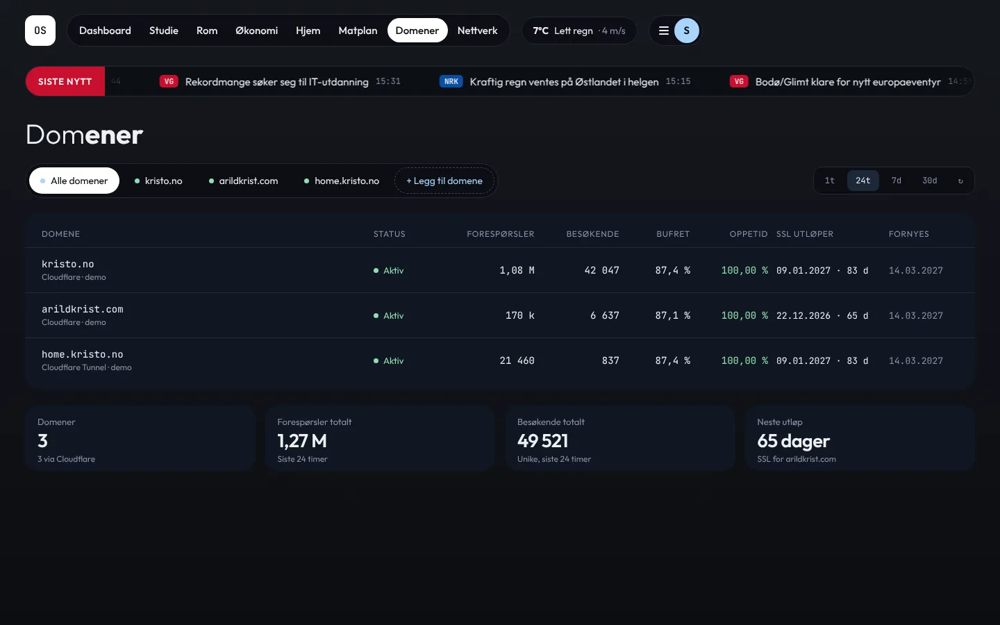
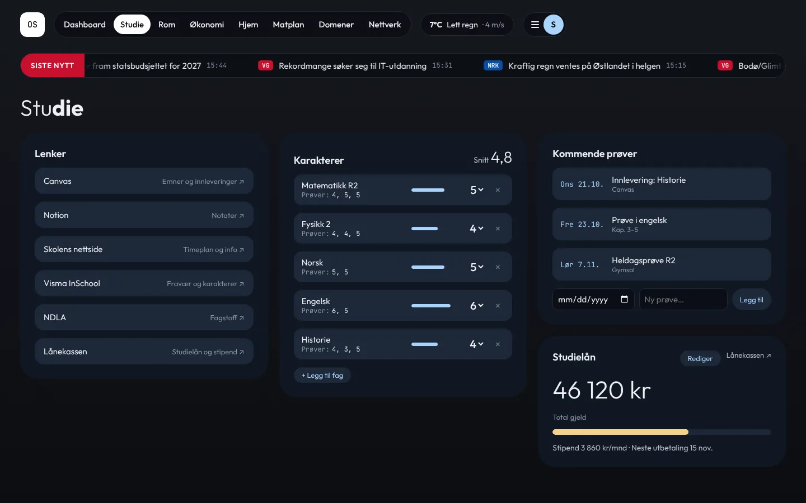
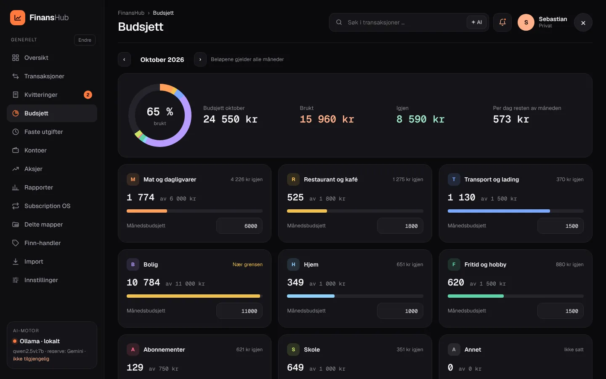
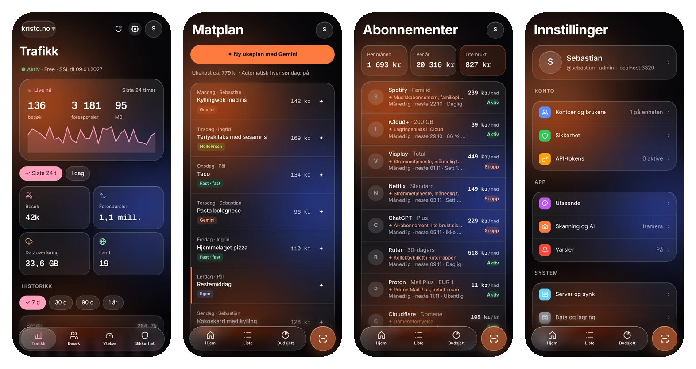
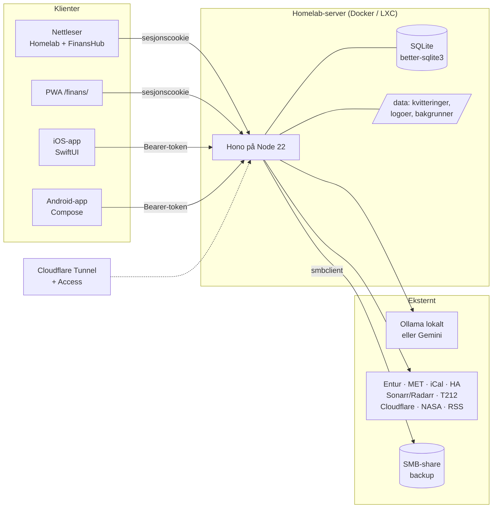

<p align="center">
  
</p>

<p align="center">
  <a href="https://github.com/SebastianKristo/torskenes-verden/actions/workflows/docker.yml"></a>
  <a href="https://github.com/SebastianKristo/torskenes-verden/actions/workflows/mobile.yml"></a>
  
  
  
  
  
</p>

<p align="center">
  <b>Et selvhostet «operativsystem» for hjemmet</b>: et dashboard for hverdagen, en komplett økonomiapp med AI-lesing av kvitteringer, og native apper for iPhone, Android og brettbare telefoner. Alt kjører på din egen server, og nøklene forlater den aldri.
</p>

<p align="center">
  <a href="#-kom-i-gang">Kom i gang</a> ·
  <a href="#-funksjoner">Funksjoner</a> ·
  <a href="#-skjermbilder">Skjermbilder</a> ·
  <a href="#-dokumentasjon">Dokumentasjon</a> ·
  <a href="apps/README.md">Mobilapper</a>
</p>

<p align="center">
  
</p>

---

## ✨ Funksjoner

<table>
<tr>
<td width="50%" valign="top">

###  Homelab-dashboard
Ruter-avganger i sanntid, vær fra yr, skoletime og kalender fra iCal, Trading 212, strøm fra Home Assistant, «Kommer ut» fra Sonarr og Radarr, og en nyhetslinje fra NRK og VG. Kortene kan flyttes og endre størrelse, og topplinjen kan dras fritt.

</td>
<td width="50%" valign="top">

###  FinansHub
Transaksjoner, budsjett, faste utgifter, kontoer og rapporter. Kvitteringer leses av **Ollama** (lokalt) eller **Gemini** og matches mot banken. Ingenting bokføres før du trykker «Bokfør».

</td>
</tr>
<tr>
<td valign="top">

###  ✦ AI-søk og sammendrag
Spør på vanlig norsk, for eksempel «hvor mye brukte jeg på strøm i september?». Søket går gjennom transaksjoner, kvitteringer og varelinjer. Svaret viser hvilke poster det bygger på, og tall som ikke finnes i dataene blir forkastet.

</td>
<td valign="top">

###  Aksjer, abonnementer og bolig
Portefølje, ordrer og utbytte fra **Trading 212**. **Subscription OS** samler abonnementer (månedlig, årlig og hvert 2. år). **Delte mapper** er et dashboard per bolig med prosjekter, avdrag, regninger og fordeling mellom brukere.

</td>
</tr>
<tr>
<td valign="top">

###  Hjem ·  Matplan ·  Domener
Boligverdi, lån og inventar med garanti. Matplan med AI-forslag, faste retter, kokker, handleliste og kalenderfeed. Domenestatistikk fra Cloudflare, Plausible eller Umami med verdenskart, sikkerhet og oppetid.

</td>
<td valign="top">

###  Mobilapper
Native **SwiftUI** (iOS 26 Liquid Glass) og **Jetpack Compose** (Material 3 Expressive), med to paneler på brettbare. Har kamera som åpner med én gang, opplastingskø, flere kontoer og biometrisk lås. Finnes også som PWA.

</td>
</tr>
<tr>
<td valign="top">

###  Brukere og tofaktor
Flere brukere med rollene admin og bruker, innlogging med brukernavn og **TOTP-2FA** med gjenopprettingskoder. Pålitelige enheter slipper passord bare på lokalt nett. API-tokens har egne tilganger og utløp.

</td>
<td valign="top">

###  Backup og gjenoppretting
Full backup som JSON, en Excel-database med ett ark per tabell, eller CSV. Automatisk og kryptert backup (AES-256-GCM) til en **SMB-share**, med versjoner. En ny installasjon kan hentes rett fra backupen.

</td>
</tr>
</table>

## 🚀 Kom i gang

**Prøv lokalt med eksempeldata.** Ingen API-nøkler trengs:

```bash
git clone https://github.com/SebastianKristo/torskenes-verden.git && cd torskenes-verden
npm install
cp .env.example .env
npm run hash-password -- 'velg-et-godt-passord'   # lim linja inn i .env
echo "SESSION_SECRET=$(openssl rand -hex 32)" >> .env
echo "COOKIE_SECURE=false" >> .env                 # bare lokalt uten HTTPS
MOCK_DATA=1 npm run dev
```

Åpne <http://localhost:3000> og logg inn som `sebastian` (eller `USER_NAME` med små bokstaver).

**Installer på homelab.** Velg én av disse:

| | Metode | Kommando / fremgangsmåte |
|---|---|---|
|  | **Proxmox (anbefalt)** | Kjør på Proxmox-verten som root:<br>`bash -c "$(curl -fsSL https://raw.githubusercontent.com/SebastianKristo/torskenes-verden/main/deploy/proxmox/install.sh)"` |
|  | **Docker Compose** | `docker compose --profile tunnel up -d --build` |
|  | **Unraid** | Mal i [`deploy/unraid/homelab-os.xml`](deploy/unraid/homelab-os.xml), med image fra GHCR |

Hele fremgangsmåten, med Cloudflare Tunnel og Access, oppdatering og feilsøking, står i **[docs/installasjon.md](docs/installasjon.md)**.

> [!TIP]
> Oppdater en Proxmox-installasjon med
> `bash -c "$(curl -fsSL https://raw.githubusercontent.com/SebastianKristo/torskenes-verden/main/deploy/proxmox/update.sh)"`.
> Skriptet trenger ikke git, og rører ikke `.env` eller `data/`.

## 📸 Skjermbilder

<details open>
<summary><b>Homelab</b></summary>
<br>

| Dashboard | Domener |
|---|---|
|  |  |
| **Hjem (Home OS)** | **Matplan** |
|  |  |
| **Studie** | **Innlogging, brukere og 2FA** |
|  |  |

</details>

<details open>
<summary><b>FinansHub</b></summary>
<br>

| Oversikt | ✦ AI-søk |
|---|---|
|  |  |
| **Kvitteringer** | **Aksjer (Trading 212)** |
|  |  |
| **Delte mapper (bolig)** | **Subscription OS** |
|  |  |
| **Budsjett** | **Backup og data** |
|  |  |

</details>

<details open>
<summary><b>Mobil</b></summary>
<br>

**iPhone: Liquid Glass**


**Android: Material 3 Expressive**


**Moduler: Domener, Matplan, Abonnementer og Innstillinger**


**Brettbar: navigasjonsrail og to paneler**


</details>

> Skjermbildene er tatt med `MOCK_DATA=1`, så alle tall og navn er eksempeldata.

## 📚 Dokumentasjon

| | Side | Innhold |
|---|---|---|
|  | [Installasjon](docs/installasjon.md) | Lokalt, Docker, Cloudflare Tunnel/Access, Proxmox, Unraid, oppdatering, feilsøking |
|  | [Konfigurasjon](docs/konfigurasjon.md) | Alle miljøvariabler og innstillingene i grensesnittet |
|  | [Homelab](docs/homelab.md) | Faner, widgets, topplinje, nyhetslinje, layout, Hjem, Matplan, Domener |
|  | [FinansHub](docs/finanshub.md) | Sider, kvitteringsflyt, AI, import, aksjer, abonnementer, delte mapper, Finn |
|  | [Sikkerhet](docs/sikkerhet.md) | Brukere, roller, 2FA, pålitelige enheter, tokens, hemmeligheter |
|  | [Backup](docs/backup.md) | Eksport, SMB-share, kryptering, gjenoppretting, ny installasjon |
|  | [API](docs/api.md) | Alle endepunkter, autentisering og eksempler (iOS-snarvei, curl) |
|  | [Mobilapper](apps/README.md) | Bygg, innlogging, sideloading av IPA, APK |
|  | [Utvikling](docs/utvikling.md) | Arkitektur, mappestruktur, tester, CI, eksempeldata |
|  | [Beslutninger](DECISIONS.md) | Hvorfor ting er laget som de er |

## 🧱 Teknologi



- **Server:** Node 22, [Hono](https://hono.dev), better-sqlite3, node-ical, undici, satellite.js og d3-geo. Ingen byggesteg.
- **Nettleser:** vanilla ES-moduler, med egne temaer for desktop, iOS (Liquid Glass) og Android (Material 3).
- **Mobil:** SwiftUI med iOS 17+ og Liquid Glass på iOS 26, Kotlin og Jetpack Compose med Material 3.
- **Drift:** Docker med PUID/PGID, Cloudflare Tunnel, Proxmox-skript, Unraid-mal, og et image på GHCR fra GitHub Actions.

## 🗂️ Struktur

```
server/            Hono-app: innlogging, homelab-API, integrasjoner, Hjem/Matplan/Domener
server/finans/     FinansHub: database, API, AI, import, søk, aksjer, backup
public/            Homelab-grensesnittet (app.html, js/, css/) og CV
public/finans/     FinansHub: desktop og mobil-PWA
apps/android/      Native Android-app (Kotlin, Compose)
apps/ios/          Native iOS-app (SwiftUI, XcodeGen)
deploy/            Proxmox-skript og Unraid-mal
docs/              Dokumentasjon, skjermbilder og ikoner
test/              node --test
```

## 🛡️ Kort om sikkerhet

- Bare `/login`, `/cv` og statiske filer er offentlige. Resten krever innlogging.
- Passord hashes med scrypt. TOTP-hemmeligheter og API-nøkler lagres kryptert, og nøkler sendes aldri tilbake til nettleseren.
- Bruk Cloudflare Tunnel i stedet for portviderekobling. Detaljene står i [docs/sikkerhet.md](docs/sikkerhet.md).

---

<p align="center"><sub>Bygget med Node, SQLite og mye kaffe ☕</sub></p>
