<p align="center">
  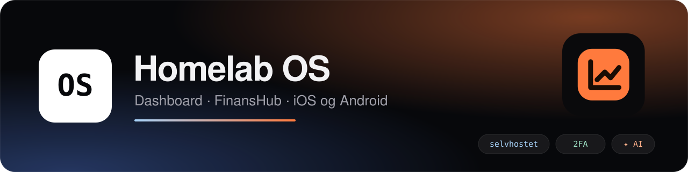
</p>

<p align="center">
  <a href="https://github.com/SebastianKristo/torskenes-verden/actions/workflows/docker.yml"></a>
  <a href="https://github.com/SebastianKristo/torskenes-verden/actions/workflows/mobile.yml"></a>
  
  
  
  
  
  <a href="https://sebastiankristo.github.io/torskenes-verden/"></a>
</p>

<p align="center">
  <b>Et selvhostet «operativsystem» for hjemmet.</b> Du får et dashboard for hverdagen, en komplett økonomiapp med AI-lesing av kvitteringer, og native apper for iPhone, Android og brettbare telefoner. Alt kjører på din egen server, og nøklene forlater den aldri.
</p>

<p align="center">
  <a href="#-kom-i-gang-på-5-minutter">Kom i gang</a> ·
  <a href="#-funksjoner">Funksjoner</a> ·
  <a href="#-skjermbilder">Skjermbilder</a> ·
  <a href="#-mobilappene">Mobilapper</a> ·
  <a href="#-oppdatering-og-backup">Oppdatering</a> ·
  <a href="https://sebastiankristo.github.io/torskenes-verden/"><b>Dokumentasjon</b></a> ·
  <a href="https://github.com/SebastianKristo/torskenes-verden/wiki">Wiki</a>
</p>

<p align="center">
  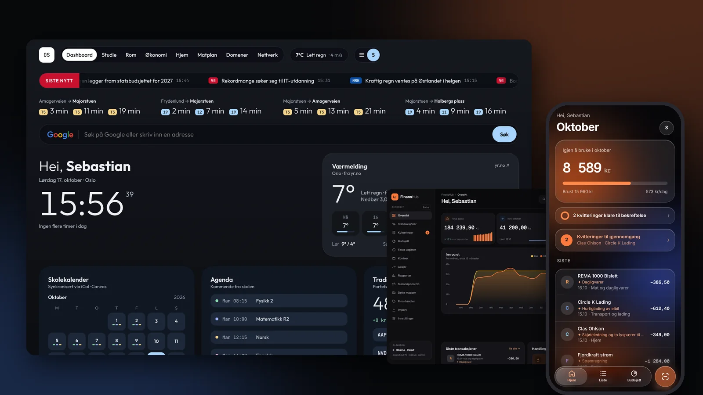
</p>

---

## 🏠 Hva er dette?

Homelab OS er én Node-tjeneste (Hono og SQLite) som du kjører i Docker på en Proxmox-LXC, en NAS eller en hvilken som helst Linux-maskin. Den gir deg:

- **Homelab-dashboardet** i nettleseren: avganger, vær, skoletimeplan, pakker, familie, huskeliste og mye mer.
- **FinansHub** på `/finans/`: regnskap, kvitteringer, budsjett, abonnementer, aksjer, Finn-handler og boliger.
- **Mobilapper** for iOS (SwiftUI) og Android (Jetpack Compose), og en PWA for alle andre.

Hver bruker har sine egne data. Bare Boliger deles, og bare med dem du inviterer. Alle tekster er på norsk.

## ✨ Funksjoner

<table>
<tr>
<td width="50%" valign="top">

###  Hjem og dashboard
Avganger fra Entur i sanntid, vær fra MET/Yr, nyheter fra NRK, VG og E24, strøm fra Home Assistant og «Kommer ut» fra Sonarr og Radarr. Kortene kan flyttes og skjules. Velg mellom temaet «Nåværende» og **Papir** («Vindu og papir»), med bakgrunn fra været, NASA-planeter eller Oslo-foto.

</td>
<td width="50%" valign="top">

###  FinansHub
Kontoer, transaksjoner, budsjett, faste utgifter og rapporter. Kvitteringer leses av AI (Gemini, Groq eller Ollama) eller lokal OCR, matches mot banken og venter på at du trykker **Bokfør**. Temaene er Lys hovedbok (standard), Mørk hovedbok, Glød og v2.

</td>
</tr>
<tr>
<td valign="top">

###  Kalender
Skoletimeplanen fra skolens iCal og Canvas, sammen med Bursdager og Google Kalender. Kortet «Nå» viser timen, rommet og læreren, og «Prøver og frister» har nedtelling. Visningene er Uke, Måned og Agenda, og det finnes widgets på iPhone, Android og Samsung.

</td>
<td valign="top">

### 🎂 Bursdager
Neste bursdag, alder og dager igjen, med påminnelse kl. 09:00. Synkes med Google Kalender (også bursdager fra kontakter) og Home Assistant. Det finnes widgets på Hjem, iOS og Android.

</td>
</tr>
<tr>
<td valign="top">

### 📍 Familie og kart
Posisjon i sanntid med spor, fart og batteri. Soner med ikon og farge gir varsel når noen kommer eller går, og helsedata kan hentes fra Apple Health eller Health Connect. **Deling er av som standard.** Du ser bare dem som deler med deg.

</td>
<td valign="top">

### 📦 Sporing
Pakker fra Posten/Bring, PostNord, DHL, UPS, Helthjem, Budbee, Instabox og flere. Sporingsnumre hentes automatisk fra e-post og Finn. Status kommer fra Mybring, PostNord og ParcelsApp, og du kan selv velge tjeneste med «Spor via».

</td>
</tr>
<tr>
<td valign="top">

### 🌦️ Vær
Egen værside med timer, 7 dager, vind, UV, sol og måne, og detaljark med grafer. «Yr og Pent» sammenligner Yr med en StormGeo-modell, og kartknappen åpner Windy. Bakgrunnen er animert etter været.

</td>
<td valign="top">

### ✅ Huskeliste
Lister med forfall og hvem som gjør hva. Eieren kan dele en liste med utvalgte personer, endringer kommer i sanntid, og listene kan synkes begge veier med Home Assistant To-do.

</td>
</tr>
<tr>
<td valign="top">

###  Boliger
Et dashboard per bolig med budsjett, prosjekter, avdrag, regninger og utgifter til godkjenning. Skann en kvittering rett inn i en bolig fra mobilen. Boliger er det eneste som deles mellom brukere.

</td>
<td valign="top">

###  ✦ AI og tidsgrenser
Gemini med flere nøkler som reserve, Groq, Ollama lokalt og Roboflow. Under «Hvem gjør hva» velger du motor per oppgave. Hver motor har sin egen tidsgrense. Lange AI-søk kjøres som jobb med fremdrift og Avbryt, og Ollama strømmer svaret.

</td>
</tr>
<tr>
<td valign="top">

###  Brukere, profiler og 2FA
Rollene er admin og bruker, og alle har **sine egne data**, også andre admins. Innlogging skjer med brukernavn og TOTP-2FA. Profilene er Standard, Finans + Boliger og Boliger-profil. App-tokens har egne tilganger og utløp.

</td>
<td valign="top">

###  Mobilapper
Papir-design, likt på iOS og Android. Appene har kamera som åpner med én gang, opplastingskø, flere kontoer, biometrisk lås, widgets (også Samsung One UI) og sidelinje på Fold og iPad. På Android kan du bytte app-ikon og app-navn.

</td>
</tr>
<tr>
<td valign="top">

###  Mat ·  Domener ·  Aksjer
Ukeplan med AI-forslag, faste retter og handleliste. Domenestatistikk fra Cloudflare med verdenskart og oppetid. Portefølje og utbytte fra Trading 212. Abonnementer samles i Subscription OS.

</td>
<td valign="top">

###  Backup
Full backup som JSON, Excel eller CSV. Automatisk og kryptert backup (AES-256-GCM) til en SMB-share, med versjoner. En ny installasjon kan hentes rett fra backupen.

</td>
</tr>
</table>

## 📸 Skjermbilder

> Alle skjermbildene er tatt med `MOCK_DATA=1`, så alle tall, navn og pakker er eksempeldata.

<details open>
<summary><b>Desktop (1440 × 900)</b></summary>
<br>

| Homelab-dashboardet (Papir) | FinansHub (Lys hovedbok) |
|---|---|
|  |  |
| **Kalender** | **Familie og kart** |
|  |  |
| **Innstillinger → Integrasjoner** | **Innlogging** |
| 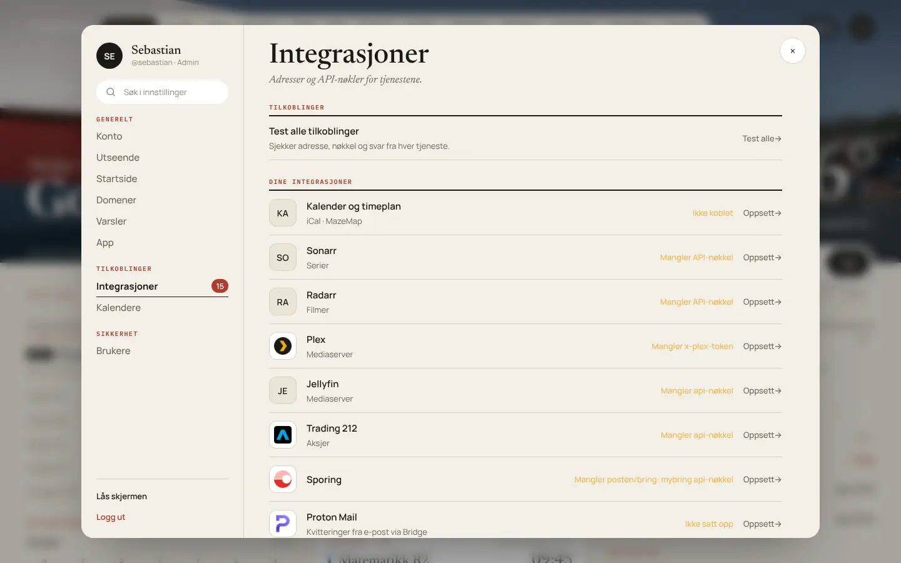 | 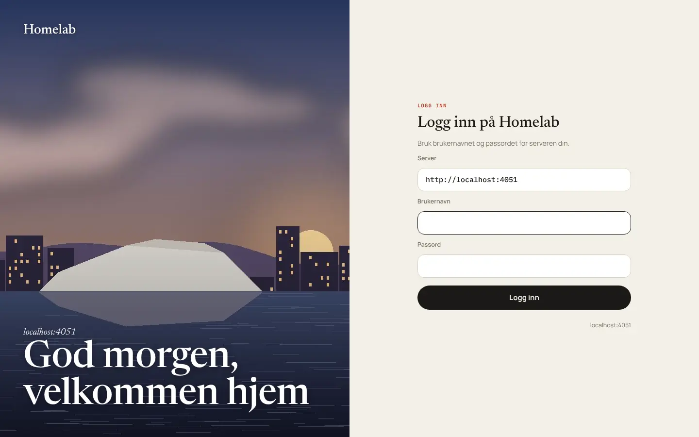 |
| **Sporing** | **Bursdager** |
| 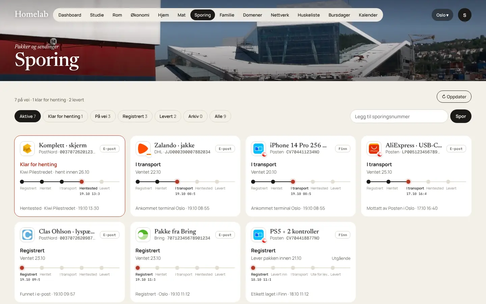 | 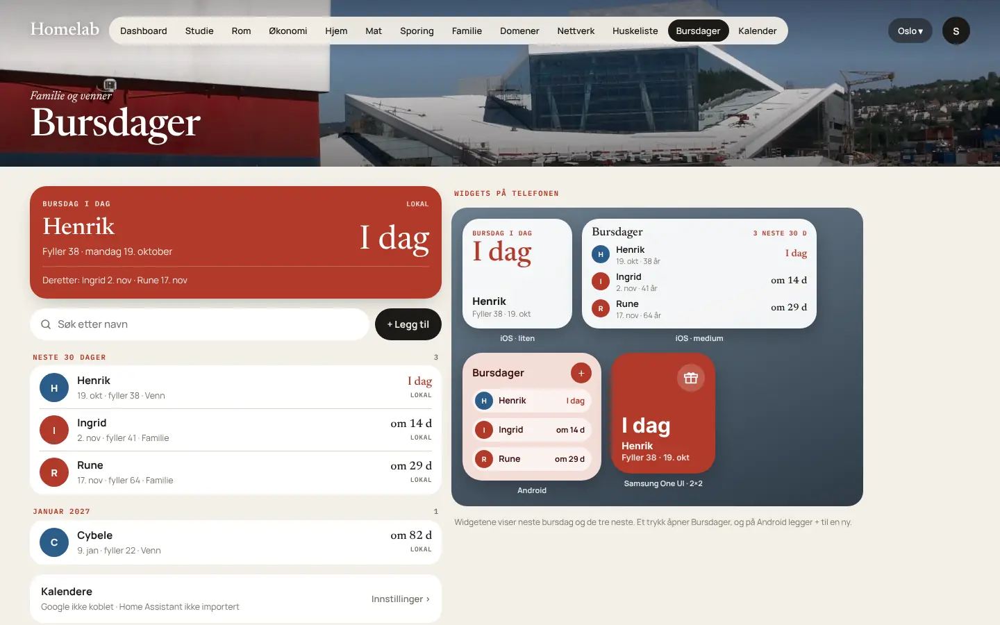 |
| **Kvitteringer** | **Boliger** |
|  | 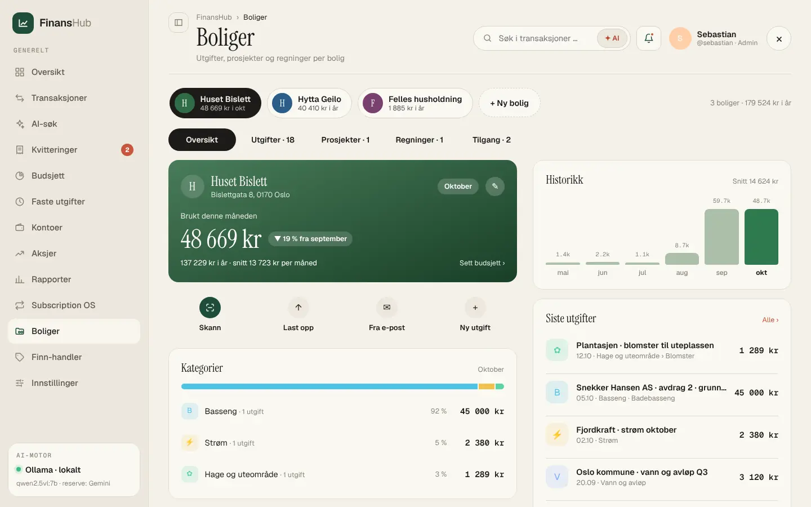 |

</details>

<details open>
<summary><b>Mobil (PWA i Papir-design, 390 × 844)</b></summary>
<br>

| Hjem | Finans | Kalender | Bursdager |
|:-:|:-:|:-:|:-:|
|  | 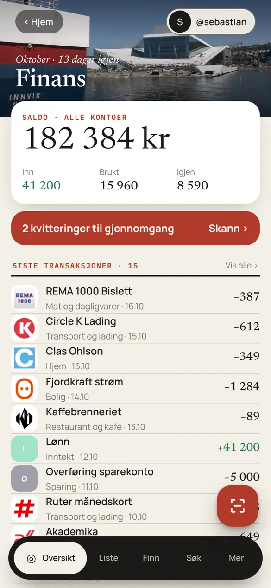 | 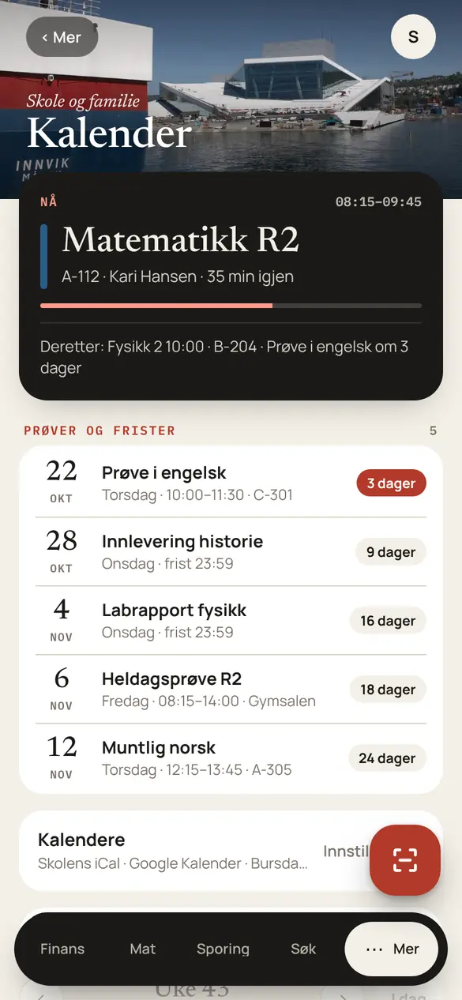 |  |
| **Sporing** | **Vær** | **Familie** | **Integrasjoner** |
|  | 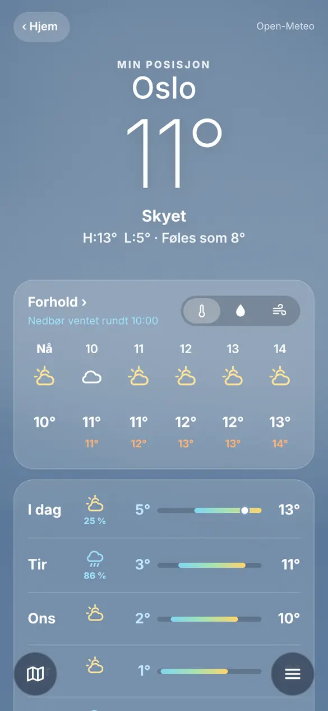 | 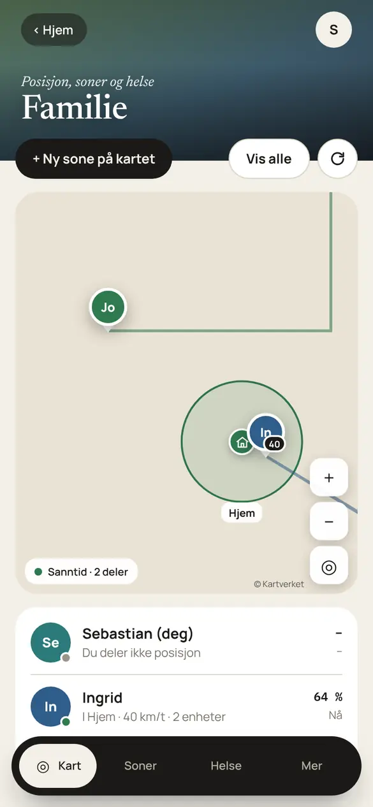 | 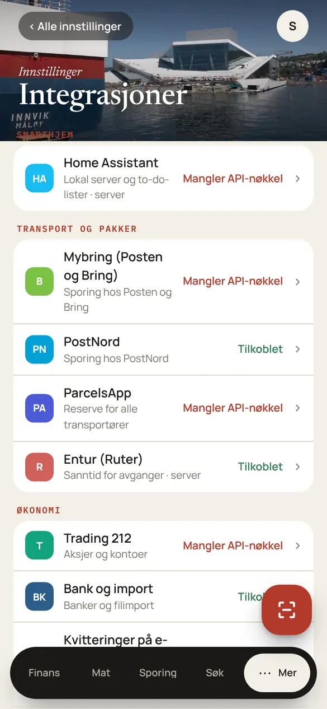 |

**Galaxy Fold og iPad:** fanelinjen blir en sidelinje til venstre.

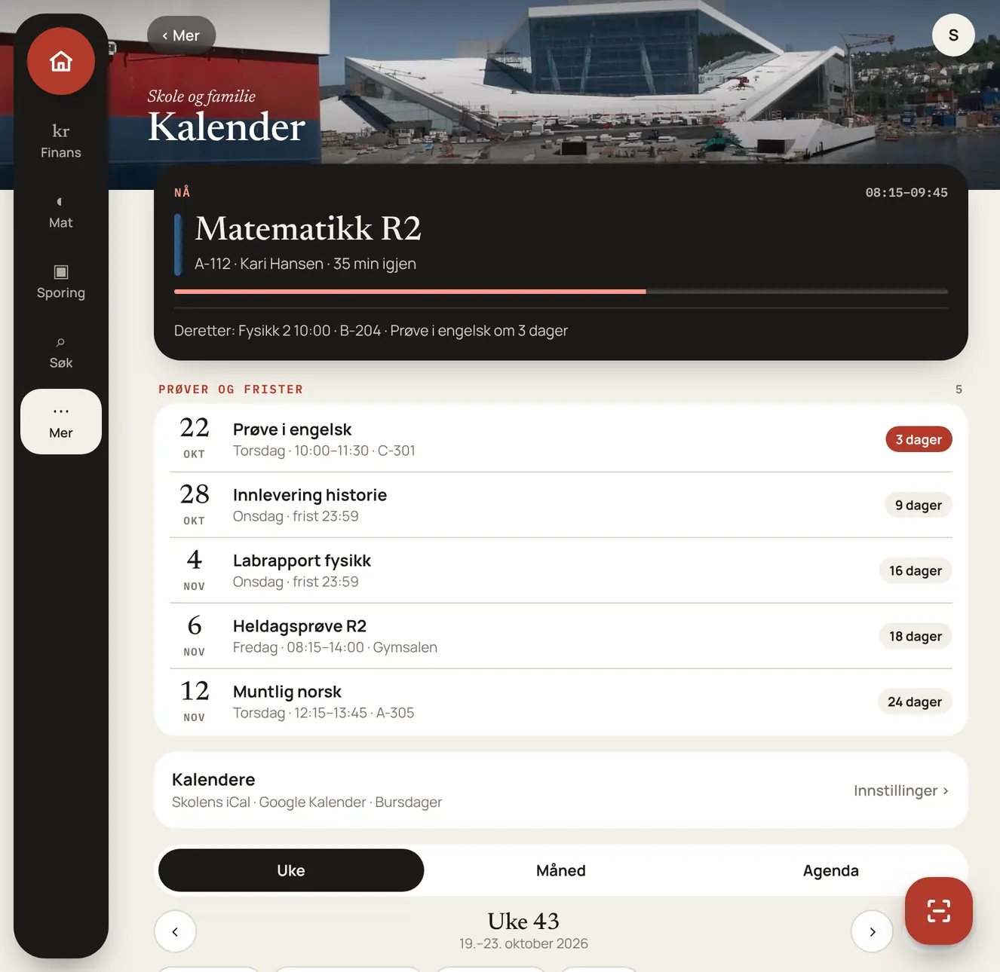

</details>

## 🚀 Kom i gang på 5 minutter

Du trenger en Linux-maskin med Docker og Docker Compose. Se [Installasjon](https://github.com/SebastianKristo/torskenes-verden/wiki/Installasjon) i wikien for Proxmox, Unraid og Cloudflare Tunnel.

**1. Hent koden og lag `.env`**

```bash
git clone https://github.com/SebastianKristo/torskenes-verden.git /opt/homelab-os
cd /opt/homelab-os
cp .env.example .env
sed -i "s/^SESSION_SECRET=.*/SESSION_SECRET=$(openssl rand -hex 32)/" .env
```

`.env.example` inneholder eksempelverdier for integrasjonene. De kan stå som de er, eller tømmes. Alt kan endres senere i Innstillinger → Integrasjoner.

**2. Velg hvordan serveren skal nås.** Endre `.env`, enten med en editor eller med kommandoene under:

```bash
# A) Bare fra LAN med http (uten Cloudflare Tunnel):
echo "BIND_ADDR=0.0.0.0" >> .env
sed -i "s/^COOKIE_SECURE=.*/COOKIE_SECURE=false/" .env

# B) Med Cloudflare Tunnel (https): la COOKIE_SECURE=true stå, og lim inn tokenet:
sed -i "s/^CLOUDFLARE_TUNNEL_TOKEN=.*/CLOUDFLARE_TUNNEL_TOKEN=eyJhIjoi.../" .env
```

**3. Start**

```bash
docker compose up -d --build                     # bare appen, port 3000
docker compose --profile tunnel up -d --build    # med Cloudflare Tunnel
```

Sjekk at den svarer: `curl http://localhost:3000/healthz` skal gi `ok`.

**4. Førstegangsoppsett i nettleseren.** Åpne `http://<serverens-ip>:3000`, eller domenet ditt. Når `APP_PASSWORD_HASH` er tom og det ikke finnes noen brukere, får du et oppsett i fire steg: navnet ditt, navnet på serveren, brukernavn og passord (minst 8 tegn), og bakgrunn. Du blir hovedadmin.

> [!TIP]
> Vil du heller lage eier-kontoen fra `.env`, kjør
> `docker compose run --rm --entrypoint node os scripts/hash-password.js 'passord'` og lim linja inn i `.env` før første start.
> Brukernavnet blir `USER_NAME` med små bokstaver.

**5. Etter innlogging:**
- **Innstillinger → Integrasjoner:** nøkler for AI, Home Assistant, Entur, sporing og andre tjenester. Se [Integrasjoner](https://github.com/SebastianKristo/torskenes-verden/wiki/Integrasjoner).
- **Innstillinger → Kalendere:** skole-iCal, Canvas og Google Kalender.
- **Innstillinger → Konto / Brukere:** slå på 2FA og legg til familien.
- **`/finans/`:** første gang velger du Start tom, Hent fra SMB-share, Last opp backupfil eller Eksempeldata.

**6. Logg inn i appene.** Skriv inn serveradressen, for eksempel `https://os.example.no` eller `http://192.168.1.60:3000`, og deretter brukernavn, passord og eventuell 2FA-kode. Appen bytter innloggingen mot et eget app-token (`fh_pat_…`), og passordet lagres ikke.

**Bare prøve lokalt?** Ingen nøkler trengs:

```bash
npm install
cp .env.example .env
sed -i "s/^SESSION_SECRET=.*/SESSION_SECRET=$(openssl rand -hex 32)/; s/^COOKIE_SECURE=.*/COOKIE_SECURE=false/" .env
MOCK_DATA=1 npm run dev        # http://localhost:3000, eksempeldata
```

## 📱 Mobilappene

| Plattform | Fil | Slik installerer du |
|---|---|---|
|  **Android** | `FinansHub-<versjon>.apk` | Last ned fra [Releases](https://github.com/SebastianKristo/torskenes-verden/releases), tillat «Installer ukjente apper» for nettleseren eller filbehandleren, og åpne filen. Nye versjoner installeres over den gamle. |
|  **iPhone / iPad** | `FinansHub-<versjon>-unsigned.ipa` | Åpne filen i [AltStore](https://altstore.io), [SideStore](https://sidestore.io) eller [Sideloadly](https://sideloadly.io) med din Apple-ID. Med gratis Apple-ID må signaturen fornyes hver 7. dag. AltStore og SideStore gjør det automatisk. |
| 🌐 **PWA** | – | Åpne `https://<din adresse>/finans/` i Safari eller Chrome og velg «Legg til på Hjem-skjerm». |

> [!WARNING]
> **Apple Health og sideloading:** sideloading-verktøy med gratis Apple-ID kan fjerne HealthKit fra signaturen. Feiler installasjonen, velg «Remove entitlements» i Sideloadly. Appen virker da som vanlig, men den får ikke spørre om tilgang til Apple Health. Under Innstillinger → App ser du hvorfor. Android bruker Health Connect og har ikke denne begrensningen.

Mer om widgets, Fold, app-ikon og Health Connect står i [Mobilapper](https://github.com/SebastianKristo/torskenes-verden/wiki/Mobilapper) og i [apps/README.md](apps/README.md).

## 🔄 Oppdatering og backup

> [!IMPORTANT]
> **Ta backup før oppdatering.** Databasen migreres automatisk ved oppstart, og noen versjoner (for eksempel 4.18) bygger den om. Gå til **FinansHub → Innstillinger → Backup og data → Ta backup nå** eller **Full backup (.json)**, eller kopier `data/`.

| Oppsett | Backup først | Oppdater |
|---|---|---|
| **Docker Compose** | `docker compose stop && tar czf ~/homelab-data-$(date +%F).tgz data .env && docker compose start` | `git pull && docker compose up -d --build` (legg til `--profile tunnel` hvis du bruker tunnel) |
| **Proxmox (LXC)** | `pct snapshot <ctid> for-oppdatering` | Kjør på verten: `bash -c "$(curl -fsSL https://raw.githubusercontent.com/SebastianKristo/torskenes-verden/main/deploy/proxmox/update.sh)"` |
| **Unraid** | Kopier `/mnt/user/appdata/homelab-os` | *Check for updates* på containeren |

[`deploy/proxmox/update.sh`](deploy/proxmox/update.sh) finner containeren `homelab-os` selv. Er navnet endret, sett `CTID=<id>` foran kommandoen. Skriptet laster ned koden som en tarball, bygger på nytt og rører ikke `.env` eller `data/`.

Gjenoppretting, SMB-backup og migreringer står i [Oppdatering og backup](https://github.com/SebastianKristo/torskenes-verden/wiki/Oppdatering-og-backup).

## 📚 Dokumentasjon

**[Dokumentasjonssiden](https://sebastiankristo.github.io/torskenes-verden/)** samler alt under med søk, faner og mørkt tema.

**Wikien** har guider med eksempler:

| | Side | Innhold |
|---|---|---|
|  | [Installasjon](https://github.com/SebastianKristo/torskenes-verden/wiki/Installasjon) | Docker, `.env`, porter, reverse proxy, Cloudflare Tunnel, førstegangsoppsett |
|  | [Oppdatering og backup](https://github.com/SebastianKristo/torskenes-verden/wiki/Oppdatering-og-backup) | `update.sh`, backup, gjenoppretting, migreringer |
|  | [Brukere og personvern](https://github.com/SebastianKristo/torskenes-verden/wiki/Brukere-og-personvern) | Roller, egne data per bruker, hva som deles |
|  | [Mobilapper](https://github.com/SebastianKristo/torskenes-verden/wiki/Mobilapper) | APK/IPA, app-token, widgets, Fold, Apple Health, Health Connect |
|  | [Integrasjoner](https://github.com/SebastianKristo/torskenes-verden/wiki/Integrasjoner) | Steg for steg for hver tjeneste |
|  | [FinansHub](https://github.com/SebastianKristo/torskenes-verden/wiki/FinansHub) | Kontoer, import, kvitteringer, budsjett, Boliger, AI-søk |
|  | [Kalender og Bursdager](https://github.com/SebastianKristo/torskenes-verden/wiki/Kalender-og-Bursdager) | Skole-iCal, Canvas, Google, widgets |
|  | [Sporing](https://github.com/SebastianKristo/torskenes-verden/wiki/Sporing) · [Familie og kart](https://github.com/SebastianKristo/torskenes-verden/wiki/Familie-og-kart) | Pakker, soner, posisjon og helse |
|  | [AI og tidsgrenser](https://github.com/SebastianKristo/torskenes-verden/wiki/AI-og-tidsgrenser) | Motorer, «Hvem gjør hva», jobber, Ollama |
|  | [API](https://github.com/SebastianKristo/torskenes-verden/wiki/API) | curl-eksempler med app-token, sanntid |
|  | [Feilsøking](https://github.com/SebastianKristo/torskenes-verden/wiki/Feilsøking) | Vanlige feil og løsninger |

**Referanse i repoet:** [installasjon](docs/installasjon.md) · [konfigurasjon (alle miljøvariabler)](docs/konfigurasjon.md) · [homelab](docs/homelab.md) · [finanshub](docs/finanshub.md) · [sikkerhet](docs/sikkerhet.md) · [backup](docs/backup.md) · [api](docs/api.md) · [utvikling](docs/utvikling.md) · [apps](apps/README.md) · [beslutninger](DECISIONS.md) · [endringslogg](CHANGELOG.md)

## 🧱 Teknologi

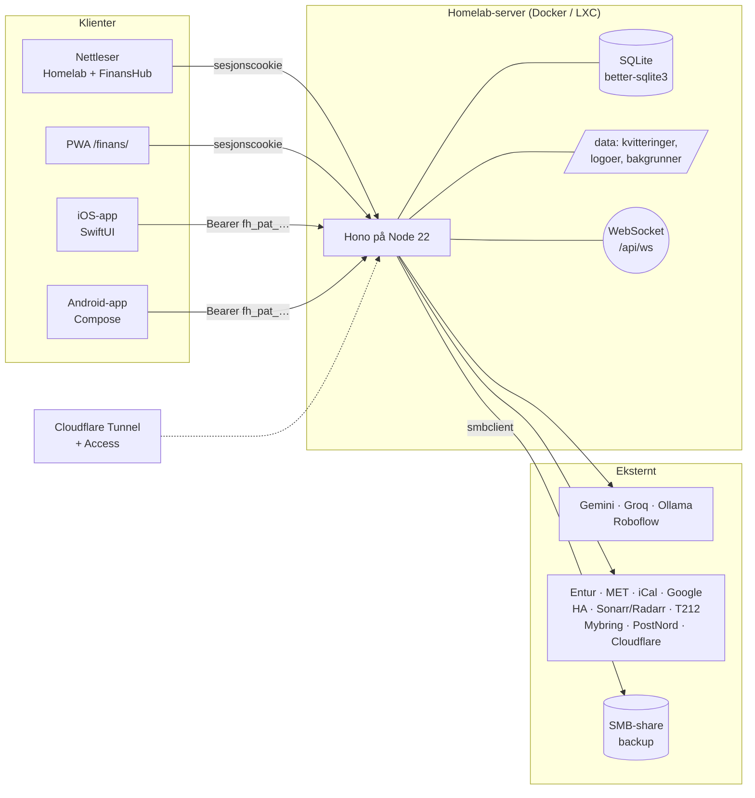

- **Server:** Node 22, [Hono](https://hono.dev), better-sqlite3 og ws. Ingen byggesteg.
- **Nettleser:** vanilla ES-moduler. Temaene er Nåværende og Papir på Homelab, og fire temaer i FinansHub.
- **Mobil:** SwiftUI (iOS 17+, Liquid Glass på iOS 26) og Kotlin med Jetpack Compose (Material 3, Glance-widgets).
- **Drift:** Docker med PUID/PGID, Cloudflare Tunnel, Proxmox-skript, Unraid-mal og image på GHCR.

## 🗂️ Struktur

```
server/            Hono-app: innlogging, homelab-API, integrasjoner, Kalender, Sporing, Familie, Bursdager
server/finans/     FinansHub: database, API, AI, import, søk, aksjer, Boliger, backup
public/            Homelab-grensesnittet (app.html, js/, css/) og CV
public/finans/     FinansHub: desktop og mobil-PWA
apps/android/      Native Android-app (Kotlin, Compose)
apps/ios/          Native iOS-app (SwiftUI, XcodeGen)
deploy/            Proxmox-skript (install.sh, update.sh), Unraid-mal, Proton Mail Bridge
docs/              Dokumentasjon, skjermbilder, ikoner og wiki (docs/wiki)
test/              node --test
```

## 🛡️ Kort om sikkerhet

- Bare `/login`, `/cv` og statiske filer er offentlige. Resten krever innlogging eller et app-token.
- Passord hashes med scrypt. TOTP-hemmeligheter og API-nøkler lagres kryptert, og nøkler sendes aldri tilbake til nettleseren.
- Bruk Cloudflare Tunnel i stedet for portviderekobling. Detaljene står i [docs/sikkerhet.md](docs/sikkerhet.md).

---

<p align="center"><sub>Bygget med Node, SQLite og mye kaffe ☕</sub></p>
