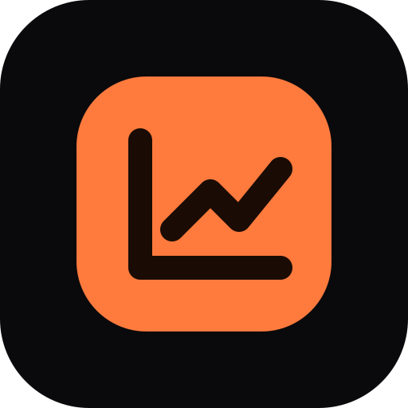
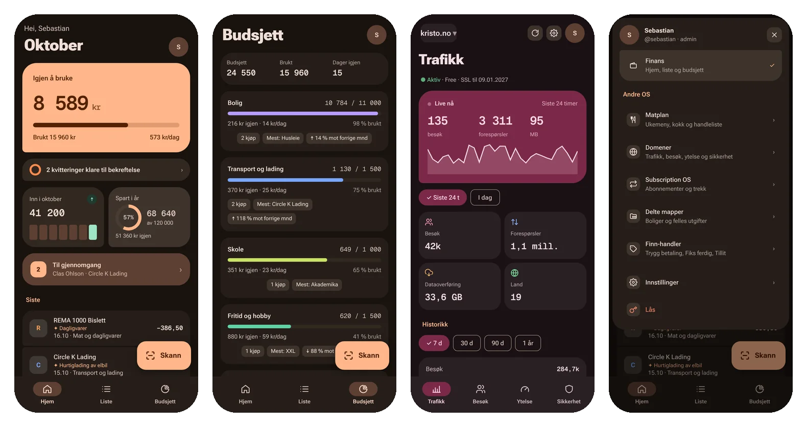
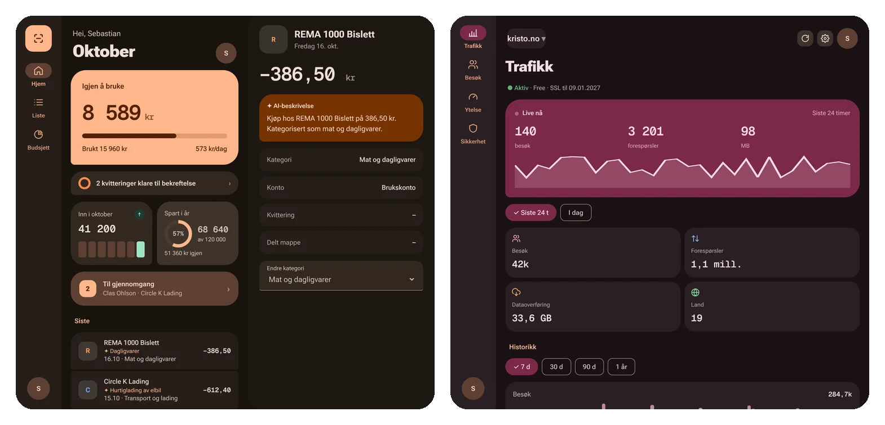

<p align="center"></p>

<h1 align="center">FinansHub – native apper</h1>

<p align="center">
  <a href="https://github.com/SebastianKristo/torskenes-verden/actions/workflows/mobile.yml"></a>
  
  
</p>

<p align="center"><a href="../README.md">← Til hovedsiden</a> · <a href="https://github.com/SebastianKristo/torskenes-verden/wiki/Mobilapper">Brukerveiledning i wikien</a> (installasjon, widgets, Apple Health og Health Connect)</p>





<sub>Skjermbildene er fra web-appen (PWA) med eksempeldata. De native appene følger samme design.</sub>

## Last ned

| Plattform | Fil | Slik installerer du |
|---|---|---|
|  Android | `FinansHub-android` (APK) | Åpne siste kjøring under [Actions → Mobilapper](https://github.com/SebastianKristo/torskenes-verden/actions/workflows/mobile.yml), last ned artefakten, pakk ut og åpne `.apk` på telefonen. Du må tillate «ukjente apper». |
|  iOS | `FinansHub-ios-unsigned` (.ipa) | Signer og installer med AltStore, SideStore eller Sideloadly, se [iOS: .ipa for sideloading](#ios-ipa-for-sideloading). |

Begge appene er rene FinansHub-klienter. De snakker bare med `/finans/api/*` på homelab-serveren og viser ingenting fra resten av siden.

**Innlogging:** skriv inn serveradressen (f.eks. `https://os.dittdomene.no` eller `http://192.168.1.60:3000`), brukernavn og passord. Har kontoen tofaktor, spør appen etter den 6-sifrede koden i et eget steg («Tofaktor er på for X …», med «← Tilbake»). Appen bytter innloggingen mot et eget token (`POST /finans/api/login` med `{username, password, code}`; svar 401 `{needsTotp: true}` betyr at koden mangler).
- Tokenet lagres i nøkkelringen på iOS og i kryptert lagring (Android Keystore) på Android.
- Passordet lagres ikke.
- Tokens kan trekkes tilbake i FinansHub → Innstillinger → Mobil og tilgang. «Logg ut» i appen trekker tilbake appens eget token.

## Android (`apps/android`)
- Kotlin og Jetpack Compose med Material 3 og tonal palett fra `#FF7A3D`.
- Uttrykksfulle former: ulik rundingsgrad og grupperte lister.
- Bunnmeny med en stor «Skann»-knapp.
- **Brettbare telefoner og nettbrett:** fra 600 dp bredde (`WindowSizeClass` Medium/Expanded) byttes det til navigasjonsrail med skanneknapp øverst, liste til venstre og detaljer til høyre.
- Skanning: systemkameraet (bakkamera) eller filvelger. «Del → FinansHub» fra Galleri laster opp direkte.
- Bildet roteres etter EXIF, og det sendes en nedskalert versjon (1600 px) til AI-en og et miniatyrbilde. Originalen beholdes.

Bygg: `cd apps/android && ./gradlew assembleDebug` (krever Android SDK og JDK 17). APK-en havner i `app/build/outputs/apk/debug/`.

## iOS (`apps/ios`)
- SwiftUI (iOS 17+) med Liquid Glass: `.glassEffect()` på iOS 26, ellers uskarpt materiale med lys kant.
- Flytende fanelinje med egen skanneknapp.
- **iPad:** sidefelt, liste og detaljer side om side.
- Skanning: kamera, Bilder eller Filer (også PDF).

Bygg (krever macOS med Xcode og [XcodeGen](https://github.com/yonaskolb/XcodeGen)):
```bash
cd apps/ios
brew install xcodegen
xcodegen generate
open FinansHub.xcodeproj
```
Velg ditt team under Signing & Capabilities og kjør appen på telefonen. Liquid Glass krever Xcode 26 og iOS 26.

## Mobil v3 (begge apper)
- **Flere kontoer i samme app:** «Legg til konto» (server → brukernavn/passord → 2FA-kode). Bytt aktiv konto i Innstillinger → Kontoer og brukere, eller **hold inne profilbildet** for raskt bytte. Hilsenen og avataren følger aktiv konto, og hver konto har egne data og tokens. «Logg ut andre kontoer» trekker tilbake de andre tokenene. Kontoene lagres i nøkkelringen (iOS) / kryptert med Android Keystore. Gamle innlogginger (én server + token) flyttes automatisk over.
- **Fanelinja i Finans:** Hjem, Liste og Budsjett. **Profilbildet** åpner menyen: Finans, «Andre OS» (Matplan, Domener, Subscription OS, Boliger, Finn-handler – egne skjermer i appen) og Innstillinger.
- **Skann:** trykk åpner kameraet med en gang; **hold inne** (~480 ms) gir valgene Ta bilde, Velg fra Bilder, Velg fil (PDF, JPG, HEIC) og Avbryt. Kan byttes i Innstillinger → Skanning og AI. Valgte filer går i opplastingskøen («I kø» → «Gemini leser … N %» → «Klar · trykk for å bekrefte»). Med «Last opp bare på Wi-Fi», eller uten nett, venter filene og lastes opp ved neste synk.
- **Brettbar Android / iPad:** navigasjonsrail/sidefelt med skanneknappen øverst og profilbildet nederst til venstre; på Android åpnes menyen fra venstre. Finans viser liste + detalj, modulene fyller hele skjermen.
- **Domener:** fanelinja byttes ut med Trafikk, Besøk, Ytelse og Sikkerhet, og skanneknappen skjules. Domenevelger, oppdater og tannhjul øverst. Leser `GET /domains/api/domains` og `GET /domains/api/:navn/analytics?range=…`. iPhone: mørkt glass med rosa aksent `#FF9EBE`; Android: rosa tonal palett (`#7B2949`/`#FFD9E2`, aksent `#FFB1C8`, kort `#2A2024`).
- **Innstillinger** (egen skjerm): profilkort og gruppene Konto (kontoer, sikkerhet, API-tokens), App (utseende, skanning og AI, varsler) og System (server og synk, data og lagring, om).
  - *Sikkerhet:* lås med Face ID / fingeravtrykk (kode/PIN som reserve), lås etter umiddelbart/1/5/15 min, skjul beløp i appveksleren. 2FA-status vises; oppsett (QR, gjenopprettingskoder) og pålitelige enheter åpnes i Homelab.
  - *API-tokens:* liste, «Trekk tilbake», nytt token med tilganger og utløp (30 d, 90 d, 1 år, aldri) som vises én gang med «Kopier». Krever at serveren tillater token-administrasjon med app-tokenet; ellers vises en henvisning til nettleseren.
  - *Utseende:* Fargebakgrunn (iOS, `fh_ios_bg`), startside, «Skjul beløp til jeg trykker».
  - *Server og synk:* lokal og ekstern adresse, «Bruk lokal adresse hjemme» (lokal brukes når den svarer innen 1,5 s), «Test tilkobling», aktiv vei, siste synk og serverversjon.
  - *Data og lagring:* tøm hurtigbuffer, synk nå, eksporter transaksjoner som CSV (`;`, UTF-8 med BOM). Full backup lages i FinansHub på PC.
- **iOS Liquid Glass:** standard `TabView` (får Liquid Glass automatisk på iOS 26) med `.tabBarMinimizeBehavior(.onScrollDown)` og en egen interaktiv glass-skanneknapp (`.glassEffect(.regular.tint(.orange).interactive())`). Bak `#if compiler(>=6.2)` + `#available(iOS 26, *)`, så appen bygger også med Xcode 16 / iOS 17.
- **Varsler:** valgene lagres (kvittering lest og budsjett 80 % også på serveren). Push fra serveren er ikke koblet på ennå.

## Mobil v4: Homelab-forsiden og hele FinansHub (begge apper)
- **Homelab-forsiden** (standard startside) leser `GET /api/mobile/home` med app-tokenet: klokke og vær, Google-søk, snarveier, «Andre OS»-kort (Finans, Domener, Matplan) og valgfrie widgets Serverstatus og Ruter. Google-søket viser historikk når feltet er tomt og forslag mens du skriver (`/api/search/suggest`, `/api/search/history`); adresser som `vg.no` åpnes direkte. Feil fra forsiden logger aldri ut.
- **Rediger forsiden** (profilmenyen): widgetene vugger, «−» skjuler og ▲ ▼ flytter. «+» åpner galleriet med alle widgets og redigering av fanelinjene (rekkefølge, vis/skjul; Homelab/Finans og Oversikt/Mer kan ikke skjules). Lagres lokalt per bruker og i `PUT /api/me/layout {mobile:{sec,hlTabs,finTabs,hide}}`.
- **Profilmenyen:** Homelab, Andre OS (Finans, Matplan, Domener), Rediger forsiden, Innstillinger. **Profilbilde** i Innstillinger → Kontoer og brukere: Bilder, Filer eller kamera, beskjæres til 256 × 256 JPEG og lastes opp til `POST /api/me/avatar`.
- **Fanelinjer:** Homelab (Homelab, Finans, Domener, Matplan) og Finans (Oversikt, Liste, Budsjett, Søk, Mer). Tilbake til Homelab: iOS har en rund 62 px glass-husknapp til venstre for fanelinja, Android et «Homelab»-element med skillelinje, brettbare/iPad en husknapp øverst i rail/sidefelt. iOS: fanelinja krymper til en sirkel når du scroller ned (iOS 18+), runde 44 px glass-tilbakeknapper og «Skann» som flytende oransje glass-pille over fanelinja.
- **Mer** har alle sidene fra nettsiden: Kvitteringer, Faste utgifter, Kontoer (saldo og sparemål), Aksjer (Trading 212), Rapporter (CSV og PDF), Subscription OS, Boliger, Finn-handler, Import (CSV/XLSX/tekst med forhåndsvisning) og ✦ AI-søk. Rader åpner en detaljside med tilhørende transaksjoner. **Søk** får fokus og tastatur med en gang.
- **Transaksjoner:** «+» i Liste lager en ny, og detaljen har Rediger og Slett (`POST/PATCH/DELETE /finans/api/transactions`). **Originaler:** original kvittering (bilde med knipezoom eller PDF) og bankraden slik den kom fra banken (`GET /finans/api/transactions/:id/original`), med «Last ned» og «Del».
- **Android Material You:** Innstillinger → Utseende → Farger: «Følg systemet» bruker dynamiske farger på Android 12+, ellers Oransje, Blå, Grønn, Lilla, Rosa eller Gul; lys, mørk eller system.
- **Utgivelser (Android):** `-PversionName=… -PversionCode=…` overstyrer versjonen; release signeres med egen nøkkel når `android.injected.signing.*` sendes inn, ellers med debug-nøkkelen. `assembleDebug` er uendret.

## Mobil v5: prompt 09 (begge apper)
- **Fanelinje på iPhone:** systemets `TabView` (iOS 18+ `Tab`-API) for Homelab, Finans og Domener, så linja ligger nederst og glass-markøren kan dras. Skann (Finans) og tannhjulet (Domener) er en rund, oransje-tonet knapp i søkeplassen til høyre i samme rad. Fanelinja har plass til fire faner ved siden av knappen; er alle fem Finans-fanene synlige, faller Søk ut (den ligger også under Mer). På iOS 17 brukes vanlig `tabItem` med knappen over linja.
- **Topprad:** «‹ Homelab»/«‹ Finans» (glass på iOS) med profilbildet til høyre på samme rad i Domener, Matplan og Finans. Innstillinger → Utseende → Tilbake til startsiden: «Pil øverst» (standard) eller «Knapp i linjen».
- **Oppstart:** Homelab, Finans · Hjem, Liste eller Budsjett (`layout.mobile.start`: `homelab|fin-hjem|fin-liste|fin-budsjett`). Med Finans som start går hjem-knappen og tilbake dit, og Homelab ligger i profilmenyen.
- **Navigasjonslinje:** «Endre navn, rekkefølge og skjul faner» i Utseende og i widget-galleriet. Navn lagres i `layout.mobile.names` med nøklene `hl.<id>` og `fin.<id>` (maks 30 tegn), sammen med `backStyle` (`arrow|bar`) og `matTheme` (`light|dark|system`).
- **Matplan** er en egen flate i «matapp»-utseendet (lys standard, mørk med ☾/☀ eller i Utseende): I dag / Kokk i dag / Faste dager, dagpiller, kremkort med ✦ annen rett, Ingredienser med «Legg i handlelisten» (`POST /mat/api/shopping`), Slik gjør du, Handleliste og «Se hele uka og alle retter». Ingen Finans-fanelinje, skanneknapp eller rail.
- **Domener:** kortet «Domene» (status, kilde, registrar, fornyes, SSL-dager, navnetjenere, IP, TLS, DNSSEC), verdenskart på Besøk (world-atlas 110m, rosa log-skala, trykk viser land og besøk), oppetid 90 dager, DNS-poster og «Administrer domener» (`POST`/`DELETE /domains/api/domains`). Kartet hentes fra `/domains/api/vendor/countries-110m.json`, ellers fra jsDelivr.
- **Søk:** «✦ AI / Vanlig søk». Vanlig søk bruker `GET /finans/api/search`; AI faller tilbake dit når den er av eller feiler. Treff viser hvorfor de traff, og etter søket vises «Prøv også» og «Flere forslag». Før søk: Butikker, Varer i kvitteringer, Beløp og perioder (`/search/suggestions`).
- **iPhone med Android-utseende:** Innstillinger → Utseende → Designstil (lagres per enhet): Material 3-navigasjonslinje med pillemarkør, utvidet Skann-knapp og M3-flater.
- **Android Material You:** fargene kommer rett fra `dynamicDarkColorScheme`/`dynamicLightColorScheme`; egne farger fra en OKLCH-rolletabell (bare kulørtonen roteres, egne toner i lys modus). Statusfarger og Domener-rosa er faste.

## Innlogging og lokalt nett
- Skriver du adressen uten `http://`/`https://`, velger appen `http://` for lokale adresser (192.168.x.x, 10.x, 172.16–31.x, 100.64–127.x, `localhost`, `*.local`, `*.lan` og navn uten punktum) og ellers `https://`.
- Appen logger inn via `POST /finans/api/login` (brukernavn, passord, ev. 2FA-kode), og faller tilbake til `/auth/token` på eldre servere (bare passord). Svarer begge med 404, får du beskjed om å sjekke adressen eller oppdatere homelab.
- **Android:** `res/xml/network_security_config.xml` tillater klartekst-HTTP (Android 9+ blokkerer det ellers) og brukerinstallerte CA-er (for selvsignerte sertifikater). Adressefeltet bruker URL-tastatur uten stor forbokstav og autokorrektur.
- **iOS:** `NSAllowsLocalNetworking` og `NSLocalNetworkUsageDescription` er satt. iOS spør om tilgang til lokalt nett første gang.

## iOS: .ipa for sideloading
Det trengs en Mac med Xcode for å bygge og signere selv. CI lager også en **usignert** `.ipa` (artefakt «FinansHub-ios-unsigned» fra macOS 26-jobben) som kan signeres ved installasjon.
1. Installer [AltStore](https://altstore.io) eller [SideStore](https://sidestore.io), som fornyer signaturen automatisk, eller [Sideloadly](https://sideloadly.io).
2. Last ned `FinansHub-unsigned.ipa` fra Actions-kjøringen, og åpne den i AltStore/SideStore/Sideloadly med din Apple-ID.
3. Med en gratis Apple-ID er signaturen gyldig i 7 dager. AltStore/SideStore fornyer den mens telefonen er på samme nett som AltServer.

Bygg selv i Xcode: `xcodegen generate`, åpne prosjektet, velg ditt personlige team under Signing, og velg **Product → Archive → Distribute App → Custom → Development** for å eksportere en `.ipa`.

## CI
`.github/workflows/mobile.yml` bygger APK-en og iOS-appen (simulator) ved hver endring i `apps/`.
- Last ned APK-en fra Actions-kjøringen (artefakt «FinansHub-android») og installer den direkte.
- iOS må signeres med egen Apple-konto for å kjøre på en telefon. Den usignerte `.ipa`-en ligger i artefakten «FinansHub-ios-unsigned».
