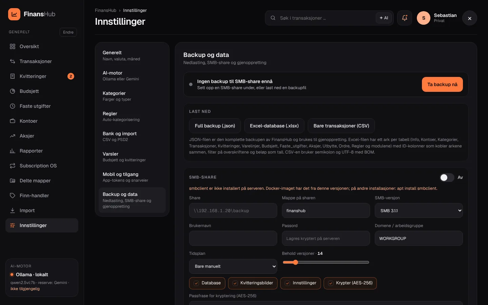

#  Backup og gjenoppretting

[← Til README](../README.md)



Alt finnes under **FinansHub → Innstillinger → Backup og data**.

## Last ned

| Format | Innhold | Brukes til |
|---|---|---|
| **Full backup (.json)** | Alle FinansHub-tabeller med ID-er | Gjenoppretting |
| **Excel-database (.xlsx)** | Ett ark per tabell: Info, Kontoer, Kategorier, Transaksjoner, Kvitteringer, Varelinjer, Budsjett, Faste utgifter, Aksjer, Utbytte, Ordre, Regler og flere | Oversikt, Excel og Power Query, og gjenoppretting |
| **Bare transaksjoner (.csv)** | `;` som skilletegn, UTF-8 med BOM | Regneark |

Excel-filen har filter på overskriftene og en frossen topprad. ID-kolonnene kobler arkene sammen, beløp lagres som tall og datoer som Excel-datoer.

## SMB-share (NAS)

Automatisk backup til en Windows-share, Synology, TrueNAS eller Unraid.

| Felt | Eksempel / standard |
|---|---|
| Share | `//nas.local/backup` |
| Mappe | `finanshub` |
| SMB-versjon | `3.1.1` (eller 3.0 / 2.1) |
| Brukernavn / passord / domene | `backup` / •••• / `WORKGROUP` |
| Tidsplan | Bare manuelt · hver natt kl. 03.00 · hver søndag kl. 03.00 · etter endringer (maks én per time) |
| Behold versjoner | `14` |
| Innhold | ☑ Database ☑ Kvitteringsbilder ☑ Innstillinger |
| Kryptering | ☑ AES-256-GCM med passfrase |

**Knapper:** «Test tilkobling», «Lagre» og «Ta backup nå». Listen nederst viser backupene på sharen (fil, tid, type, størrelse og status), hver med «Gjenopprett».

**Arkivet:**
```
homelab-backup-<tidspunkt>.tar.gz.enc
└─ FHBK1-hode · salt · IV · AES-256-GCM( tar.gz )
   ├─ homelab.db       øyeblikksbilde av hele SQLite-databasen (online backup)
   ├─ receipts/        kvitteringsbilder og miniatyrer
   ├─ uploads/         bakgrunner og andre opplastinger
   └─ settings.json    innstillinger (kv-tabellen)
```

- **Nøkkel:** nøkkelen lages fra passfrasen med scrypt (N=2¹⁵).
- **Overføring:** filen sendes med `smbclient`, som er inkludert i Docker-imaget, med en midlertidig passordfil (modus 600).
- **Opprydding:** eldre versjoner enn «behold versjoner» slettes fra sharen.

> [!CAUTION]
> Uten passfrasen kan en kryptert backup **ikke** gjenopprettes. Ta vare på den, og på `SECRET_KEY` og `TOTP_ENC_KEY` hvis du har satt dem, et annet sted enn på serveren.

## Gjenoppretting

Gjenoppretting skjer i to steg:
1. **Forhåndsvisning:** last opp en `.json`, `.xlsx` eller `.tar.gz(.enc)`, eller velg en backup på sharen. Du ser antall rader per tabell før noe skjer.
2. **Gjenopprett:** importen beholder ID-ene og er idempotent, så samme fil to ganger gir samme resultat.

Testene ([`test/finans-backup.test.js`](../test/finans-backup.test.js)) sjekker at en gjenoppretting til en tom installasjon gir like mange rader for alle tre formatene.

## Ny installasjon

Første gang `/finans/` åpnes med tom database, får du fire valg:

| Valg | Hva skjer |
|---|---|
| **Start tom** | Standardkategorier og ingen data |
| **Hent fra SMB-share** | Fyll inn sharen og passfrasen, velg en backup og gjenopprett |
| **Last opp backupfil** | `.json`, `.xlsx` eller `.tar.gz(.enc)` |
| **Eksempeldata** | Demodata for å prøve FinansHub |

## Manuell backup av hele serveren

Alt ligger i `data/` (`/opt/homelab-os/data` på Proxmox). Stopp containeren og kopier mappen, eller ta et snapshot av LXC-en i Proxmox:

```bash
pct snapshot <ctid> for-oppdatering
```

## Systembackup (Innstillinger → Backup)

Hele serveren (eller utvalgte moduler) som ett arkiv, kjørt etter tidsplan eller med **Ta backup nå**. Bare administratorer
ser og endrer dette. API: `/api/backup` (se `server/system-backup.js`).

- **Innhold:** `db/homelab.db` (konsistent øyeblikksbilde med `db.backup()`; ved modul-utvalg bare modulenes tabeller og
  innstillinger), filmappene til modulene under `files/` og `manifest.json` (versjon, moduler, tabeller, sha256 per fil).
  Øktene tas aldri med.
- **Format:** `.tar.zst` når `zstd` finnes på serveren, ellers `.tar.gz`. Kryptert: `.enc` (AES-256-GCM).
- **Lagring:** `BACKUP_DIR` (standard `data/system-backups`). I Docker/Proxmox: bind-mount `/srv/backup:/srv/backup` og sett
  `BACKUP_DIR=/srv/backup` i `.env` (se `docker-compose.yml`). Eldre backuper slettes etter «Behold».
- **Tidsplan (Europe/Oslo):** hver natt 03:00, hver 6. time, søndag 03:00 eller den 1. kl. 03:00.
- **Kryptering:** gjenopprettingsnøkkelen vises én gang. Ta vare på den: serveren har en kryptert kopi (for automatisk
  backup), men mister du `SESSION_SECRET`/`SECRET_KEY` eller datamappen, er nøkkelen eneste vei tilbake.
- **Sky:** Backblaze B2 (S3-API, signert med AWS SigV4). Bare krypterte backuper lastes opp. Google Drive kommer senere.
- **Gjenoppretting:** krever passordet, tar alltid en full sikkerhetskopi først, og erstatter de valgte modulenes tabeller i én
  transaksjon og filmappene med rename. Databasefilen byttes ikke, så serveren trenger ingen omstart; last appen på nytt etterpå.
