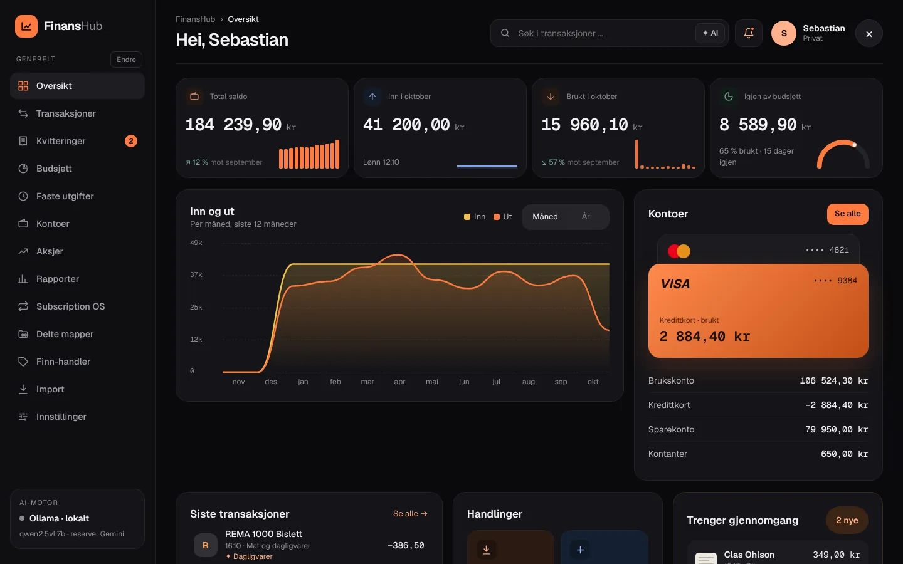
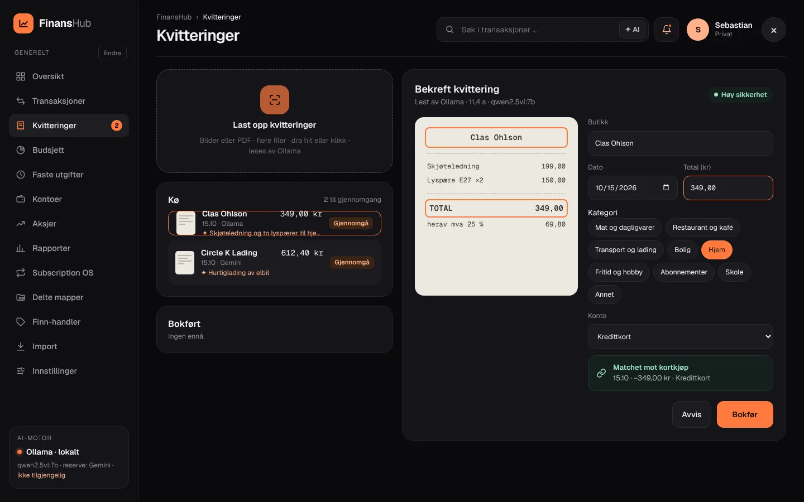
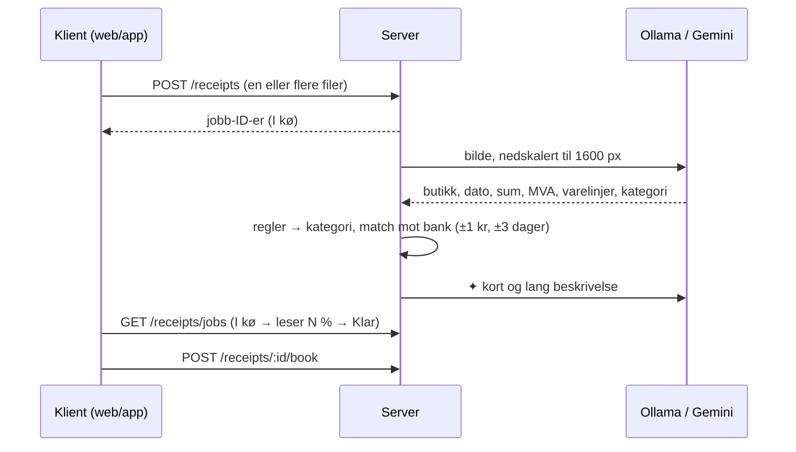
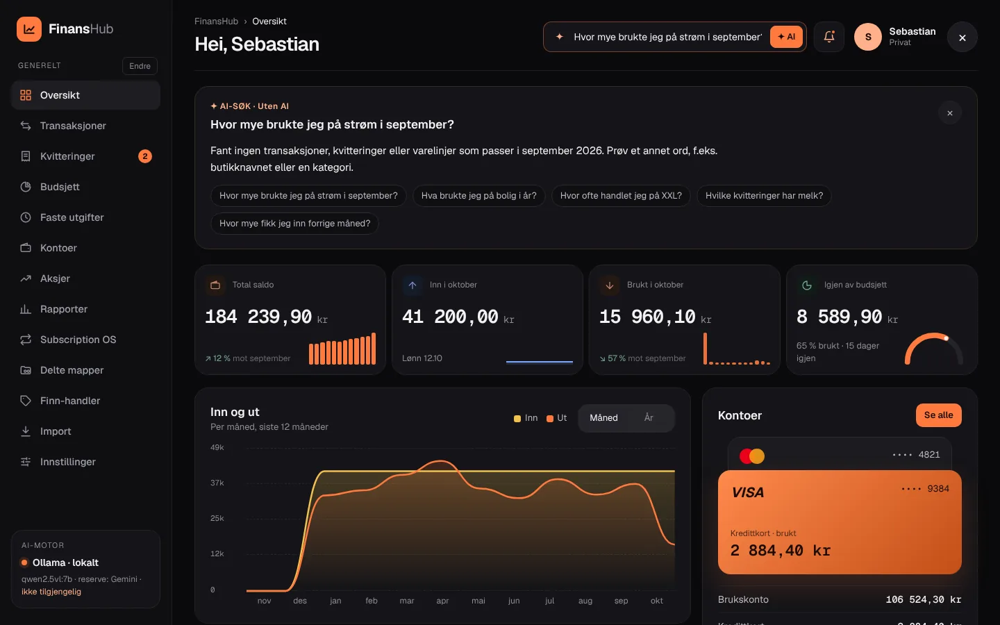
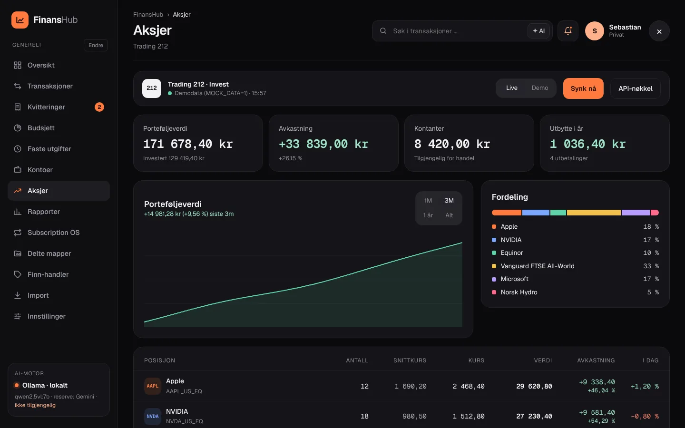
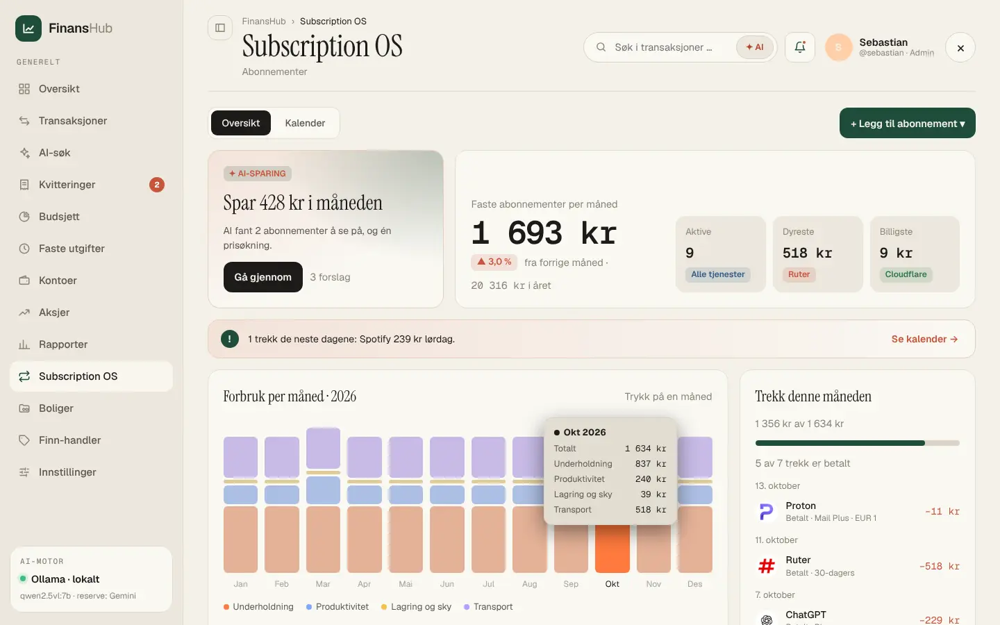
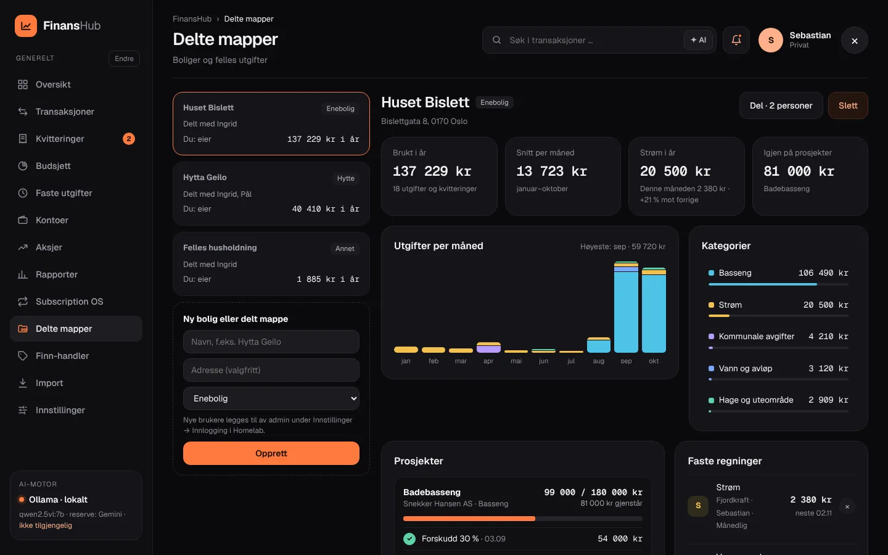
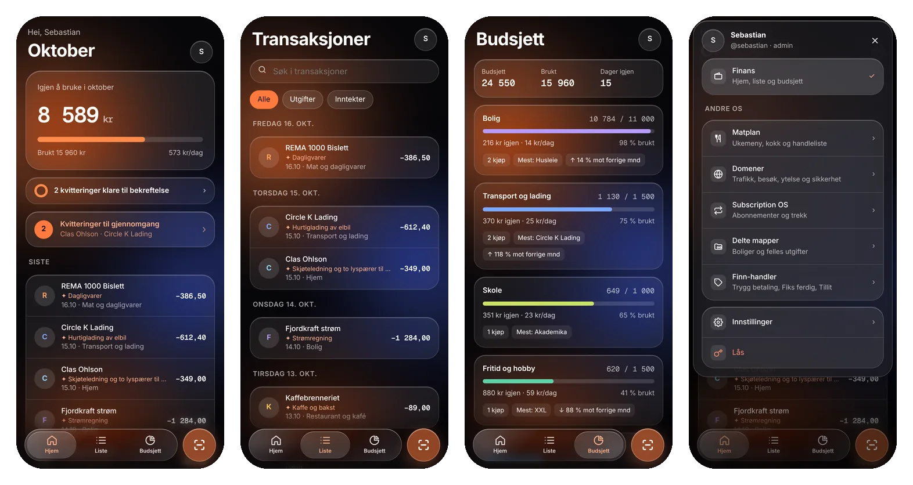

#  FinansHub

[← Til README](../README.md)

FinansHub er økonomidelen, og ligger på `/finans/`. På PC vises desktop-grensesnittet, og på telefon og nettbrett vises mobil-PWA-en (iOS- eller Android-tema). De native appene snakker med det samme API-et, se [apps/README.md](../apps/README.md).



## Sider

| Side | Innhold |
|---|---|
| **Oversikt** | 4 nøkkeltall (total saldo, inn, brukt og igjen av budsjett) med minigrafer, inn/ut-graf, kontokort, siste transaksjoner, handlinger, budsjett, gjennomgangskø og kommende trekk |
| **Transaksjoner** | Søk og filter, detaljpanel med ✦ AI-beskrivelse og varelinjer, «Lag regel», ny transaksjon og CSV |
| **Kvitteringer** | Last opp (flere filer, dra og slipp), AI-utlesing i kø, bekreftelsespanel med bankmatch, «Les på nytt», avvis og bokfør |
| **Budsjett** | Månedsbudsjett per kategori, varsel ved 80 % og 100 % |
| **Faste utgifter** | Regninger og trekk, med automatisk oppdagelse |
| **Kontoer** | Saldo per konto og sparemål |
| **Aksjer** | Trading 212: portefølje, fordeling, posisjoner, ordrer og utbytte |
| **Rapporter** | Måned eller år, fordeling per kategori, mest brukt hos, CSV og PDF |
| **Subscription OS** | Abonnementer, månedlig, årlig eller hvert 2. år |
| **Delte mapper** | Dashboard per bolig, delt mellom brukere |
| **Finn-handler** | Kjøp og salg via Finn (Trygg betaling, Fiks ferdig, Tillit) |
| **Import** | CSV, XLSX og innlimt tekst |
| **Innstillinger** | Se [konfigurasjon.md](konfigurasjon.md#finanshub--innstillinger) |

**Sidemeny:** trykk **Endre** ved siden av «Generelt», dra punktene eller bruk ▲▼, og trykk **Ferdig**. «Tilbakestill rekkefølge» gir standard tilbake. Rekkefølgen lagres per bruker.

##  Kvitteringer





1. **Opplasting:** klienten sender originalen, en nedskalert JPEG og et miniatyrbilde. Med flere filer får hver fil en jobb i køen.
2. **AI-utlesing:** **Ollama** (lokalt) eller **Gemini** leser kvitteringen. Valgfri reserve, og ett nytt forsøk ved ugyldig JSON.
3. **Kategori:** regler går foran AI-forslaget. En kategori du retter, kan bli en ny regel.
4. **Bankmatch:** samme beløp ±1 kr og dato ±3 dager. Like fire siste siffer på kortet gir forrang.
5. **Bokføring:** ingenting bokføres før du trykker **Bokfør**.
6. **Feil:** er AI-motoren nede, havner kvitteringen i køen med beskjed om å fylles ut manuelt.

## ✦ AI-sammendrag og logoer

- **Sammendrag:** hver transaksjon og kvittering får en kort linje (`✦ …`, ca. 60 tegn) og en lengre beskrivelse på 2–3 setninger. De lages i bakgrunnen, og først vises en regelbasert tekst.
- **Logoer:** butikknavnet gjøres om til et domene (regelliste, deretter AI, for eksempel «Bilema» → biltema.no). Faviconet caches i `data/logos` i 30 dager og serveres fra `/finans/api/logo/:domain`.

##  ✦ AI-søk



Trykk **✦ AI** i søkefeltet og still et spørsmål:
- «hvor mye brukte jeg på strøm i september?»
- «hva kjøpte jeg på Biltema i år?»
- «hvilke abonnementer har jeg?»

**Slik virker det:**
1. Treff hentes med SQLite FTS5 (BM25) fra transaksjoner, kvitteringer og varelinjer, og eventuelt med vektorsøk via Ollama- eller Gemini-embeddings.
2. Månedsnavn, «i år» og «forrige måned» forstås.
3. Språkmodellen svarer bare ut fra treffene. **Et svar som inneholder et tall som ikke finnes i dataene, blir forkastet**, og da vises et regelbasert sammendrag i stedet.
4. Uten AI svarer søket regelbasert innen 12 s.

##  Aksjer (Trading 212)



- **Nøkkel:** lages hos Trading 212 under *Innstillinger → API (Beta)*. Gi bare lesetilgang (account, portfolio, history:orders, history:dividends), og lås den gjerne til homelab-IP-en.
- **Oppsett:** nøkkel og secret legges inn på siden og lagres kryptert. Velg *live* eller *demo*.
- **Data:** kontosammendrag, portefølje, ordrer og utbytte, med cache i 60 s og «Synk nå». Ved feil (for eksempel 429) vises sist gode data.
- **Graf:** et daglig øyeblikksbilde gir porteføljegrafen og kolonnen «I dag».
- **Test tilkobling:** kaller `GET /api/v0/equity/account/summary` med verdiene i skjemaet (før du lagrer) og viser valuta og total, eller nøyaktig hva som er galt.

### Hvis Trading 212 avviser nøkkelen

| Melding | Årsak | Løsning |
|---|---|---|
| **401** – nøkkel-ID eller secret er feil | Feil eller ufullstendig nøkkel, eller nøkkelen hører til det andre miljøet | Lim inn begge på nytt. Testen sjekker også det andre miljøet og foreslår «Bytt til Demo/Live». |
| **403** – mangler tilgang til «portfolio» | Tilgangen (scope) er ikke slått på, eller nøkkelen er låst til en annen IP | Rediger nøkkelen hos Trading 212. Bak Cloudflare Tunnel er IP-en homelabens offentlige WAN-IP. |
| **429** – for mange kall | Rate limit | Vent og prøv igjen; sist gode data vises imens. |
| Kan ikke dekrypteres | `SECRET_KEY`/`SESSION_SECRET` er byttet etter at nøkkelen ble lagret | Lim inn nøkkel-ID og secret på nytt. |

- **Header:** `Authorization: Basic base64(KEY_ID:SECRET)`. Mellomrom, linjeskift, anførselstegn og et «Basic »-prefiks fra liming fjernes automatisk. Eldre nøkler uten secret prøves med rå nøkkel hvis Basic gir 401.
- **Konto:** API-et virker for Invest og Stocks ISA, ikke CFD. Lag nøkkelen i samme konto og samme miljø (Live eller Demo) som du velger i skjemaet.
- **Lagring:** verdier lagret i grensesnittet går foran `TRADING212_API_KEY`/`TRADING212_API_SECRET` i `.env`. Skjemaet viser de fire første tegnene og lengden på det som er lagret, og testen viser lengdene som faktisk ble sendt (aldri selve verdiene).

##  Kvitteringer fra e-post (Proton Mail)

FinansHub henter uleste e-poster fra en mappe, lager kvitteringsjobber av vedleggene (PDF, JPG, PNG, HEIC) og sender e-poster uten vedlegg (typisk nettbutikker) til AI-en som ren tekst. Jobbene havner i opplastingskøen og gjennomgangskøen som vanlig, merket med avsender og emne. Ferdige e-poster flyttes til «Lest»-mappen.

Proton Mail har ingen offentlig IMAP-server, så alt går gjennom **Proton Mail Bridge** (krever betalt plan: Mail Plus, Unlimited, Duo, Family eller Business). Oppsettet finnes i **Homelab → Innstillinger → Integrasjoner → Proton Mail** og i **FinansHub → Innstillinger → Bank og import**.

**1. Start Bridge ved siden av FinansHub** (tjenesten ligger i `docker-compose.yml` som profilen `mail`, og portene publiseres ikke):
```bash
docker compose --profile mail run --rm protonmail-bridge init
>>> login      # Proton-adresse, passord og 2FA. Vent til synkroniseringen er ferdig.
>>> info       # viser brukernavn og Bridge-passord
>>> exit
docker compose --profile mail up -d
```

**2. Finn variablene**

| Felt | Hvor du finner det | Typisk verdi |
|---|---|---|
| Vert (`IMAP_HOST`) | Navnet på tjenesten i compose | `protonmail-bridge` (Bridge-appen på samme maskin: `127.0.0.1`) |
| Port (`IMAP_PORT`) | `info` viser 1143, men imaget videresender den til 143 | `143` fra en annen container, `1143` mot Bridge-appen |
| Sikkerhet (`IMAP_SECURITY`) | `info` → Security | `starttls` |
| Brukernavn (`IMAP_USER`) | `info` → Username | `navn@proton.me` |
| Passord (`IMAP_PASSWORD`) | `info` → Password – **Bridge-passordet, ikke Proton-passordet** | 16 tegn |
| Mappe (`IMAP_FOLDER`) | Egne mapper heter `Folders/<navn>`, etiketter `Labels/<navn>` | `Folders/Kvitteringer` |
| Ferdig-mappe (`IMAP_DONE_FOLDER`) | Lag undermappen i Proton | `Folders/Kvitteringer/Lest` |
| Intervall (`IMAP_POLL_MINUTES`) | | `10` |

**3. Lag et filter i Proton:** mail.proton.me → Innstillinger → Filtre → Legg til filter. For eksempel: emne inneholder «kvittering», «ordre» eller «receipt», eller avsender er butikken → flytt til mappen *Kvitteringer*.

**4. Test tilkobling.** Første gang lagres (pinnes) Bridge sitt selvsignerte sertifikat (SHA-256-fingeravtrykket vises), i stedet for at sertifikatsjekken slås av. Endres sertifikatet senere, avvises tilkoblingen til du trykker «Glem sertifikat» og tester på nytt. Offentlige IMAP-servere med gyldig sertifikat sjekkes på vanlig måte.

| Feil i testen | Betyr |
|---|---|
| Innloggingen ble avvist (AUTHENTICATIONFAILED) | Brukt Proton-passordet i stedet for Bridge-passordet, eller Bridge er logget ut |
| Tilkoblingen ble nektet | Bridge kjører ikke, eller feil port (1143 i stedet for 143 fra en annen container) |
| Fant ikke mappen | Mangler `Folders/` foran navnet |
| Sertifikatet stemmer ikke / kunne ikke verifiseres | Bridge er satt opp på nytt – glem sertifikatet og test igjen |

- **Duplikater:** hver e-post huskes på `Message-ID` og sha256 av hvert vedlegg (tabellen `fh_mail_imports`), så ingenting importeres to ganger selv om e-posten flyttes tilbake.
- **Ved feil:** e-posten blir liggende ulest og feilen vises under Status. «Kjør nå» starter en runde med en gang.
- **Finn-handler:** fyll inn en egen Finn-mappe (f.eks. `Folders/Finn`), så leses Finn-e-postene fra samme postkasse inn som handler.
- **Bridge-data** ligger i `./proton` – ta den med i backupen.

## Subscription OS



- **Nøkkeltall:** per måned, per år og «lite brukt, kan sies opp».
- **Legg til:** som nytt abonnement, fra en kvittering (AI fyller ut feltene) eller fra en transaksjon.
- **Trekk-intervall:** månedlig, årlig eller **hvert 2. år**, med *kr per trekk*. 1 200 kr hvert 2. år gir 50 kr/mnd og 600 kr/år.
- **Status:** Aktiv → Si opp → Sagt opp.

## Delte mapper (bolig)



En mappe er hovedsakelig et **dashboard for en bolig**: enebolig, leilighet, hytte, utleie eller annet.
- **Utgifter:** vann, strøm, hage, vedlikehold og lignende, med graf per måned og per kategori.
- **Prosjekter:** leverandør, budsjett, brukt og gjenstående, og en avdragsplan med **Registrer betalt**, som lager utgiftsposten.
- **Faste regninger:** hvem som betaler, frekvens, sist betalt og neste.
- **Fordeling:** likt delt eller egen nøkkel, med saldo per medlem (betalt − andel).
- **Deling:** med andre brukere, med rollene **Eier**, **Kan redigere** og **Kan se**. Eiere deler og endrer roller, medlemmer kan forlate mappen, og den siste eieren kan ikke forlate den.
- **Andre brukere** enn admin ser bare Delte mapper der de er medlem. Resten av regnskapet tilhører eieren.

## Finn-handler

- **Innhold:** kjøpt i år, solgt i år og pågående handler, med steg-chips for hver handel.
- **Legg inn:** lim inn en Finn-e-post (Trygg betaling, Fiks ferdig, Tillit), eller skriv inn handelen manuelt. AI eller regex leser ut gjenstand, motpart, beløp og status.
- **Oppdatering:** samme ordrenummer i en senere e-post oppdaterer samme handel.
- **Automatisk:** med en Finn-mappe i e-postoppsettet (se *Kvitteringer fra e-post*) leses Finn-e-postene inn automatisk.

## Import

- **Format:** `.xlsx`, `.csv`, `.txt` eller innlimt tekst.
- **Banker:** DNB (`Dato · Forklaring · Rentedato · Ut · Inn`, `MM/DD/YY`, komma som tusenskille), Nordea, SpareBank 1, Sbanken og Bank Norwegian. Kolonnene finnes automatisk.
- **Rensing:** `Visa 100021`, `Varekjøp`, valutakurs og `Dato … kl …` fjernes. `Vipps:pal wengard` blir «Vipps · Pal Wengard».
- **Forhåndsvisning:** viser logo, dato, renset navn, ✦, kategoriforslag og beløp før **Importer N poster**. Duplikater hoppes over.

## Mobil



- **Fanelinje:** Hjem, Liste og Budsjett. **Andre OS** (Matplan, Domener, Subscription OS, Delte mapper, Finn-handler) og **Innstillinger** ligger bak profilbildet.
- **Skann:** et trykk åpner kameraet, og et langt trykk viser valgene Ta bilde, Bilder og Filer.
- **Opplasting:** kø med status per fil og en fremdriftspille på forsiden.
- **Brettbar:** navigasjonsrail med profilbildet nederst til venstre, og liste og detaljer side om side.
