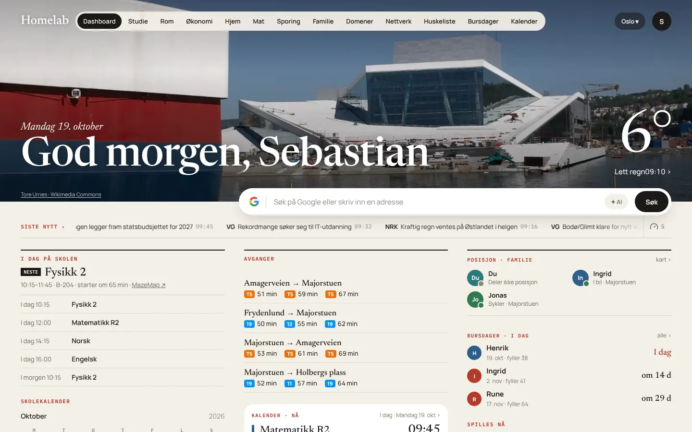
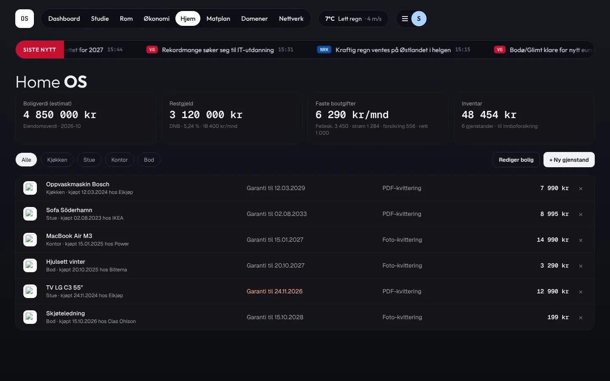
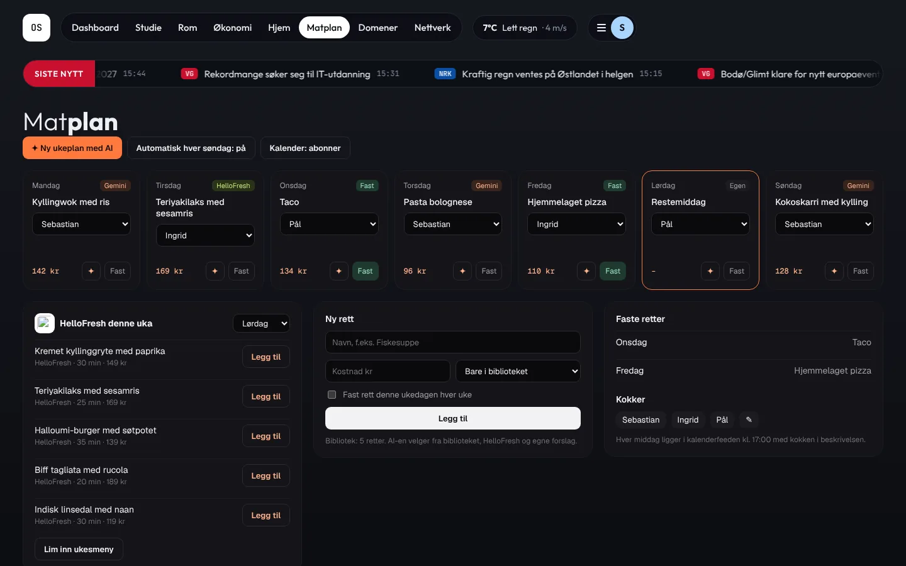
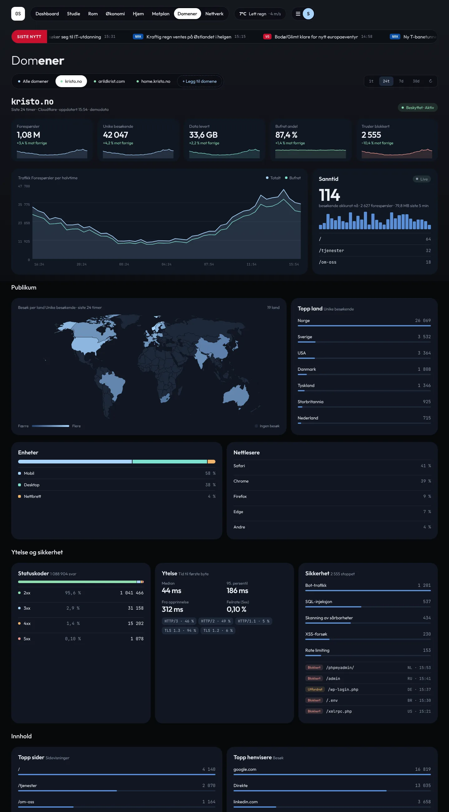

#  Homelab

[← Til README](../README.md)

## Moduler og menyer

Modulene, navnene, ikonene og rekkefølgen kommer fra modullisten
[`shared/schemas/moduler.json`](../shared/schemas/moduler.json) (se [api.md](api.md#moduler-get-apimoduler-sesjon-eller-app-token)),
så web, iPhone og Android viser det samme. Brukeren ser bare modulene hen har tilgang til.

| Gruppe | Moduler (adresse på web) |
|---|---|
| I dag | **Oversikt** (`#/oversikt`): avganger, søk og Glimt, vær, kalender, agenda, Trading 212, energi, økonomi, snarveier og «Kommer» · **Chat** (`#/chat`) · **Brief** (ark, `#/brief`) |
| Hjemme | **Smarthjem** (`#/hjem`): bolig, lån, faste boutgifter og inventar med garanti · **Mat** (`#/matplan`) · **Gjøremål** (`#/gjoremal`) · **Familie** (`#/familie`, med fanen Kart) |
| Tid | **Kalender** (`#/kalender`): visningene År … Liste og filtrene Familie, Bursdager og Skole |
| Ute | **Vær** (`#/vaer`) · **Reise** (`#/reise`: Avganger og Kart) · **Sporing** (`#/sporing`) |
| Økonomi | **Økonomi** (`/finans/`), se [finanshub.md](finanshub.md). «‹ Homelab» tar deg tilbake |
| Fritid og læring | **Media** (`#/media`, egen tilgang) · **Nyheter** (ark) · **Studie** (`#/studie`): lenker, karakterer, prøver, studielån · **Rom** (`#/rom`): Starlink over Norge, NASA APOD og gallerier · **Bibel** (egen tilgang) |
| Verksted | **Skjold Lab** (`#/skjold`) |
| Drift | **Domener** (`#/domener`, admin): trafikk, verdenskart, ytelse, sikkerhet og oppetid · **Nettverk** (`#/nettverk`): helsesjekk av tjenestene og lenker |

- **Toppmenyen (desktop):** de faste fanene Oversikt, Kalender, Økonomi, Media, Familie, Mat, Gjøremål og Skjold Lab, og
  «Alle sider ▾» med alle modulene gruppert. Faner som ikke får plass, ligger under «Mer ▾». Rekkefølgen, navnene og hvilke
  faner som vises, kan endres under Innstillinger → Utseende.
- **Mobil:** bunnmenyen og **Mer**, der modulene står gruppert først og snarveiene nederst.
- **Gamle adresser** (`#/dash`, `#/huskeliste`, `#/kart`, `#/familiekalender`, `#/bursdager` …) videresendes til den nye siden.

## Topplinje

- **Rekkefølge:** logo · faner · vær · meny (hamburger og avatar), venstrejustert.
- **Flytt elementer:** velg *✥ Flytt topplinje* i menyen eller i Innstillinger, og dra hver del med musa.
  - **«Hold alle elementene på samme høyde»** er på som standard, og da flyttes delene bare sideveis. Slår du det av, kan de flyttes fritt.
  - **Nullstill** og **Ferdig** ligger i linja nederst, og Esc avslutter.
  - Plasseringen lagres på serveren per bruker.
- **Mål:** Innstillinger → Utseende → Topplinje har *mellomrom mellom seksjoner* (0–120 px), *mellomrom mellom faner* (0–40 px) og *bredde på faner* (6–24 px).

## Nyhetslinje

Nyhetslinja («NYHETER») fra NRK og VG, hentet på serveren og cachet i 5 minutter. Linja ruller kontinuerlig og sømløst.
- **Hastighet 1–10:** én runde tar 350 s / hastighet (standard 5 gir 70 s). Endringen vises med en gang.
- **Pause ved hover:** på som standard.
- **Redusert bevegelse:** linja står stille når systemet ber om det.

## Layout

- **Flytt kort:** dra og slipp på desktop, langt trykk (450 ms) på mobil.
- **Endre størrelse:** dra i det usynlige hjørnet nederst til høyre på kortet. Bredden snapper til kolonner, og høyden er fri (minst 120 px). Dobbeltklikk nullstiller.
- **Masonry:** kort med ulik høyde pakkes tett.
- **Popup:** klikk på en kalenderdag, en agenda-rad, en aksje eller en plakat for å se detaljer. Lukkes med ×, Esc eller klikk utenfor.
- **Lagring:** alt lagres per bruker. «Tilbakestill layout» i menyen nullstiller.

##  Smarthjem

- 4 nøkkeltall: boligverdi, restgjeld (bank, rente, måneder), faste boutgifter (spesifisert) og inventar (sum, antall).
- Filter per rom og inventarliste med butikklogo, kjøpsdato og garanti. Garantien vises i oransje når det er under 60 dager igjen.
- API: `/home/api/property` og `/home/api/inventory`.

##  Matplan

- **✦ Ny ukeplan:** lages med Gemini eller Ollama, enten for hele uka eller én dag. Faste retter respekteres, og retter fra de siste tre ukene unngås. Uten AI velges det fra biblioteket og HelloFresh-retter.
- **Automatisk:** søndag etter kl. 18 lages neste ukes plan når «Automatisk» er på.
- **Faste retter:** låses til en ukedag. Hver dag har en **kokk**, og man kan legge til egne retter.
- **HelloFresh:** lim inn ukesmenyen, én rett per linje (`Navn – 30 min – 149 kr`).
- **Handleliste:** kan krysses av. Ukekostnaden vises mot kategorien «Mat og dagligvarer».
- **Kalender:** abonner på `/mat/calendar.ics?key=…` i Google eller Apple Kalender. Hver middag ligger 17:00–18:00 med kokken i beskrivelsen. Nøkkelen kan byttes.

##  Domener

- **Flere domener:** «+ Legg til domene» med domene, statistikkilde og token.

  | Kilde | Krever |
  |---|---|
  | Cloudflare zone analytics | Token med Zone, DNS, Analytics, Registrar og Firewall Services: Read |
  | Cloudflare Tunnel | Samme token (filtrerer på vertsnavn) |
  | Plausible | API-nøkkel |
  | Umami (selvhostet) | Adresse og token |
  | Bare oppetid og SSL | Ingenting |

- **Nøkkeltall:** status, forespørsler, besøkende, bufret andel, oppetid, utløp for SSL og fornyelse.
- **Grafer og tabeller:** trafikk med sanntid (oppdateres hvert 30. s), **verdenskart** (d3-geo, Natural Earth) med logaritmisk fargeskala, toppland, enheter og nettlesere.
- **Ytelse og sikkerhet:** statuskoder, TTFB p50/p95 og stoppede trusler.
- **Innhold og infrastruktur:** toppsider og henvisere, oppetid de siste 90 dagene (egen ping hvert 5. min) og DNS-poster.
- **Cache:** 5 min for statistikk og 30 s for sanntid. Tokens lagres kryptert og vises aldri igjen.
- **Mobil:** i mobilappen har Domener egne faner: Trafikk, Besøk, Ytelse og Sikkerhet.

> [!NOTE]
> På Cloudflares gratisplan dekker toppsider, enheter, henvisere og svartider bare de siste 24 timene, uansett hvilken periode du velger.

## Nettverk og Tailnet

**Nettverk** (`#/nettverk`) viser helsesjekken av tjenestene og lenkene. For administratorer står **Tailnet** (Tailscale) øverst:

- **Stat-rad:** online av totalt, median latens (24 t), andel direkte (resten via DERP), trafikk i dag og antall vedlikeholdspunkter.
- **Enheter:** søk på navn eller IP, filterpillene Alle, Servere, Datamaskiner, Mobil og Offline (med antall; mobil og nettbrett ligger bak Mobil), og gruppering etter tags eller eier. Online først, så navn. Maks 12 brikker, så «Vis alle N». Offline vises dempet med «sist sett 3 d», og ukjent latens som «ukjent».
- **Enhetsdetalj** (popup): IPv4 og IPv6, MagicDNS, OS, klientversjon, tunnel, eier, tags, nøkkelutløp og trafikk, latens 24 t med median og p95, oppetidsstripe for 30 dager (oppe, delvis, nede), tjenestene i helsesjekken med 100.x-adresse eller MagicDNS-navn, og knappene **Ping nå**, **Kopier IP**, **Kopier SSH-kommando** (`ssh root@<magicdns>`) og **Åpne ↗**. Varslene for enheten slås av og på her.
- **Vedlikehold:** nøkler som utløper innen 14 dager, klienter med oppdatering, avvikende klientversjon, exit-node i bruk og enheter frakoblet over 30 dager. **Trafikk i dag:** topp 5 (ned og opp).
- **Oversikt:** flisen **Tailnet** (online/totalt, en donut per type, siste endring og en prikk når noe trenger tilsyn). Den kan flyttes og skjules som de andre.
- **Glimt:** «hvilke maskiner er nede?», «hva er IP-en til unraid?» og «hvor lenge har hytta vært offline?» (bare lesing). **⌘K** finner enhetene.
- **Appene:** Mer → **Tailnet** (iOS og Android) med liste, detalj, Ping nå, Kopier IP og Kopier SSH.
- **Varsler** (til administratorene): en server er offline i over 10 min, en nøkkel utløper om 7 dager, en ny enhet har dukket opp, eller en enhet har gått via DERP i over en time.

Kilden velges automatisk: **LocalAPI** når `/var/run/tailscale` er montert lesende, ellers **Tailscale-API-et** med OAuth-klient eller API-nøkkel (se [konfigurasjon](konfigurasjon.md#tailscale)). Homelab endrer aldri noe i tailnetet. Statistikken (en prøve per enhet hvert 5. minutt) lagres i SQLite og slettes etter 90 dager. Visningen (filter, søk, gruppering, åpen/lukket) lagres per bruker på serveren. Siden oppdateres via sanntid (`tailscale.node`), uten polling.
