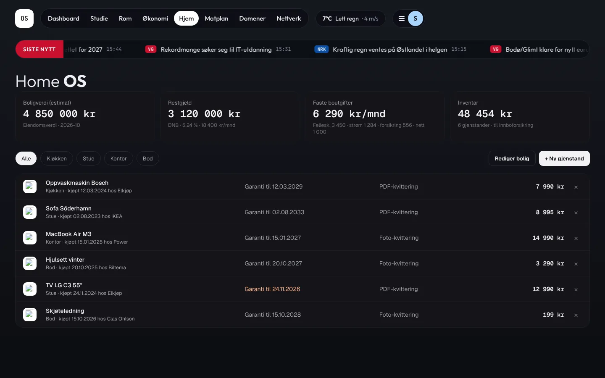
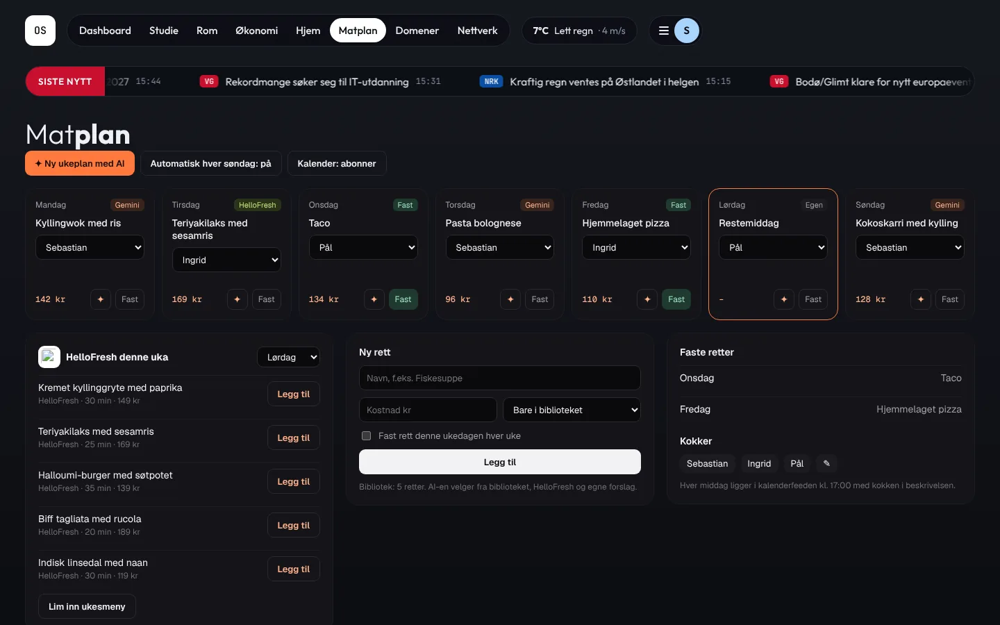
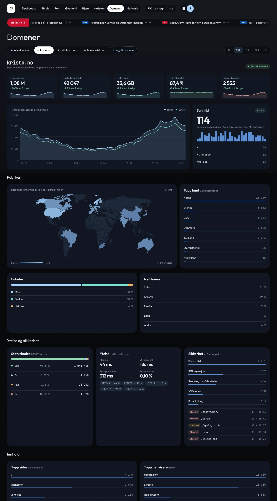

#  Homelab

[← Til README](../README.md)

## Faner

| Fane | Rute | Innhold |
|---|---|---|
| Dashboard | `#/dash` | Ruter-avganger, søkebar, hilsen og klokke, vær, skolekalender, agenda, Trading 212, energi, økonomi, snarveier, «Kommer ut» |
| Studie | `#/studie` | Lenker, karakterer (legg til, endre, slett), prøver, studielån |
| Rom | `#/rom` | Starlink over Norge (CelesTrak TLE + satellite.js), NASA APOD og gallerier |
| Økonomi | `/finans/` | Åpner [FinansHub](finanshub.md) i fullskjerm. Den runde × tar deg tilbake. |
| Hjem | `#/hjem` | Home OS: bolig, lån, faste boutgifter og inventar med garanti |
| Matplan | `#/matplan` | Ukemeny, kokker, handleliste og kalenderfeed |
| Domener | `#/domener` | Trafikk, publikum med verdenskart, ytelse, sikkerhet og oppetid |
| Nettverk | `#/nettverk` | Helsesjekk av tjenestene og lenker |

På mobil samles Rom, Hjem, Matplan, Domener og Nettverk under **Mer**. Hjem, Matplan og Domener er bare tilgjengelige for administratorer.

## Topplinje

- **Rekkefølge:** logo · faner · vær · meny (hamburger og avatar), venstrejustert.
- **Flytt elementer:** velg *✥ Flytt topplinje* i menyen eller i Innstillinger, og dra hver del med musa.
  - **«Hold alle elementene på samme høyde»** er på som standard, og da flyttes delene bare sideveis. Slår du det av, kan de flyttes fritt.
  - **Nullstill** og **Ferdig** ligger i linja nederst, og Esc avslutter.
  - Plasseringen lagres på serveren per bruker.
- **Mål:** Innstillinger → Utseende → Topplinje har *mellomrom mellom seksjoner* (0–120 px), *mellomrom mellom faner* (0–40 px) og *bredde på faner* (6–24 px).

## Nyhetslinje

«SISTE NYTT» fra NRK og VG, hentet på serveren og cachet i 5 minutter. Linja ruller kontinuerlig og sømløst.
- **Hastighet 1–10:** én runde tar 350 s / hastighet (standard 5 gir 70 s). Endringen vises med en gang.
- **Pause ved hover:** på som standard.
- **Redusert bevegelse:** linja står stille når systemet ber om det.

## Layout

- **Flytt kort:** dra og slipp på desktop, langt trykk (450 ms) på mobil.
- **Endre størrelse:** dra i det usynlige hjørnet nederst til høyre på kortet. Bredden snapper til kolonner, og høyden er fri (minst 120 px). Dobbeltklikk nullstiller.
- **Masonry:** kort med ulik høyde pakkes tett.
- **Popup:** klikk på en kalenderdag, en agenda-rad, en aksje eller en plakat for å se detaljer. Lukkes med ×, Esc eller klikk utenfor.
- **Lagring:** alt lagres per bruker. «Tilbakestill layout» i menyen nullstiller.

##  Hjem (Home OS)

- 4 nøkkeltall: boligverdi, restgjeld (bank, rente, måneder), faste boutgifter (spesifisert) og inventar (sum, antall).
- Filter per rom og inventarliste med butikklogo, kjøpsdato og garanti. Garantien vises i oransje når det er under 60 dager igjen.
- API: `/home/api/property` og `/home/api/inventory`.

##  Matplan

- **✦ Ny ukeplan:** lages med Gemini eller Ollama, enten for hele uka eller én dag. Faste retter respekteres, og retter fra de siste tre ukene unngås. Uten AI velges det fra biblioteket og HelloFresh-retter.
- **Automatisk:** søndag etter kl. 18 lages neste ukes plan når «Automatisk» er på.
- **Faste retter:** låses til en ukedag. Hver dag har en **kokk**, og man kan legge til egne retter.
- **HelloFresh:** lim inn ukesmenyen, én rett per linje (`Navn – 30 min – 149 kr`).
- **Handleliste:** kan krysses av. Ukekostnaden vises mot kategorien «Mat og dagligvarer».
- **Kalender:** abonner på `/mat/calendar.ics?key=…` i Google eller Apple Kalender. Hver middag ligger 17:00–18:00 med kokken i beskrivelsen. Nøkkelen kan byttes.

##  Domener

- **Flere domener:** «+ Legg til domene» med domene, statistikkilde og token.

  | Kilde | Krever |
  |---|---|
  | Cloudflare zone analytics | Token med Zone, DNS, Analytics, Registrar og Firewall Services: Read |
  | Cloudflare Tunnel | Samme token (filtrerer på vertsnavn) |
  | Plausible | API-nøkkel |
  | Umami (selvhostet) | Adresse og token |
  | Bare oppetid og SSL | Ingenting |

- **Nøkkeltall:** status, forespørsler, besøkende, bufret andel, oppetid, utløp for SSL og fornyelse.
- **Grafer og tabeller:** trafikk med sanntid (oppdateres hvert 30. s), **verdenskart** (d3-geo, Natural Earth) med logaritmisk fargeskala, toppland, enheter og nettlesere.
- **Ytelse og sikkerhet:** statuskoder, TTFB p50/p95 og stoppede trusler.
- **Innhold og infrastruktur:** toppsider og henvisere, oppetid de siste 90 dagene (egen ping hvert 5. min) og DNS-poster.
- **Cache:** 5 min for statistikk og 30 s for sanntid. Tokens lagres kryptert og vises aldri igjen.
- **Mobil:** i mobilappen har Domener egne faner: Trafikk, Besøk, Ytelse og Sikkerhet.

> [!NOTE]
> På Cloudflares gratisplan dekker toppsider, enheter, henvisere og svartider bare de siste 24 timene, uansett hvilken periode du velger.
