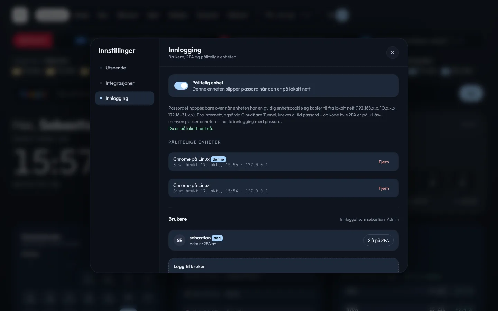

#  Sikkerhet

[← Til README](../README.md)

## Hva er offentlig

| Sti | Tilgang |
|---|---|
| `/login`, `/healthz`, `/assets/*` | Offentlig |
| `/cv` | Offentlig lesing. Redigering krever admin. |
| `/finans/api/login`, `/finans/api/logo/:domain` | Offentlig (innlogging for appene og favicons) |
| `/mat/calendar.ics?key=…` | Krever den hemmelige nøkkelen i URL-en |
| Alt annet | Innlogget sesjon eller Bearer-token |

## Brukere og roller

| Rolle | Kan |
|---|---|
| **admin** | I tillegg til sine egne data: legge til og fjerne brukere, sette roller og tilgang, endre tilkoblinger og CV, Smarthjem og Domener, og Server (system, backup, logger og AI-nøkler) |
| **bruker** | Sine egne data i modulene brukeren har tilgang til (de andre vises ikke i menyene, og `GET /api/moduler` sender dem ikke), egen 2FA og eget passord |

**Alt er per bruker**, også for administratorer: en admin ser ikke andres regnskap, kalender eller gjøremål. Unntakene er
Boliger, som deles med dem du inviterer, og Matplan, som er felles for husstanden. Ellers deles noe bare når brukeren selv slår
det på (posisjon i Familie, en gjøremålsliste). Profilen (Standard, Finans + Boliger, Boliger-profil) avgjør hvilke moduler en
bruker har.

- **Administrasjon:** brukere legges til av admin under **Innstillinger → Husstand** (brukernavn, passord og rolle).
- **Første oppstart:** eier-kontoen lages fra `USER_NAME` og `APP_PASSWORD_HASH`.
- **Sletting:** når en bruker slettes, slettes også sesjonene, enhetene, innstillingene og tokenene. Navnet beholdes som betaler i delte mapper.

## Passord

- **Hashing:** scrypt (N=2¹⁶, r=8, p=1, 64 MB, ca. 190 ms). Eldre hasher verifiseres fortsatt. Argon2 er ikke brukt fordi Node ikke har det innebygd før v24, se [DECISIONS.md](../DECISIONS.md).
- **Formatet** `scrypt:N:r:p:salt:hash` bruker `:` fordi Docker Compose tolker `$`.
- **Bytte passord:** gjør det under Innstillinger → Konto og sikkerhet. Andre innlogginger for brukeren logges ut.
- **Rate limiting:** 5 feil per IP og 10 per bruker per 15 minutter. Ukjente brukernavn tar like lang tid som feil passord, så brukernavn kan ikke gjettes ut fra svartiden.

## Totrinnsbekreftelse (2FA, TOTP)

1. Innstillinger → Konto og sikkerhet → **Slå på 2FA**.
2. Skann QR-koden med Google Authenticator, Aegis, 1Password eller lignende, eller skriv inn nøkkelen manuelt.
3. Skriv inn koden for å bekrefte. Du får **10 gjenopprettingskoder** som bare vises én gang.

| Detalj | Verdi |
|---|---|
| Algoritme | RFC 6238, SHA-1, 6 siffer, 30 s |
| Klokkeavvik | ±1 tidsvindu, og samme kode kan ikke brukes to ganger |
| Lagring | Hemmeligheten krypteres med AES-256-GCM (`TOTP_ENC_KEY` eller avledet fra `SESSION_SECRET`). Gjenopprettingskodene lagres som HMAC. |
| Uleselig nøkkel | Er serverhemmeligheten byttet (f.eks. etter gjenoppretting av en backup fra en annen server), gir en kode meldingen «Tofaktor-nøkkelen kan ikke leses fordi serverhemmeligheten er endret …» i stedet for en kryptofeil. Innlogging uten 2FA gis aldri. Slå av med passordet og sett opp på nytt; se [backup](backup.md#serverhemmeligheten-og-gjenoppretting). |
| Innloggingssteg | «Tofaktor er på for X …». Billetten varer 5 min, med maks 5 forsøk. |
| Slå av | Krever passord eller en gyldig kode |
| Nødvei | En admin trykker **Nullstill** ved 2FA under brukeren (Husstand). Eneste admin: `npm run reset-2fa -- <bruker>` (slår bare av 2FA) eller `npm run reset-password -- <bruker>` (nytt passord + 2FA av) på serveren – aldri over nett. `npm run rekey-secrets` krypterer 2FA-nøkler på nytt når den gamle hemmeligheten er kjent. |

## Pålitelig enhet på lokalt nett

«Husk denne enheten på lokalt nett» er krysset av som standard ved innlogging. Passordet hoppes **bare** over når begge disse er oppfylt:
1. Enheten har en gyldig enhetscookie (httpOnly, signert, 1 år) som hører til brukeren.
2. Klient-IP-en er privat: `10.0.0.0/8`, `172.16.0.0/12` eller `192.168.0.0/16`.

IP-en leses fra tilkoblingen, eller fra `CF-Connecting-IP` bak Cloudflare. Den leses **aldri** fra `X-Forwarded-For`, som klienten kan sette selv. Fra internett kreves alltid passord og eventuelt 2FA. **Lås** i menyen pauser enheten til neste innlogging med passord.

## Sesjoner og tokens

- **Sesjoner:** tilfeldig ID i en httpOnly-cookie (`SameSite=Lax`, `Secure` når `COOKIE_SECURE=true`), varighet 30 dager. Bare en HMAC av ID-en lagres.
- **Utlogging:** `POST /api/logout` sletter økta og trekker tilbake brukerens Kalender-tokens. Utlogging i Kalender-appene
  (`POST /finans/api/auth/logout`, med `/finans/api/logout` som alias for eldre apper) trekker tilbake app-tokenet.
- **API-tokens:** `fh_pat_` + 32 tegn. Tokenet vises én gang, og bare hashen lagres.

  | Tilgang | Gir |
  |---|---|
  | `finance:read` | Lese alt i Økonomi |
  | `finance:write` | Endre alt i Økonomi |
  | `receipts:write` | Bare laste opp kvitteringer (iOS-snarvei) |
  | `read:transactions`, `read:summary`, `read:budget` | Smal lesetilgang |
  | `write:transactions` | Smal skrivetilgang |

  Utløp: 30 d, 90 d, 1 år eller aldri for tokens laget i Innstillinger. Tokens fra app-innlogging (mobil, Kalender, QR, invitasjon) utløper etter 180 dager uten bruk (Q23): hver bruk gir 180 nye dager, og et utløpt token gir 401 `TOKEN_EXPIRED`. Listen viser når tokenet sist ble brukt og har «Trekk tilbake». Et token kan aldri gi seg selv flere tilganger enn det har, og det gir aldri tilgang til resten av homelab utenom Smarthjem, Matplan og Domener for admin.

## Hemmeligheter

- **API-nøkler** i Tilkoblinger og Økonomi (Gemini, Trading 212, SMB, IMAP, Cloudflare) lagres kryptert på serveren, og vises bare som «lagret».
- **Nøkler i nettleseren:** ingen nøkler sendes til nettleseren. Alle eksterne kall går fra serveren.
- **Sporing (Posten, Bring, PostNord):** kontoinnloggingen bruker transportørenes egne app-verdier (klient-ID, app-hemmelighet for Posten/Bring og PostNords gateway-nøkkel), slik de åpne Home Assistant-integrasjonene gjør (Q22). De er ikke brukerhemmeligheter, men de ligger i repoet (`server/sporing/carrier-apps.js`), og bruken kan bryte transportørenes vilkår. Bytter en transportør dem, settes de nye i `.env` (`SPORING_POSTNORD_CLIENT_ID`, `SPORING_POSTNORD_API_KEY`, `SPORING_POSTEN_CLIENT_ID`, `SPORING_POSTEN_SECRET`, `SPORING_BRING_CLIENT_ID`, `SPORING_BRING_SECRET`) uten kodeendring. De sendes aldri til klientene og logges aldri.
- **Tredjeparts-JS:** CSP-en (`script-src 'self'`) blokkerer inline-skript og tredjeparts-JS.
- **Serverens hemmelighet:** `SESSION_SECRET` i `.env`. Er den ikke satt på en ny installasjon, lager serveren 48 tilfeldige byte og lagrer dem i `data/session-secret` (0600). En eldre installasjon uten `SESSION_SECRET` bruker fortsatt en fast reservenøkkel fra kildekoden og gir et varsel til administrator under **Innstillinger → Konto og sikkerhet**: sett `SESSION_SECRET` i `.env` (`openssl rand -hex 32`) og start på nytt. Da blir alle logget ut, og lagrede integrasjonsnøkler må legges inn på nytt.

## AI og finansdata

- Alle AI-kall går via `server/ai/gate.js` / `server/ai/run.js` (én kø med tidsgrenser). Ollama (port 11434) og de andre lokale
  tjenestene eksponeres aldri; bare serveren snakker med dem.
- **Finansdata forlater aldri huset:** kvitteringer og finansdata sendes aldri til sky-motorer.

## Helsedata (prompt 57)

- **Bare for brukeren selv:** `/api/helse` (søvn, skritt, trening, vekt) gir bare egne data. Andre i husstanden ser bare det
  personen har slått på i Familie (`shareHealth`, per kategori; Trening og Vekt er av som standard).
- **Aldri til eksterne AI-tjenester:** Glimt svarer på helsespørsmål med verktøyet `health.get`, og svaret lages av tallene på
  serveren uten modell. Planleggeren er alltid lokal og ser bare spørsmålet. Tallene lagres ikke i Glimt-tracen, svar-cachen eller
  samtalehistorikken, og Brief-kortet «Helse» er ikke med i AI-oppsummeringen.
- **Logges ikke.** Hovedbryteren av i appen (eller `DELETE /api/helse`) sletter alle egne helsedata. Data eldre enn 400 dager slettes.

## iOS-appene

- **Tokens i Nøkkelringen:** kontotokenet, Kalender-økta og enhetsnøkkelen ligger i Nøkkelringen med App Group-en som
  tilgangsgruppe og `ThisDeviceOnly`, aldri i `UserDefaults` eller App Group-plisten. De følger derfor ikke med i ukrypterte
  sikkerhetskopier, og gamle verdier flyttes ved oppstart.
- **WebSocket:** tokenet sendes i `Authorization`-headeren, ikke i URL-en (som havner i tilgangslogger).

## Android-appene på nettet

- **Signering:** release signeres bare med nøkkelen i GitHub-hemmelighetene. Det finnes ingen nøkkel i repoet, se
  [android-signering.md](android-signering.md).
- **App Links** (`/l/`, `/join/`, `/app-auth`) gjelder standardadressen `os.smarthjemeksperten.no` og den eldre `home.kristo.no`. Serveren svarer på
  `/.well-known/assetlinks.json` når `ANDROID_CERT_SHA256` har fingeravtrykket til signeringsnøkkelen.

- **Klartekst bare hjemme:** `http://` og `ws://` godtas bare til lokalt nett (`:felles`, `LokaltNett`, samme fasit som
  `shared/testvektorer/serveradresse.json`). Et lokalt *navn* (`nas.lan`, `homelab`) må i tillegg peke til en lokal adresse når
  forbindelsen åpnes (`Klartekstvakt`), så falsk DNS på et offentlig nett ikke får tokenet i klartekst. OkHttp sjekker adressen
  den faktisk koblet til.
- **Sertifikater:** brukerinstallerte CA-er godtas bare for `.local`, `.lan`, `.home.arpa` og `.internal` (selvsignert sertifikat
  for homelab hjemme). Alle andre verter må ha et offentlig sertifikat, så en CA fra MDM eller en angriper ikke kan lese trafikken.
  https mot en lokal IP-adresse med selvsignert sertifikat virker derfor ikke; bruk http på lokalt nett eller et `.lan`-navn.
- **Tokens på enheten:** kryptert med Android Keystore (`:felles-android`, `SikkerLagring`). Er nøkkelen eller fila ødelagt,
  nullstilles lagringen og brukeren logger inn igjen; tokens skrives aldri ukryptert.

## Lokale adresser i RSS og iCal

RSS-kilder, artikkelsider og iCal-abonnementer hentes av serveren. For at en bruker ikke skal kunne bruke dem til å lese tjenester på hjemmenettet, hentes bare offentlige adresser: private, loopback-, link-local- og metadata-adresser (også når et navn peker dit via DNS, og etter omdirigering) avvises med «Lokale adresser må godkjennes av en administrator (Innstillinger → Sikkerhet).»

- **Godkjente lokale verter:** en administrator kan godkjenne vertsnavn eller IP-adresser (maks 50) under **Innstillinger → Konto og sikkerhet → Lokale adresser (RSS og iCal)**. API: `GET`/`PUT /api/admin/local-fetch-hosts` (`{hosts: [...]}`, bare admin). Godkjente verter kan brukes av alle brukere.
- **Automatisk:** når en administrator selv legger til en RSS-kilde eller et iCal-abonnement med lokal adresse (for eksempel Nextcloud eller Home Assistant på hjemmenettet), legges verten på lista.
- **Ved oppgradering:** lokale verter i abonnementene til administratorer godkjennes én gang. Andre brukeres lokale abonnementer slutter å hentes til en administrator godkjenner verten.

## Anbefalt drift

- Bruk **Cloudflare Tunnel + Access** og ingen åpne porter. Se [installasjon.md](installasjon.md#cloudflare-tunnel-og-access).
- Slå på 2FA for alle admin-brukere.
- Sett `TOTP_ENC_KEY` og `SECRET_KEY` eksplisitt, og ta vare på dem sammen med backupen.
- Bruk en egen passfrase for backup, se [backup.md](backup.md).
