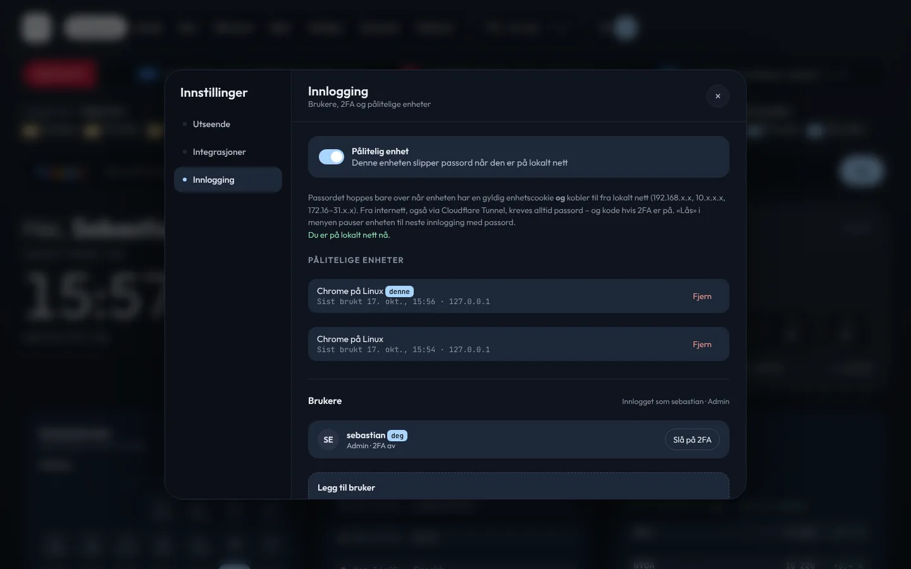

#  Sikkerhet

[← Til README](../README.md)

## Hva er offentlig

| Sti | Tilgang |
|---|---|
| `/login`, `/healthz`, `/assets/*` | Offentlig |
| `/cv` | Offentlig lesing. Redigering krever admin. |
| `/finans/api/login`, `/finans/api/logo/:domain` | Offentlig (innlogging for appene og favicons) |
| `/mat/calendar.ics?key=…` | Krever den hemmelige nøkkelen i URL-en |
| Alt annet | Innlogget sesjon eller Bearer-token |

## Brukere og roller

| Rolle | Kan |
|---|---|
| **admin** | Alt: legge til og fjerne brukere, sette roller, endre integrasjoner og CV, hele FinansHub, Hjem, Matplan og Domener |
| **bruker** | Dashboardet, egen 2FA, eget passord, og i FinansHub bare Delte mapper der brukeren er medlem |

- **Administrasjon:** brukere legges til av admin under **Innstillinger → Innlogging → Brukere** (brukernavn, passord og rolle).
- **Første oppstart:** eier-kontoen lages fra `USER_NAME` og `APP_PASSWORD_HASH`.
- **Sletting:** når en bruker slettes, slettes også sesjonene, enhetene, innstillingene og tokenene. Navnet beholdes som betaler i delte mapper.

## Passord

- **Hashing:** scrypt (N=2¹⁶, r=8, p=1, 64 MB, ca. 190 ms). Eldre hasher verifiseres fortsatt. Argon2 er ikke brukt fordi Node ikke har det innebygd før v24, se [DECISIONS.md](../DECISIONS.md).
- **Formatet** `scrypt:N:r:p:salt:hash` bruker `:` fordi Docker Compose tolker `$`.
- **Bytte passord:** gjør det under Innstillinger → Innlogging. Andre innlogginger for brukeren logges ut.
- **Rate limiting:** 5 feil per IP og 10 per bruker per 15 minutter. Ukjente brukernavn tar like lang tid som feil passord, så brukernavn kan ikke gjettes ut fra svartiden.

## Tofaktor (TOTP)

1. Innstillinger → Innlogging → **Slå på 2FA**.
2. Skann QR-koden med Google Authenticator, Aegis, 1Password eller lignende, eller skriv inn nøkkelen manuelt.
3. Skriv inn koden for å bekrefte. Du får **10 gjenopprettingskoder** som bare vises én gang.

| Detalj | Verdi |
|---|---|
| Algoritme | RFC 6238, SHA-1, 6 siffer, 30 s |
| Klokkeavvik | ±1 tidsvindu, og samme kode kan ikke brukes to ganger |
| Lagring | Hemmeligheten krypteres med AES-256-GCM (`TOTP_ENC_KEY` eller avledet fra `SESSION_SECRET`). Gjenopprettingskodene lagres som HMAC. |
| Innloggingssteg | «Tofaktor er på for X …». Billetten varer 5 min, med maks 5 forsøk. |
| Slå av | Krever passord eller en gyldig kode |
| Nødvei | `npm run reset-password -- <bruker>` på serveren |

## Pålitelig enhet på lokalt nett

«Husk denne enheten på lokalt nett» er krysset av som standard ved innlogging. Passordet hoppes **bare** over når begge disse er oppfylt:
1. Enheten har en gyldig enhetscookie (httpOnly, signert, 1 år) som hører til brukeren.
2. Klient-IP-en er privat: `10.0.0.0/8`, `172.16.0.0/12` eller `192.168.0.0/16`.

IP-en leses fra tilkoblingen, eller fra `CF-Connecting-IP` bak Cloudflare. Den leses **aldri** fra `X-Forwarded-For`, som klienten kan sette selv. Fra internett kreves alltid passord og eventuelt 2FA. **Lås** i menyen pauser enheten til neste innlogging med passord.

## Sesjoner og tokens

- **Sesjoner:** tilfeldig ID i en httpOnly-cookie (`SameSite=Lax`, `Secure` når `COOKIE_SECURE=true`), varighet 30 dager. Bare en HMAC av ID-en lagres.
- **API-tokens:** `fh_pat_` + 32 tegn. Tokenet vises én gang, og bare hashen lagres.

  | Tilgang | Gir |
  |---|---|
  | `finance:read` | Lese alt i FinansHub |
  | `finance:write` | Endre alt i FinansHub |
  | `receipts:write` | Bare laste opp kvitteringer (iOS-snarvei) |
  | `read:transactions`, `read:summary`, `read:budget` | Smal lesetilgang |
  | `write:transactions` | Smal skrivetilgang |

  Utløp: 30 d, 90 d, 1 år eller aldri. Listen viser når tokenet sist ble brukt og har «Trekk tilbake». Et token kan aldri gi seg selv flere tilganger enn det har, og det gir aldri tilgang til resten av homelab utenom Hjem, Matplan og Domener for admin.

## Hemmeligheter

- **API-nøkler** i Integrasjoner og FinansHub (Gemini, Trading 212, SMB, IMAP, Cloudflare) lagres kryptert på serveren, og vises bare som «lagret».
- **Nøkler i nettleseren:** ingen nøkler sendes til nettleseren. Alle eksterne kall går fra serveren.
- **Tredjeparts-JS:** CSP-en (`script-src 'self'`) blokkerer inline-skript og tredjeparts-JS.

## Anbefalt drift

- Bruk **Cloudflare Tunnel + Access** og ingen åpne porter. Se [installasjon.md](installasjon.md#cloudflare-tunnel-og-access).
- Slå på 2FA for alle admin-brukere.
- Sett `TOTP_ENC_KEY` og `SECRET_KEY` eksplisitt, og ta vare på dem sammen med backupen.
- Bruk en egen passfrase for backup, se [backup.md](backup.md).
