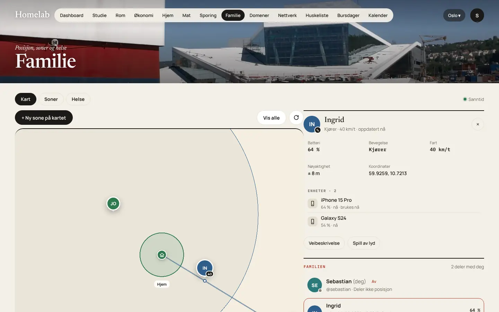

# Familie og kart

Familie viser hvor familien er, med soner, varsler og helse. Den finnes på web, i PWA-en og i appene, med fanene **Kart · Soner · Helse · Mer**.

{ loading=lazy }

!!! warning "Viktig"

    **Deling er av som standard.** Etter 4.13.0 må alle slå på posisjonsdeling på nytt. Du ser bare dem som deler med deg, og helse vises aldri når delingen er av.

## Slå på deling

**I appen (anbefalt, siden posisjonen kommer fra telefonen):**

1. **Innstillinger → App → Helse og posisjon.**
2. Slå på **posisjonsdeling** og gi appen tilgang til posisjon. Velg «Alltid» på iOS og «Tillat hele tiden» på Android, hvis sonevarsler skal virke i bakgrunnen.
3. Velg presisjon: **nøyaktig** eller **omtrentlig**.
4. Har du flere telefoner, vises du likevel én gang («· 2 enheter»). Velg hvilken enhet posisjonen skal komme fra, eller **Automatisk**.

**Valgene for deling:**

| Valg | Betyr |
|---|---|
| **På** | Familien ser posisjonen din i sanntid |
| **Pause** | Ingen nye posisjoner sendes. Siste posisjon blir stående. |
| **Av** | Ingenting deles, og **lagrede posisjoner slettes** på serveren |
| **Omtrentlig** | Familien ser bare omtrent hvor du er |

Serveren håndhever valget, så en eldre app kan ikke dele mer enn du har valgt.

## Kartet

- Standardkartet er **Kartverket topo**. Kartflisene hentes gjennom serveren (`/tiles/...`) og caches i 30 dager.
- Med nøkkel kan du også bruke MapTiler eller Stadia, se [Integrasjoner](integrasjoner.md#maptiler-og-stadia). iPhone og iPad bruker Apple Maps.
- Hver person vises med profilbilde, fart og spor. Du kan sette et eget bilde på hver person. Bildet er bare synlig for deg.
- Personkortet viser batteri, bevegelse, fart, nøyaktighet og enheter, med **Veibeskrivelse** og **Spill av lyd**.
- Posisjonskortet på Hjem viser sonen, «Går · Bislett», strøket, eller «Sist sett 14:32».

!!! info

    Er kartflisene grå eller viser **403**, får ikke serveren kontakt med kartleverandøren. Se [Feilsøking](../feilsoking.md#kartet-er-grått-eller-viser-403).

## Soner

1. **Soner → + Ny sone på kartet.** Trykk på kartet der sonen skal være.
2. Gi den navn (for eksempel «Skole»), radius, farge og ett av 13 ikoner: hjem, jobb, skole, hjerte, hytte, trening, butikk, ball, kafé, tre, fly, stjerne eller nål.
3. Sonen er **din egen**, til du slår på **Del med familien**. Bare den som lagde sonen, kan endre eller slette den.
4. **Varsler:** velg per person om du vil ha varsel når de kommer til eller drar fra sonen.

Sonene sjekkes på telefonen.

## Helse

Helse hentes fra **Apple Health** (iOS) eller **Health Connect** (Android). Bare datatypene du velger, deles, og bare når posisjonsdelingen er på.

- Oppsett: se [Mobilapper → Apple Health](../oppsett/mobilapper.md#apple-health-ios) og [Health Connect](../oppsett/mobilapper.md#health-connect-android).
- Med flere enheter telles helsedata ikke dobbelt.
- Slår du av hovedbryteren for helse, slettes helsedataene dine på serveren.

## Sanntid

Posisjoner og sonehendelser sendes over WebSocket (`/api/ws`) bare til dem som har tilgang. Se [API → Sanntid](../utvikling/api.md#sanntid-websocket).
