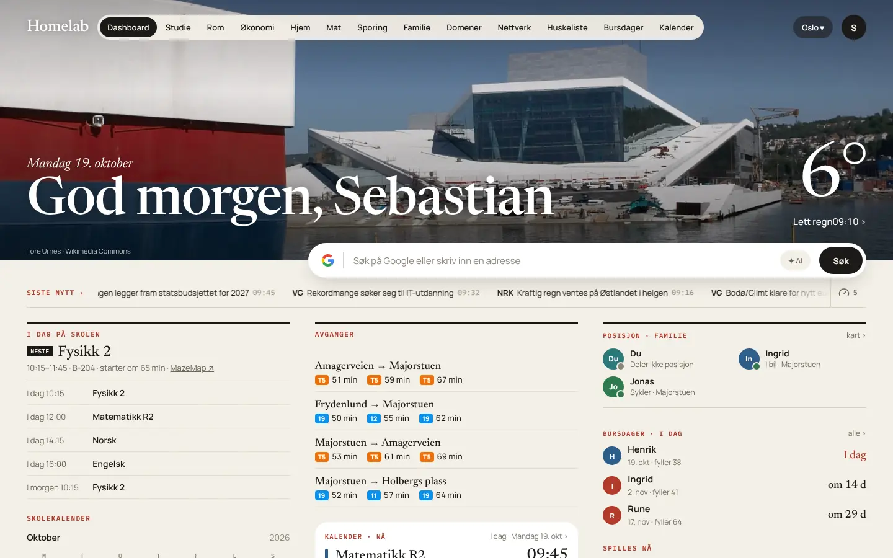

# Bruk

Slik bruker du modulene i Homelab OS. Hver bruker har sine egne data i alle modulene, se [Brukere og personvern](../oppsett/brukere-og-personvern.md).

{ .tv-shot loading=lazy }

-   :material-cash-multiple:{ .lg } **[FinansHub](finanshub.md)**

    ---

    Kontoer, bankimport, kvitteringer, budsjett, abonnementer, aksjer, Finn, Boliger og ✦ AI-søk.

-   :material-calendar-month-outline:{ .lg } **[Kalender og Bursdager](kalender-og-bursdager.md)**

    ---

    Skoletimeplan, prøver og frister, Google Kalender, bursdager og widgets.

-   :material-package-variant-closed:{ .lg } **[Sporing](sporing.md)**

    ---

    Pakker fra e-post, Finn og manuelt, med valg av tjeneste.

-   :material-map-marker-radius-outline:{ .lg } **[Familie og kart](familie-og-kart.md)**

    ---

    Posisjonsdeling, soner, helse og varsler.

-   :material-puzzle-outline:{ .lg } **[Integrasjoner](integrasjoner.md)**

    ---

    Steg for steg for Home Assistant, Google, Plex, Mybring, Entur, AI-motorene og resten.

-   :material-timer-cog-outline:{ .lg } **[AI og tidsgrenser](ai-og-tidsgrenser.md)**

    ---

    Motorer, «Hvem gjør hva», tidsgrenser, jobber og Ollama-modeller.

-   :material-chat-processing-outline:{ .lg } **[Chat](chat.md)**

    ---

    Samtaler med lokale og sky-modeller, Mine data, vedlegg og Open WebUI.

