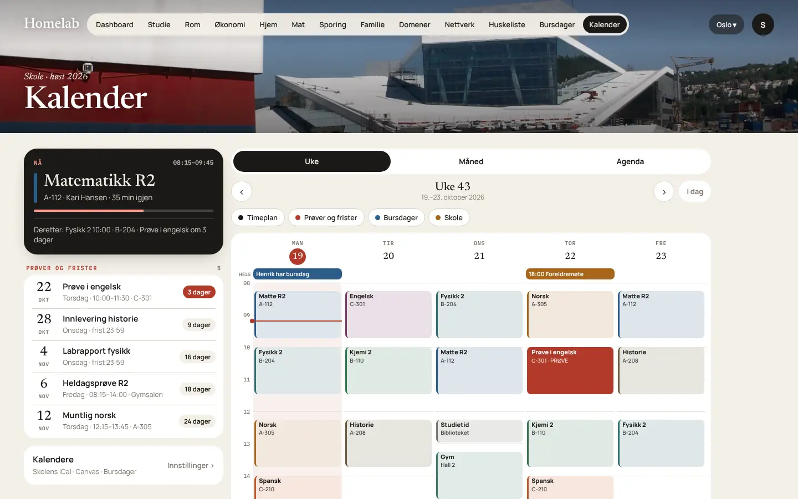

# Kalender og Bursdager

## Kalender

Kalenderen viser **skoletimeplanen** sammen med prøver, frister, bursdager og Google Kalender. På web er det fanen **Kalender**, og i appene ligger den under **Mer → Kalender**.

{ loading=lazy }

### Oppsett

1. **Innstillinger → Kalendere.** Her ligger alle kalenderkildene samlet:
    - **Skole-iCal:** timeplan og prøver
    - **Canvas-iCal:** innleveringer og frister
    - **Google Kalender:** logg inn med Google
    - **Home Assistant:** en kalender-entitet (admin)
2. Lim inn adressene og trykk **Test tilkobling**. Steg for steg står i [Integrasjoner → Skole-iCal og Canvas](integrasjoner.md#skole-ical-og-canvas) og [Integrasjoner → Google Kalender](integrasjoner.md#google-kalender).

Kalenderne hentes på nytt hver time. **Oppdater** henter dine kalendere på nytt med en gang.

### Hvordan hendelsene tolkes

| I kalenderen | Blir |
|---|---|
| `SUMMARY` | Faget, for eksempel «Matematikk R2» |
| `LOCATION` | Rommet, for eksempel «A-112» |
| `DESCRIPTION` eller `ORGANIZER` | Læreren |
| Tittel med «prøve», «heldag» eller «muntlig» | **Prøve** (vises i rødt). En prøve erstatter timen den overlapper. |
| Tittel med «innlevering» eller «frist» | **Frist** |
| Heldagshendelse med «fri» eller «planleggingsdag» | Timene den dagen skjules |
| Gjentakende hendelser (`RRULE`), flyttede timer og unntak | Håndteres |

### Visningene

- **Nå-kortet:** NÅ (time, rom, lærer, minutter igjen og fremdriftslinje), ellers NESTE TIME eller NESTE SKOLEDAG, og neste prøve.
- **Prøver og frister:** kommende, med nedtelling. Rødt betyr 7 dager eller mindre.
- **Uke:** mandag til fredag, 08–16, med nå-linje, rad for hele dagen og ukenummer. I helgen vises neste uke. Sveip for å bytte uke.
- **Måned:** prikker per dag. Trykk på en dag for å se listen.
- **Agenda:** 21 dager fremover, gruppert per dag.
- **Detaljkort:** rom, lærer, fag, merknad, påminnelse og lenken «Finn rommet i MazeMap».
- **Filter:** Timeplan, Prøver og frister, Bursdager og Skole. Lagres per bruker.

**Tilpass:** hold inne et kort for å flytte det (▲ ▼) eller skjule det (−).

**Påminnelser:** standard er dagen før for prøver og frister, og ingen for vanlige timer. Påminnelsene er lokale varsler på telefonen.

### Widgets

| | Liten | Medium | Stor |
|---|---|---|---|
| **Innhold** | NÅ eller NESTE TIME, klokkeslett, fag, rom og «34 min igjen» | Som liten, pluss de tre neste timene | Alle dagens timer, og de to neste prøvene og fristene |
| **iPhone** | ✓ | ✓ | ✓ |
| **Android (Material You)** | 2 × 2 | 4 × 2 | 4 × 4 |
| **Samsung (One UI)** | 2 × 2 | 4 × 2 | 4 × 4 |

Widgetene oppdateres når hver time starter og slutter. På Android kan oppdateringen komme et minutt for sent. Etter siste time viser de neste skoledag. Det finnes også en Kalender-widget på **Hjem** i appen og på dashboardet.

---

## Bursdager

{ loading=lazy }

Bursdager viser **neste bursdag**, søk, og en liste per måned med alder og dager igjen. På web er det fanen **Bursdager**, og i appene **Mer → Bursdager**.

### Legge til

- Trykk **+ Legg til**, og skriv navn, dato, eventuelt fødselsår (for alder) og hvem det er: familie, venn, jobb eller annet.
- Velg hvor bursdagen skal lagres: **lokalt**, i **Google Kalender** eller i **Home Assistant**.
- Lagres en bursdag i Google eller Home Assistant og kilden avviser den, beholdes den lokalt, og du får beskjed.

### Google Kalender

1. Admin setter opp OAuth-klienten, se [Integrasjoner → Google Kalender](integrasjoner.md#google-kalender).
2. Hver bruker går til **Innstillinger → Kalendere → Google Kalender → Logg inn med Google** og velger kalender.
3. Bursdager fra Google-kontaktene dine (kalenderen «Bursdager») hentes også inn.

### Home Assistant

Under **Innstillinger → Kalendere → Home Assistant** velger admin en kalender-entitet og trykker **Importer**. Synken går begge veier.

### Påminnelser og widgets

- Påminnelse kl. **09:00**, på dagen eller dagene før, som du velger per bursdag.
- Widgets: på Hjem, på iOS (liten, medium og låseskjerm), på Android (Material You) og på Samsung.

### Eksempel med API

```bash
curl -s https://os.example.no/api/birthdays \
  -H "Authorization: Bearer $TOKEN" -H 'content-type: application/json' \
  -d '{"name":"Emma","month":10,"day":21,"year":2012,"relation":"familie","saveTo":"local"}'
```

Se [API](../utvikling/api.md#bursdager).
