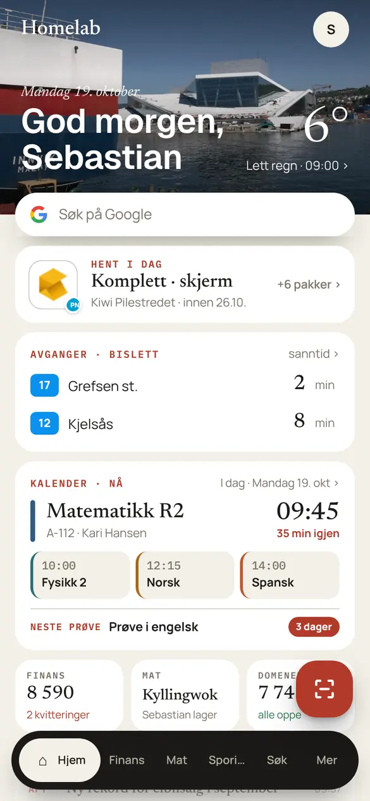
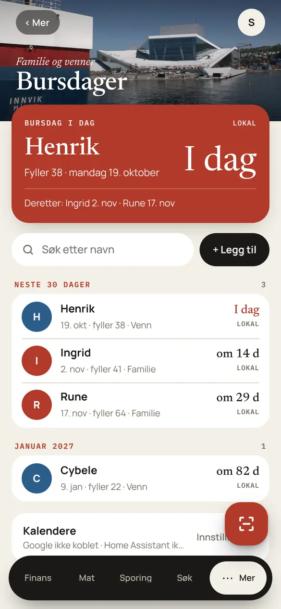
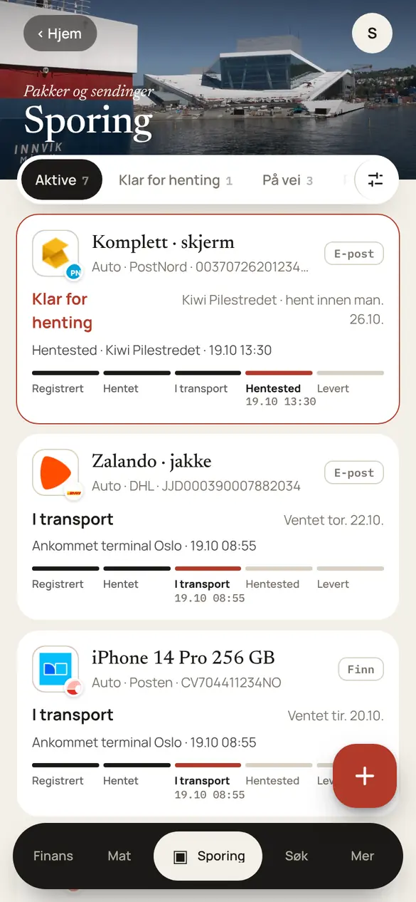
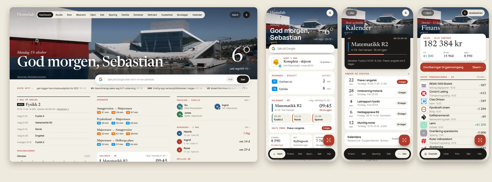

<div class="tv-hero" markdown>
<span class="tv-hero__eyebrow">Selvhostet · norsk · versjon 4.20</span>

<h1 class="tv-hero__title">Et <em>operativsystem</em> for hjemmet</h1>

<p class="tv-hero__lead">Homelab OS gir deg et dashboard for hverdagen, økonomiappen FinansHub med AI-lesing av kvitteringer, og native apper for iPhone, Android og brettbare telefoner. Alt kjører på din egen server, og nøklene forlater den aldri.</p>

<div class="tv-hero__actions" markdown>
[Kom i gang :material-arrow-right:](oppsett/installasjon.md){ .md-button .md-button--primary }
[Se funksjonene](bruk/index.md){ .md-button }
[Kildekoden :fontawesome-brands-github:](https://github.com/SebastianKristo/torskenes-verden){ .md-button }
</div>
</div>

<div class="tv-phones" markdown>
<figure><figcaption>Hjem</figcaption></figure>
<figure><figcaption>Finans</figcaption></figure>
<figure><figcaption>Kalender</figcaption></figure>
<figure><figcaption>Bursdager</figcaption></figure>
<figure><figcaption>Sporing</figcaption></figure>
<figure><figcaption>Familie</figcaption></figure>
</div>

!!! tip "Bare prøve? Ingen nøkler trengs"

    Start med eksempeldata på din egen maskin: `MOCK_DATA=1 npm run dev`. Se [hurtigstarten](#hurtigstart) under. Alle skjermbildene på denne siden er tatt slik, så navn, tall og pakker er eksempeldata.

## Hva systemet kan

<div class="grid cards" markdown>

-   :material-view-dashboard-outline:{ .lg .middle } **Hjem og dashboard**

    ---

    Avganger fra Entur, vær fra MET, kalender, pakker, familie, nyheter, media og strømpris på én skjerm.

    [:octicons-arrow-right-24: Integrasjoner](bruk/integrasjoner.md)

-   :material-cash-multiple:{ .lg .middle } **FinansHub**

    ---

    Kontoer, bankimport, kvitteringer med AI eller lokal OCR, budsjett, abonnementer, aksjer, Finn-handler og delte Boliger.

    [:octicons-arrow-right-24: FinansHub](bruk/finanshub.md)

-   :material-calendar-month-outline:{ .lg .middle } **Kalender og Bursdager**

    ---

    Skoletimeplan fra iCal og Canvas, prøver og frister, Google Kalender og bursdager med påminnelser og widgets.

    [:octicons-arrow-right-24: Kalender](bruk/kalender-og-bursdager.md)

-   :material-package-variant-closed:{ .lg .middle } **Sporing**

    ---

    Pakker fra e-post, Finn og manuelt, med Posten, Bring, PostNord, DHL og flere.

    [:octicons-arrow-right-24: Sporing](bruk/sporing.md)

-   :material-map-marker-radius-outline:{ .lg .middle } **Familie og kart**

    ---

    Posisjon, soner og helse, men bare med dem du velger å dele med. Deling er av som standard.

    [:octicons-arrow-right-24: Familie](bruk/familie-og-kart.md)

-   :material-creation-outline:{ .lg .middle } **AI og Chat**

    ---

    Ollama lokalt, eller Gemini og Groq i sky. Velg motor per oppgave, og få spørsmål før data sendes ut.

    [:octicons-arrow-right-24: AI og Chat](bruk/chat.md)

-   :material-cellphone:{ .lg .middle } **Native apper**

    ---

    SwiftUI på iPhone og iPad, Jetpack Compose på Android og Galaxy Fold, og PWA for alt annet. Widgets på alle tre.

    [:octicons-arrow-right-24: Mobilapper](oppsett/mobilapper.md)

-   :material-shield-lock-outline:{ .lg .middle } **Egne data per bruker**

    ---

    Hver i familien har sin egen konto med 2FA. Ingen ser andres data, heller ikke andre administratorer.

    [:octicons-arrow-right-24: Brukere og personvern](oppsett/brukere-og-personvern.md)

</div>

## Hurtigstart

Du trenger en Linux-maskin med Docker og Docker Compose. Hele veiledningen, med Cloudflare Tunnel og reverse proxy, står i [Installasjon](oppsett/installasjon.md).

=== ":fontawesome-brands-docker: Docker"

    ```bash
    git clone https://github.com/SebastianKristo/torskenes-verden.git /opt/homelab-os
    cd /opt/homelab-os
    cp .env.example .env
    sed -i "s/^SESSION_SECRET=.*/SESSION_SECRET=$(openssl rand -hex 32)/" .env

    # Bare på LAN med http? Gjør appen synlig og slå av secure-cookie:
    echo "BIND_ADDR=0.0.0.0" >> .env
    sed -i "s/^COOKIE_SECURE=.*/COOKIE_SECURE=false/" .env

    docker compose up -d --build
    curl http://localhost:3000/healthz      # → ok
    ```

=== ":simple-proxmox: Proxmox"

    Kjør på **Proxmox-verten** som root (*pve → Shell*). Skriptet lager en Debian 12-LXC med Docker og starter tjenesten.

    ```bash
    bash -c "$(curl -fsSL https://raw.githubusercontent.com/SebastianKristo/torskenes-verden/main/deploy/proxmox/install.sh)"
    ```

=== ":material-server: Unraid"

    1. Kopier [`homelab-os.xml`](https://github.com/SebastianKristo/torskenes-verden/blob/main/deploy/unraid/homelab-os.xml) til `/boot/config/plugins/dockerMan/templates-user/`.
    2. **Docker → Add Container** og velg malen `homelab-os`.
    3. Fyll inn `SESSION_SECRET`, og la `APP_PASSWORD_HASH` stå tom.

=== ":material-laptop: Prøve lokalt"

    ```bash
    npm install
    cp .env.example .env
    sed -i "s/^SESSION_SECRET=.*/SESSION_SECRET=$(openssl rand -hex 32)/; s/^COOKIE_SECURE=.*/COOKIE_SECURE=false/" .env
    MOCK_DATA=1 npm run dev        # http://localhost:3000, eksempeldata
    ```

Åpne så `http://<serverens-ip>:3000`. Første gang får du et oppsett i fire steg: navnet ditt, navnet på serveren, brukernavn og passord, og bakgrunn. Du blir hovedadmin.

## Hvor skal jeg begynne?

| Jeg vil … | Les |
|---|---|
| installere serveren for første gang | [Installasjon](oppsett/installasjon.md) |
| oppdatere uten å miste data | [Oppdatering og backup](oppsett/oppdatering-og-backup.md) |
| legge til familien og forstå hva de ser | [Brukere og personvern](oppsett/brukere-og-personvern.md) |
| få appen på telefonen | [Mobilapper](oppsett/mobilapper.md) |
| koble til Home Assistant, Google, Plex, Mybring og andre | [Integrasjoner](bruk/integrasjoner.md) |
| sette opp AI for kvitteringer, søk og chat | [AI og tidsgrenser](bruk/ai-og-tidsgrenser.md) · [Chat](bruk/chat.md) |
| lage egne skript, snarveier eller Home Assistant-sensorer | [API](utvikling/api.md) |
| løse et problem | [Feilsøking og FAQ](feilsoking.md) |

{ .tv-shot loading=lazy }

Dokumentasjonen gjelder **4.20.0** og nyere. Se [endringsloggen](https://github.com/SebastianKristo/torskenes-verden/blob/main/CHANGELOG.md) for hva som er nytt.
