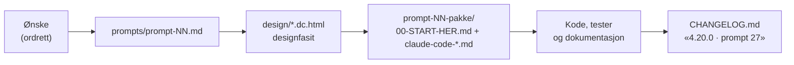

# Prompt og designhandoff

Homelab OS bygges i runder. Ønskene skrives ned ordrett, blir til et design, og deretter til en pakke med oppgaver som Claude Code bygger etter. Alt ligger i [`design_handoff_homelab/`](https://github.com/SebastianKristo/torskenes-verden/tree/main/design_handoff_homelab).

## Mappene

| Hvor | Hva |
|---|---|
| `prompts/prompt-NN.md` | Ønskene **ordrett**, med dato, og en kort tolkning under hvert punkt med hvilken designfil som endres |
| `prompts/prompt-NN-pakke/` | Pakken for runden: `00-START-HER.md` med oppgavene i rekkefølge, og én `claude-code-*.md` per oppgave |
| `design/*.dc.html` | High-fidelity HTML-prototyper. Åpne dem i nettleseren sammen med `design/support.js`. |
| `CLAUDE.md` | Prosjektinstruksen: hvordan prompter samles og hvilken fil som er aktiv |
| `README.md` og `PROMPT-CLAUDE-CODE.md` | Grunnlaget fra første runde: sider, ruter, innlogging og hosting |

## Slik går en runde

1. **Samle.** Skriv «nytt promt». Alt etter det legges ordrett i neste ledige `prompts/prompt-NN.md`, til du skriver «nytt promt» igjen.
2. **Designe.** Hvert ønske bygges inn i riktig `design/*.dc.html`, for eksempel `Mobil Papir App.dc.html` for appen og `Homelab Papir Web.dc.html` for web.
3. **Pakke.** `prompt-NN-pakke/00-START-HER.md` lister oppgavene i rekkefølge, med lenke til en egen `claude-code-*.md` per oppgave: krav, API-kontrakt, tester og hva som ikke skal endres.
4. **Bygge.** Claude Code leser `00-START-HER.md`, bygger oppgavene, og bruker designfilene som fasit for farger, typografi, radius og tekst.
5. **Dokumentere.** Endringene får en oppføring i [CHANGELOG.md](https://github.com/SebastianKristo/torskenes-verden/blob/main/CHANGELOG.md) med prompt-nummeret, og wikien og denne siden oppdateres.

!!! example "Eksempel fra prompt 27"

    Ønsket «når jeg feks i finans skal søke etter enkel ting som butikk navn … gi mulige treff» ble til:

    - et punkt i `prompt-27.md` med tolkningen: opptil 6 forslag fra butikker, kategorier og varelinjer, rangert etter treff på starten av navnet, og tåler én skrivefeil
    - en endring i `design/Mobil Papir App.dc.html` (Finans → Søk)
    - oppgaven `claude-code-finans-sokeforslag.md` i pakken
    - linja «**Finans-søkeforslag:** treff mens du skriver, som hos Google» i endringsloggen for 4.20.0

## Papir-designet

Designet heter **Papir** og går igjen i web, PWA, appene og denne siden:

| | Lyst | Mørkt |
|---|---|---|
| Bakgrunn | papir `#f3efe6` | `#11141b` |
| Tekst | blekk `#1b1a17` | `#ece9e2` |
| Aksent | lab-rød `#b23a2a` | laks `#f08a76` |
| Fonter | Newsreader (overskrifter), Manrope (tekst), IBM Plex Mono (etiketter og tall) | samme |
