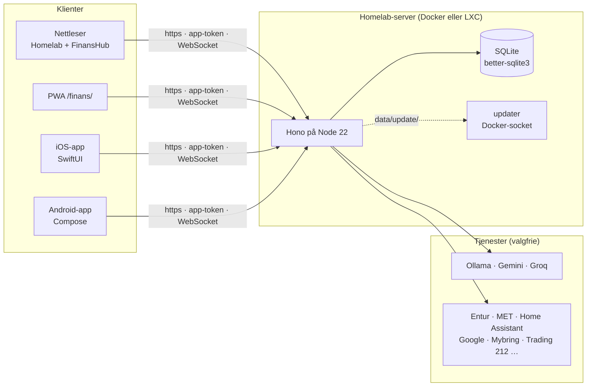

# Arkitektur

Homelab OS er **én Node-tjeneste** med en SQLite-database i `data/`. Nettsidene er vanlige ES-moduler uten byggesteg, og de native appene snakker med det samme JSON-API-et som nettsiden.



## Valgene

| Valg | Hvorfor |
|---|---|
| **Hono på Node 22** | Lite, raskt og med god støtte for `fetch`. Ingen byggesteg. |
| **SQLite (better-sqlite3)** | Én fil, enkel backup og synkrone spørringer. FTS5 gir fritekstsøk. |
| **Vanilla ES-moduler** | Ingen bundler. CSP-en (`script-src 'self'`) holder seg streng. |
| **Native apper** | Ekte Liquid Glass og Material 3, nøkkelring og Keystore, kamera og WorkManager. |
| **Egen updater-container** | Appen har aldri Docker-tilgang. Bare den lille updateren har socketen, og den har ingen porter. |

Begrunnelsen for flere valg står i [DECISIONS.md](https://github.com/SebastianKristo/torskenes-verden/blob/main/DECISIONS.md).

## Mappestruktur

```text
server/
  index.js            ruter, sikkerhetshoder, statiske filer, oppstart
  auth.js totp.js     brukere, sesjoner, enheter, rate limiting, TOTP og QR
  db.js               SQLite-skjema for homelab (users, sessions, devices, kv …)
  settings.js ui.js   integrasjonsoppsett og innstillinger per bruker
  integrations.js     Entur, MET, iCal, HA, T212, Sonarr/Radarr, RSS, NASA, CelesTrak
  chat.js             Chat (/api/chat/*)
  system-update.js    Oppdatering fra appen (/api/system/update)
  finans/             FinansHub: routes.js, db.js, ai.js, search.js, backup.js …
public/
  app.html js/ css/   Homelab, én modul per fane
  finans/             FinansHub: desktop, mobil-PWA og service worker
apps/android/ apps/ios/   native apper
deploy/               proxmox/install.sh, proxmox/update.sh, unraid/, updater/
scripts/              hash-password.js, reset-password.js
test/                 node --test
docs/                 referanse, wiki/ (GitHub-wikien), site/ (denne siden), images/
design_handoff_homelab/   prompter og designfasit, se Prompt og designhandoff
```

## Data og sikkerhet

- **Data per bruker.** Dataene har en eier (`user_id`), og rutene filtrerer på innlogget bruker. Bare Boliger deles, med medlemmene.
- **Hemmeligheter forlater aldri serveren.** Nøkler lagres kryptert, og klientene ser bare om en nøkkel er satt.
- **Innlogging:** scrypt-hashede passord, httpOnly-sesjonscookie, TOTP, og app-tokens (`fh_pat_…`) med egne tilganger.
- **Sanntid** går over WebSocket på `/api/ws`, og bare til den som eier dataene.

Mer i [docs/sikkerhet.md](https://github.com/SebastianKristo/torskenes-verden/blob/main/docs/sikkerhet.md).
