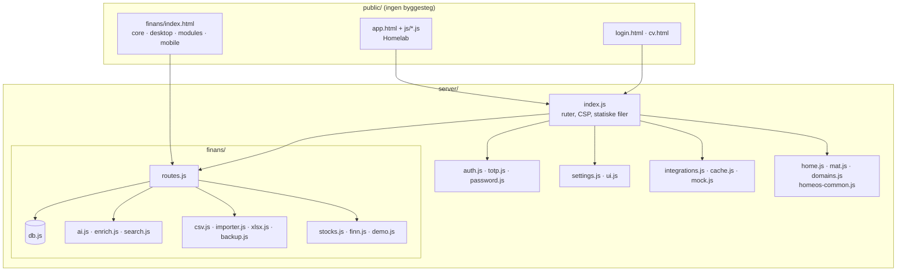

#  Utvikling

[← Til README](../README.md)

## Arkitektur



| Valg | Hvorfor |
|---|---|
| **Hono på Node 22** | Lite, raskt og med god støtte for `fetch`. Ingen byggesteg. |
| **SQLite (better-sqlite3)** | Én fil, enkel backup og synkrone spørringer. FTS5 gir fritekstsøk. |
| **Vanilla ES-moduler** | Ingen bundler. CSP-en (`script-src 'self'`) holder seg streng. |
| **Native apper** | Ekte Liquid Glass og Material 3, nøkkelring og Keystore, og kamera og WorkManager. |

Begrunnelsen for flere valg står i [DECISIONS.md](../DECISIONS.md).

## Kom i gang

```bash
npm install
MOCK_DATA=1 npm run dev     # http://localhost:3000, eksempeldata, starter på nytt ved endringer
npm test                    # node --test "test/**/*.test.js"
```

`MOCK_DATA=1` gir eksempeldata for alle integrasjoner, laster demo-økonomi i en tom database, og legger inn tre eksempeldomener. Alt fungerer uten nett.

## Mappestruktur

```
server/
  index.js            ruter, sikkerhetshoder, statiske filer, oppstart
  auth.js totp.js     brukere, sesjoner, enheter, rate limiting, TOTP og QR
  password.js         scrypt-hashing
  db.js               SQLite-skjema for homelab (users, sessions, devices, kv …)
  settings.js ui.js   integrasjonsoppsett og innstillinger per bruker
  integrations.js     Entur, MET, iCal, HA, T212, Sonarr/Radarr, RSS, NASA, CelesTrak
  home.js mat.js domains.js   Hjem, Matplan og Domener
  finans/             FinansHub (se tabellen under)
public/
  app.html js/ css/   homelab, én modul per fane (dash, study, space, home, mat, domains, net …)
  finans/             FinansHub: core.js (felles), desktop.js + modules.js, mobile*.js, sw.js
apps/android/ apps/ios/   native apper
deploy/               proxmox/install.sh, proxmox/update.sh, unraid/homelab-os.xml
scripts/              hash-password.js, reset-password.js
test/                 node --test
docs/                 dokumentasjon, bilder (images/) og ikoner (assets/)
```

| `server/finans/` | Ansvar |
|---|---|
| `db.js` | Tabeller (`fh_*`), migreringer, innstillinger og krypterte hemmeligheter |
| `routes.js` | Hele `/finans/api`, tilgangskontroll og tokens |
| `ai.js` | Ollama og Gemini med JSON-skjema, reserve og nytt forsøk |
| `enrich.js` | ✦ sammendrag, domene og logo per butikk |
| `search.js` | AI-søk: FTS5 og embeddings, med tallsjekk av svaret |
| `csv.js` / `importer.js` / `xlsx.js` | Bankimport, DNB-rensing, lesing og skriving av xlsx |
| `backup.js` | Eksport, SMB, kryptering og gjenoppretting |
| `stocks.js` / `finn.js` | Trading 212 og Finn-handler |
| `demo.js` | Eksempeldata |

## CI

| Workflow | Når | Hva |
|---|---|---|
| [`docker.yml`](../.github/workflows/docker.yml) | Push til `main` | Bygger og publiserer `ghcr.io/sebastiankristo/torskenes-verden` |
| [`mobile.yml`](../.github/workflows/mobile.yml) | Endringer i `apps/` | Android-APK, og iOS på macOS 15 og 26 (simulator og usignert `.ipa`) |

APK-en og `.ipa`-filen lastes ned under **Actions → Mobilapper → Artifacts**.

## Skjermbilder til dokumentasjonen

Bildene i `docs/images/` er tatt med Playwright mot en server med `MOCK_DATA=1`, i 1440×900 for desktop og i iPhone-, Pixel- og Pixel Fold-størrelse for mobil. De er lagret som WebP.

## Web: lasting, henting og service workere

Fase 3 (ytelse, B §3). Hjelperne ligger i `public/js/lib/` og brukes av både Homelab og FinansHub (`/assets/js/lib/…`).

| Hva | Hvordan |
|---|---|
| **Rutene** | `app.js` laster rutemodulen med `import()` når ruten åpnes. Skallet (topplinje, meny, søk, temaer) er statisk. Nabofanene forhåndslastes når nettleseren er ledig, og en fane lastes når pekeren er over den. `settings.js` er en lett inngang; selve vinduet (`settings-view.js` med sidene) lastes når innstillingene åpnes. En ny rute legges i `MODS`/`ROUTES` i `app.js`, ikke som statisk import. |
| **Periodisk henting** | `lib/poll.js`: `poll(fn, ms, { visible, first })`. Pauser når fanen er skjult eller `visible()` er falsk, og tar igjen hentingen når siden vises (`wakePolls()` etter rutebytte). Ikke bruk `setInterval` for henting. Sanntid går over `/api/ws` (`realtime.js` `onLive`). |
| **Layout** | Les fra DOM-en før du skriver. `lib/viewport.js` (`vw()`, `vh()`) i stedet for `innerWidth`/`innerHeight` i tegnekode. Mål etter layout (ResizeObserver, `requestAnimationFrame`) i stedet for rett etter `innerHTML`. |
| **Lange lister** | `lib/chunks.js` `appendChunks(beholder, antall, (fra, n) => html)`: tegn de første radene, resten ved scroll eller når nettleseren er ledig. Transaksjonene har også `?limit&cursor` → `nextCursor` på serveren. |
| **Datoer** | `lib/dates.js`: forhåndsvisningen av raske avtaler er serverens tolkning (`POST /api/kalender/quick/parse`); dager i spørsmål tolkes med `POST /api/dates/parse`, helligdager kommer fra `GET /api/dates/holidays`. Web regner ikke ut datoer selv. |

**Service workere.** Det er to, fordi Homelab og FinansHub er to installerbare apper med hver sin scope og hvert sitt push-abonnement: `/sw.js` (scope `/`) og `/finans/sw.js` (scope `/finans/`). Å slå dem sammen ville flytte FinansHubs registrering og push-abonnement, så de holdes adskilt, men strategien er den samme:

| Forespørsel | Strategi |
|---|---|
| Navigasjon (HTML) | Nettet først (`no-store`), siste kopi uten nett. Homelab faller tilbake til skallet `/` |
| `/assets/…?v=<build>` | Cachen først (filene endres aldri). Uten nett og uten treff: samme fil uten `?v` fra cachen |
| `/assets/…` uten `v` | Nettet først (`no-cache`), cachen uten nett |
| API | Aldri via cachen, unntatt noen lese-API-er i Homelab (`api51-les`, nettet først) og bildene (plakater, bakgrunner: cachen først) |
| Forhåndscache | Homelab: skallet `/` og de statiske modulene og stilarkene det laster (følger importene ved installasjon). FinansHub: `SHELL`-lista |

Øk cachenavnet (`os-vNN`, `finanshub-vNN`) når strategien eller forhåndscachen endres.

## Konvensjoner

- **Språk:** all tekst i grensesnittet er norsk bokmål.
- **Formater:** tall skrives `1 234,56`, minus `−` og dato `dd.mm.åååå`.
- **Beløp** lagres i øre (heltall) i FinansHub.
- **Hemmeligheter** forlater aldri serveren. Nye nøkler legges i `SCHEMA` (homelab) eller som `secret()` (FinansHub).
- **Integrasjoner:** en ny integrasjon skal ha en mock i `mock.js` og en forklaring i kortet når den ikke er satt opp.
