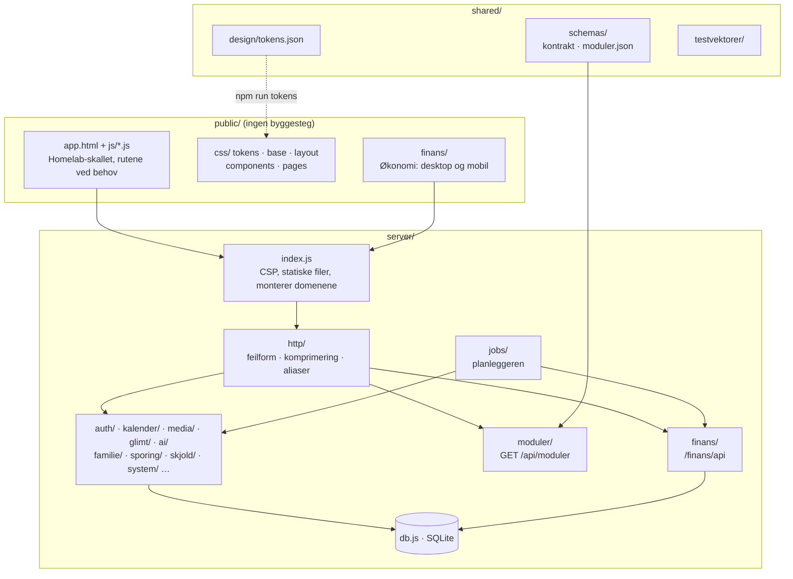

#  Utvikling

[← Til README](../README.md)

## Arkitektur



| Valg | Hvorfor |
|---|---|
| **Hono på Node 22** | Lite, raskt og med god støtte for `fetch`. Ingen byggesteg. |
| **SQLite (better-sqlite3)** | Én fil, enkel backup og synkrone spørringer. FTS5 gir fritekstsøk. |
| **Vanilla ES-moduler** | Ingen bundler. CSP-en (`script-src 'self'`) holder seg streng. |
| **Native apper** | Ekte Liquid Glass og Material 3, nøkkelring og Keystore, og kamera og WorkManager. |

Begrunnelsen for flere valg står i [DECISIONS.md](../DECISIONS.md).

## Kom i gang

```bash
npm install
MOCK_DATA=1 npm run dev     # http://localhost:3000, eksempeldata, starter på nytt ved endringer
npm test                    # node --test "test/**/*.test.js"
```

`MOCK_DATA=1` gir eksempeldata for alle integrasjoner, laster demo-økonomi i en tom database, og legger inn tre eksempeldomener. Alt fungerer uten nett.

## Mappestruktur

Én mappe per domene på serveren, og én fil per skjerm eller komponent på alle plattformer, med beskrivende navn (CLAUDE.md).

```
server/
  index.js            sikkerhetshoder, statiske filer, oppstart, monterer domenene (mount<Domene>(app))
  db.js               SQLite-skjema for homelab (users, sessions, devices, kv …) og statement-cache q(sql)
  http/               felles feilform {error, code}, brotli/gzip, eldre API-aliaser (tellet), grenser for anonyme forespørsler
  jobs/               planleggeren for bakgrunnsjobber
  auth/               innlogging, økter, enheter, 2FA, passkeys, QR, app-tokens, invitasjoner, serveradressen
  ai/                 AI-gaten (gate.js, run.js), AI-kontroll, minne, Chat og de lokale motorene
  glimt/              Glimt: motoren, samtalen, minnet og Brief
  kalender/ media/ familie/ sporing/ gjoremal/ mat/ vaer/ reise/ nyheter/ studie/ rom/ bibel/ skjold/ domener/
                      ett domene per mappe, med index.js som monterer rutene
  moduler/            modullisten (GET /api/moduler) og grupperingen av tilkoblinger
  system/             backup, oppdatering, drift, søk i innstillinger, tema
  dates/              datotolking, «i dag» i Oslo og helligdager
  finans/             Økonomi (se tabellen under)
  settings.js ui.js integrations.js mock.js   integrasjonsoppsett, innstillinger per bruker og eksempeldata
public/
  app.html js/        Homelab-skallet og én modul per side (rutene i app.js lastes med import())
  js/lib/             felles hjelpere for Homelab og Økonomi (poll, chunks, dates, viewport)
  css/                tokens.css (generert), base.css, layout.css, papir-mork.css, components/, pages/
  finans/             Økonomi: core.js (felles), desktop.js, js/ og css/, mobile*.js, sw.js
shared/
  schemas/            API-kontrakten (JSON Schema), eksempler, moduler.json og tilkoblinger.json
  design/             tokens.json, kilden til CSS, Swift og Kotlin (npm run tokens)
  testvektorer/       felles fasit for regler som også appene har
apps/ios/             SwiftUI (XcodeGen, project.yml), HomelabTests
apps/android/         Compose: app, kalender, wear, felles (ren Kotlin) og felles-android
deploy/               proxmox/install.sh, proxmox/update.sh, unraid/homelab-os.xml
scripts/              hash-password.js, reset-password.js, reset-2fa.js, rekey-secrets.js, design-tokens.mjs, android-nokkel.sh
test/                 node --test, e2e51/ (ende-til-ende), a11y51/ (tilgjengelighet), visuelle tester og ytelse
docs/                 dokumentasjon, bilder (images/) og ikoner (assets/)
```

| `server/finans/` | Ansvar |
|---|---|
| `index.js` | Monterer `/finans/api` og jobbene via planleggeren |
| `db.js` | Tabeller (`fh_*`), migreringer, innstillinger og krypterte hemmeligheter |
| `routes.js` | Det meste av `/finans/api`, tilgangskontroll og tokens |
| `faste-betalinger.js` / `cycles.js` / `subs.js` | Faste betalinger, neste trekk og beløp per måned (Oslo-tid) |
| `category-migration.js` | «Flytt til nye kategorier» (admin): forhåndsvisning, utføring og angring |
| `ai.js` | Ollama og Gemini med JSON-skjema, reserve og nytt forsøk |
| `enrich.js` | ✦ sammendrag, domene og logo per butikk |
| `search.js` | AI-søk: FTS5 og embeddings, med tallsjekk av svaret |
| `csv.js` / `importer.js` / `xlsx.js` | Bankimport, DNB-rensing, lesing og skriving av xlsx |
| `backup.js` | Eksport, SMB, kryptering og gjenoppretting |
| `stocks.js` / `finn.js` | Trading 212 og Finn-handler |
| `demo.js` | Eksempeldata |

## CI

| Workflow | Når | Hva |
|---|---|---|
| [`docker.yml`](../.github/workflows/docker.yml) | Push til `main` | Bygger og publiserer `ghcr.io/sebastiankristo/torskenes-verden` |
| [`mobile.yml`](../.github/workflows/mobile.yml) | Endringer i `apps/`, `shared/testvektorer/` eller `shared/schemas/` | Android-APK, og iOS på macOS 15 og 26 (simulator, enhetstestene i `HomelabTests` og usignert `.ipa`) |

APK-en og `.ipa`-filen lastes ned under **Actions → Mobilapper → Artifacts**.

**iOS-enhetstester** (`apps/ios/HomelabTests`): kjører `shared/testvektorer/*.json` mot det som fortsatt er lokal logikk i
appene (serveradresse, «i dag», Kalenders forhåndsvisning av datoer) og dekoder eksemplene i `shared/schemas/eksempler` med
DTO-ene i `apps/ios/SharedNet/APIModels.swift`. Eksemplene lages på nytt med `npm run kontrakt:eksempler` når et skjema endres
(`test/kontrakt-eksempler.test.js` sjekker at de følger skjemaene). Lokalt: `xcodegen` i `apps/ios/`, så
`xcodebuild test -scheme HomelabTests -destination 'platform=iOS Simulator,name=iPhone 16'`.

**Android-enhetstester** (Q25): `./gradlew :felles:test :kalender:testDebugUnitTest` i `apps/android` (CI-steget
«Enhetstester (JUnit)» i «Mobilapper»). `:felles` er ren Kotlin og kjører `serveradresse.json`, `idag.json` og
`shared/schemas/eksempler` uten Android SDK; `:kalender` kjører `datoer.json` mot den lokale hurtigtolkingen (ikke streng, se under).

## Android: felles moduler, tema og skall

Ny kode bruker modulene og API-ene under. De gamle API-ene (`C.*`, `P.*`, `PaperPal.current`, `tc()`/`Tone.map()`,
`paperType`) finnes fortsatt som tynne adaptere der en skjerm ikke er flyttet; flytt skjermen når du endrer den.

**Moduler** (`apps/android/settings.gradle.kts`, versjoner i `gradle/libs.versions.toml`):

| Modul | Hva | Bruk |
|---|---|---|
| `:felles` (ren Kotlin, `no.kristo.felles`) | `nett/LokaltNett`, `URL.openSikker()`, `UsikretHttp`, `Klartekstvakt` (http bare hjemme, S3) · `nett/ServerAdresse` (normalisering, lokal, «pålitelig enhet») · `nett/Feilsvar`, `HttpFeil`, `Nettfeil` (feilform og norske tekster) · `nett/HttpKlient` · `kontrakt/Bruker`, `Innlogging` (tokenutløp), `Serverversjon` · `tid/OsloDato` · `navigasjon/Tilbakestabel` | Alle tre appene. Ny ren regel (uten Android) legges her, med JUnit-test mot `shared/testvektorer`. Også `moduler/` (modullisten, innebygd fra `shared/schemas/moduler.json`) og `moduler/Dyplenker` |
| `:felles-android` (`no.kristo.felles.android`) | `SikkerLagring.prefs(ctx, navn, gammelKlartekst?)`: kryptert lagring som tåler ødelagt Keystore (B4), aldri ukryptert | Alle tokens og hemmeligheter. Ikke kall `EncryptedSharedPreferences.create` direkte |

**Nettverk.** Alle HTTP-kall går via `URL.openSikker()` (eller `Api` i `:app`, `HttpKlient` i Wear/Kalender), alltid fra en
bakgrunnstråd (`withContext(Dispatchers.IO)`), og JSON-tolking av store svar på `Dispatchers.Default`. Feil leses med
`Feilsvar.fra(body, status)`; `tokenUgyldig(401)` (HOMELAB_AUTH/TOKEN_EXPIRED) betyr logg ut. Brukeren ser `Nettfeil.melding(e, vert)`,
aldri rå unntakstekst. Serveradressen normaliseres med `ServerAdresse.normaliser` (samme fasit som iOS).

**Logikk på serveren.** Vis feltene serveren sender i stedet for å regne: `nextDate`/`label` (abonnement, og
`GET /finans/api/subscriptions/next-charge` i skjemaet), `nextDue` (gjøremål), `monthly`, `daysLeft`, `spent`.
Hurtigtolking: serveren først (`POST /api/kalender/quick/parse`, Glimt), lokal tolking bare som reserve uten nett. En lokal reserve
skal ha felles testvektor (`HurtigtolkingTest` stemmer i dag med 44 av 63 i `datoer.json`; tallet heves når avvik rettes).
«I dag» er `OsloDato.iDag()`, aldri `LocalDate.now()` uten sone.

**Tema** (`ui/designsystem/HomelabTheme.kt`, satt av `FinansTheme`). Stil × modus kommer fra appvalget (`dsStil`, `dsDark`; Glass er
alltid mørk, Q13). Dynamic color forblir av (Q16).

| Før | Etter |
|---|---|
| `PaperPal.current.ink` / `.bg` / `.card` / `.line` | `HomelabTheme.colors.textPrimary` / `.surface` / `.surfaceRaised` / `.line` |
| `.sub` / `.mut` | `.textSecondary` / `.textTertiary` |
| `.lab` / `.onLab` | `.accent` / `.onAccent` |
| `.pos` / `.posSoft` | `.success` / `.successSoft` |
| `.surf2` / `.container` / `.pop` | `.surfaceSunken` / `.surfaceChip` / `.surfaceOverlay` |
| `C.red`, `P.red` | `.danger` (bakgrunn `.dangerSoft`) |
| `tc(0x…)`, `Color(0x…)` | En rolle fra `HomelabTheme.colors` eller `.category.*`. Mangler rollen: legg den i `shared/design/tokens.json` + `npm run tokens` (rediger aldri `DesignTokens.kt`) |
| `Tone.glass` | `HomelabTheme.isGlass` |
| `16.dp`, `12.dp` … | `HomelabTheme.space.lg`, `.md` … og `HomelabTheme.radius.*` |

Fargene er ikke helt like overalt (for eksempel `mut` 7A7468 mot `textTertiary` 8F897C i Papir lys); sjekk kontrasten og beskriv
endringen når en skjerm flyttes.

**Typografi.** `MaterialTheme.typography` er `HomelabTypography` (tokenstilene med Papir-fontene Manrope/Newsreader). For stilene
uten M3-rolle: `HomelabType.caption … largeTitle`, `label`, `labelSmall`, `mono`. Erstatt `fontSize = N.sp` slik (fet skrift med
`.copy(fontWeight = …)`, aldri ny størrelse):

| `fontSize` i dag | Stil |
|---|---|
| ≤ 11.5 sp | `HomelabType.caption` (`labelSmall`) |
| 12–12.5 sp | `HomelabType.footnote` (`bodySmall`) |
| 13–13.5 sp | `HomelabType.subheadline` |
| 14–15 sp | `HomelabType.callout` (`bodyMedium`), knapper `HomelabType.label` (`labelLarge`) |
| 15.5–17 sp | `HomelabType.body` (`bodyLarge`) |
| 18–20 sp | `HomelabType.headline` (`titleMedium`) |
| 21–26 sp | `HomelabType.title3` (`titleLarge`) |
| 28–36 sp | `HomelabType.title2` (`headlineMedium`) |
| ≥ 38 sp | `HomelabType.largeTitle` (`displaySmall`); større tall (52, 104 sp) med `.copy(fontSize = …)` og en kommentar |

**Navigasjon og skall** (`ui/HomelabSkall.kt`). Skjermene styres fortsatt av tilstand i `AppViewModel`. Tilbake går alltid via
`vm.back()`, som bruker tilbakestabelen (`Tilbakestabel` med 31 navngitte `Tilbakesteg` i `AppViewModel`, øverst = ligger over alt).
Et nytt ark eller en ny underside får et nytt steg på riktig plass, ikke en egen `BackHandler`. `vm.tilbakeRute` er rute-id-en for
laget tilbake lukker («rot» på Hjem). Prediktiv tilbake (`PredictiveBackHandler` i `Nav23Back`) kjører `back()` på prøve og virker for
alle stegene. En skjerm som flyttes, pakkes i `HomelabSkall(toppfelt, bunnlinje) { innfelling -> … }` (Scaffold med
`WindowInsets.safeDrawing`) og legger ikke på `statusBarsPadding`/`navigationBarsPadding` selv. Trykkflater er minst
`HomelabTheme.minTouch` (48 dp), og ikoner er `Icon(Icons.…, contentDescription)` i `IconButton`, ikke `Text("✕")`.

## Skjermbilder til dokumentasjonen

Bildene i `docs/images/` er tatt med Playwright mot en server med `MOCK_DATA=1`, i 1440×900 for desktop og i iPhone-, Pixel- og Pixel Fold-størrelse for mobil. De er lagret som WebP.

## Web: lasting, henting og service workere

Hjelperne ligger i `public/js/lib/` og brukes av både Homelab og Økonomi (`/assets/js/lib/…`). Ytelsen måles med `npm run test:perf`.

| Hva | Hvordan |
|---|---|
| **Rutene** | `app.js` laster rutemodulen med `import()` når ruten åpnes. Skallet (topplinje, meny, søk, temaer) er statisk. Nabofanene forhåndslastes når nettleseren er ledig, og en fane lastes når pekeren er over den. `settings.js` er en lett inngang; selve vinduet (`settings-view.js` med sidene) lastes når innstillingene åpnes. En ny rute legges i `MODS`/`ROUTES` i `app.js`, ikke som statisk import, og modulen med navn og meny i `shared/schemas/moduler.json` (menyene, titlene og Mer bygges fra `public/js/moduler.js`). |
| **Periodisk henting** | `lib/poll.js`: `poll(fn, ms, { visible, first })`. Pauser når fanen er skjult eller `visible()` er falsk, og tar igjen hentingen når siden vises (`wakePolls()` etter rutebytte). Ikke bruk `setInterval` for henting. Sanntid går over `/api/ws` (`realtime.js` `onLive`). |
| **Layout** | Les fra DOM-en før du skriver. `lib/viewport.js` (`vw()`, `vh()`) i stedet for `innerWidth`/`innerHeight` i tegnekode. Mål etter layout (ResizeObserver, `requestAnimationFrame`) i stedet for rett etter `innerHTML`. |
| **Lange lister** | `lib/chunks.js` `appendChunks(beholder, antall, (fra, n) => html)`: tegn de første radene, resten ved scroll eller når nettleseren er ledig. Transaksjonene har også `?limit&cursor` → `nextCursor` på serveren. |
| **Datoer** | `lib/dates.js`: forhåndsvisningen av raske avtaler er serverens tolkning (`POST /api/kalender/quick/parse`); dager i spørsmål tolkes med `POST /api/dates/parse`, helligdager kommer fra `GET /api/dates/holidays`. Web regner ikke ut datoer selv. |

**Service workere.** Det er to, fordi Homelab og Økonomi er to installerbare apper med hver sin scope og hvert sitt push-abonnement: `/sw.js` (scope `/`) og `/finans/sw.js` (scope `/finans/`). Å slå dem sammen ville flytte Økonomis registrering og push-abonnement, så de holdes adskilt, men strategien er den samme:

| Forespørsel | Strategi |
|---|---|
| Navigasjon (HTML) | Nettet først (`no-store`), siste kopi uten nett. Homelab faller tilbake til skallet `/` |
| `/assets/…?v=<build>` | Cachen først (filene endres aldri). Uten nett og uten treff: samme fil uten `?v` fra cachen |
| `/assets/…` uten `v` | Nettet først (`no-cache`), cachen uten nett |
| API | Aldri via cachen, unntatt noen lese-API-er i Homelab (`api51-les`, nettet først) og bildene (plakater, bakgrunner: cachen først) |
| Forhåndscache | Homelab: skallet `/` og de statiske modulene og stilarkene det laster (følger importene ved installasjon). Økonomi: `SHELL`-lista |

Øk cachenavnet (`os-vNN`, `finanshub-vNN`) når strategien eller forhåndscachen endres.

## Konvensjoner

- **Språk:** all tekst i grensesnittet er norsk bokmål.
- **Formater:** tall skrives `1 234,56`, minus `−` og dato `dd.mm.åååå`.
- **Beløp** lagres i øre (heltall) i Økonomi.
- **Hemmeligheter** forlater aldri serveren. Nye nøkler legges i `SCHEMA` (homelab) eller som `secret()` (Økonomi).
- **Integrasjoner:** en ny integrasjon skal ha en mock i `mock.js`, en gruppe i `shared/schemas/tilkoblinger.json` og en forklaring i kortet når den ikke er satt opp.
- **Navn i UI** følger [ordlisten](ordliste.md) og modullisten. Arbeidsreglene står i [CLAUDE.md](../CLAUDE.md).
