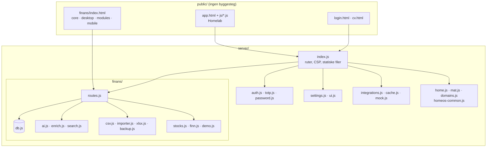

#  Utvikling

[← Til README](../README.md)

## Arkitektur



| Valg | Hvorfor |
|---|---|
| **Hono på Node 22** | Lite, raskt og med god støtte for `fetch`. Ingen byggesteg. |
| **SQLite (better-sqlite3)** | Én fil, enkel backup og synkrone spørringer. FTS5 gir fritekstsøk. |
| **Vanilla ES-moduler** | Ingen bundler. CSP-en (`script-src 'self'`) holder seg streng. |
| **Native apper** | Ekte Liquid Glass og Material 3, nøkkelring og Keystore, og kamera og WorkManager. |

Begrunnelsen for flere valg står i [DECISIONS.md](../DECISIONS.md).

## Kom i gang

```bash
npm install
MOCK_DATA=1 npm run dev     # http://localhost:3000, eksempeldata, starter på nytt ved endringer
npm test                    # node --test "test/**/*.test.js"
```

`MOCK_DATA=1` gir eksempeldata for alle integrasjoner, laster demo-økonomi i en tom database, og legger inn tre eksempeldomener. Alt fungerer uten nett.

## Mappestruktur

```
server/
  index.js            ruter, sikkerhetshoder, statiske filer, oppstart
  auth.js totp.js     brukere, sesjoner, enheter, rate limiting, TOTP og QR
  password.js         scrypt-hashing
  db.js               SQLite-skjema for homelab (users, sessions, devices, kv …)
  settings.js ui.js   integrasjonsoppsett og innstillinger per bruker
  integrations.js     Entur, MET, iCal, HA, T212, Sonarr/Radarr, RSS, NASA, CelesTrak
  home.js mat.js domains.js   Hjem, Matplan og Domener
  finans/             FinansHub (se tabellen under)
public/
  app.html js/ css/   homelab, én modul per fane (dash, study, space, home, mat, domains, net …)
  finans/             FinansHub: core.js (felles), desktop.js + modules.js, mobile*.js, sw.js
apps/android/ apps/ios/   native apper
deploy/               proxmox/install.sh, proxmox/update.sh, unraid/homelab-os.xml
scripts/              hash-password.js, reset-password.js
test/                 node --test
docs/                 dokumentasjon, bilder (images/) og ikoner (assets/)
```

| `server/finans/` | Ansvar |
|---|---|
| `db.js` | Tabeller (`fh_*`), migreringer, innstillinger og krypterte hemmeligheter |
| `routes.js` | Hele `/finans/api`, tilgangskontroll og tokens |
| `ai.js` | Ollama og Gemini med JSON-skjema, reserve og nytt forsøk |
| `enrich.js` | ✦ sammendrag, domene og logo per butikk |
| `search.js` | AI-søk: FTS5 og embeddings, med tallsjekk av svaret |
| `csv.js` / `importer.js` / `xlsx.js` | Bankimport, DNB-rensing, lesing og skriving av xlsx |
| `backup.js` | Eksport, SMB, kryptering og gjenoppretting |
| `stocks.js` / `finn.js` | Trading 212 og Finn-handler |
| `demo.js` | Eksempeldata |

## CI

| Workflow | Når | Hva |
|---|---|---|
| [`docker.yml`](../.github/workflows/docker.yml) | Push til `main` | Bygger og publiserer `ghcr.io/sebastiankristo/torskenes-verden` |
| [`mobile.yml`](../.github/workflows/mobile.yml) | Endringer i `apps/` | Android-APK, og iOS på macOS 15 og 26 (simulator og usignert `.ipa`) |

APK-en og `.ipa`-filen lastes ned under **Actions → Mobilapper → Artifacts**.

## Skjermbilder til dokumentasjonen

Bildene i `docs/images/` er tatt med Playwright mot en server med `MOCK_DATA=1`, i 1440×900 for desktop og i iPhone-, Pixel- og Pixel Fold-størrelse for mobil. De er lagret som WebP.

## Konvensjoner

- **Språk:** all tekst i grensesnittet er norsk bokmål.
- **Formater:** tall skrives `1 234,56`, minus `−` og dato `dd.mm.åååå`.
- **Beløp** lagres i øre (heltall) i FinansHub.
- **Hemmeligheter** forlater aldri serveren. Nye nøkler legges i `SCHEMA` (homelab) eller som `secret()` (FinansHub).
- **Integrasjoner:** en ny integrasjon skal ha en mock i `mock.js` og en forklaring i kortet når den ikke er satt opp.
