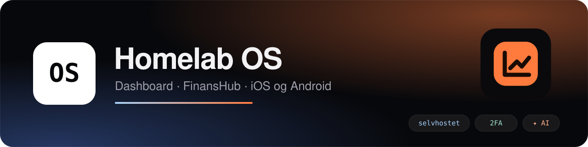
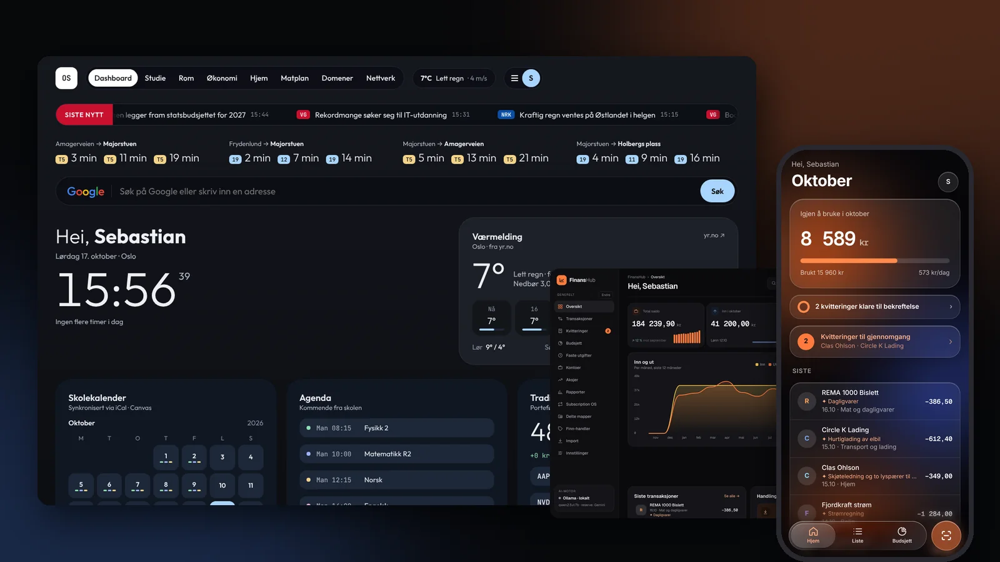

# Homelab OS – wiki

> [!TIP]
> Den samme dokumentasjonen finnes som nettside med søk, faner og mørkt tema: **[sebastiankristo.github.io/torskenes-verden](https://sebastiankristo.github.io/torskenes-verden/)**.

Homelab OS er et selvhostet «operativsystem» for hjemmet. Du får **Homelab-dashboardet** i nettleseren, assistenten **Glimt**, økonomiappen **FinansHub** på `/finans/`, **Media**, sorteringssystemet **Skjold Lab**, en **PWA**, og native apper for **iOS** og **Android** med Apple Watch og Wear OS. På hjemskjermen heter appen «Homelab». Alt kjører på én Node-server med SQLite, i Docker på din egen maskin.

## Hvor skal jeg begynne?

| Jeg vil … | Les |
|---|---|
| installere serveren for første gang | [Installasjon](Installasjon) |
| oppdatere uten å miste data | [Oppdatering og backup](Oppdatering-og-backup) |
| legge til familien og forstå hva de ser | [Brukere og personvern](Brukere-og-personvern) |
| få appen på telefonen | [Mobilapper](Mobilapper) |
| koble til Home Assistant, Google, Plex, Mybring og andre | [Integrasjoner](Integrasjoner) |
| sette opp lokale modeller for Glimt, kvitteringer og tale | [AI og tidsgrenser](AI-og-tidsgrenser) |
| styre Sonarr, Radarr og nedlastinger fra Media | [Integrasjoner → Media](Integrasjoner#media-sonarr-radarr-prowlarr-og-qbittorrent) |
| få LED-en over skuffen til å lyse i Skjold Lab | [Integrasjoner → WLED](Integrasjoner#wled-til-skjold-lab) |
| ha Kalender inni Homelab-appen på iPhone | [Mobilapper → Kalender i appen](Mobilapper#kalender-i-appen-iphone) |
| bruke FinansHub: import, kvitteringer, budsjett og Boliger | [FinansHub](FinansHub) |
| få skoletimeplanen og bursdager inn | [Kalender og Bursdager](Kalender-og-Bursdager) |
| spore pakker | [Sporing](Sporing) |
| dele posisjon og lage soner | [Familie og kart](Familie-og-kart) |
| lage egne skript, snarveier eller Home Assistant-sensorer | [API](API) |
| løse et problem | [Feilsøking](Feilsøking) |

## Modulene kort

| Modul | Hvor | Hva |
|---|---|---|
| **Hjem / Dashboard** | `/` | Avganger, vær, kalender, pakker, familie, nyheter, media og strøm |
| **Glimt** | Søkefeltet på Hjem, og Chat | Assistent på lokale modeller: svarer ut fra dine data, legger inn avtaler og gjøremål, faste oppgaver og Now Brief |
| **FinansHub** | `/finans/` | Kontoer, transaksjoner, kvitteringer, budsjett, faste utgifter, aksjer, abonnementer, Finn, Boliger |
| **Kalender** | Fanen Kalender (web), Mer → Kalender (app) | Skoletimeplan, prøver og frister, bursdager og Google |
| **Bursdager** | Fanen Bursdager, Mer → Bursdager | Bursdager med påminnelse, Google- og Home Assistant-synk |
| **Familie** | Fanen Familie | Posisjon, soner, helse, varsler |
| **Sporing** | Fanen Sporing | Pakker fra e-post, Finn og manuelt |
| **Vær** | Trykk på temperaturen | Timer, 7 dager, detaljark, Yr og Pent |
| **Gjøremål** (tidligere Huskeliste) | Mer → Gjøremål | Private og delte lister med sanntid og Home Assistant To-do |
| **Mat** | Fanen Mat | Ukeplan, oppskrifter, handleliste. Felles for husstanden. |
| **Media** | Media-siden på web og i appene | Sonarr, Radarr, Prowlarr og qBittorrent: bibliotek, interaktivt søk, nedlastinger, og styring av avspillinger i Plex og Jellyfin |
| **Skjold Lab** | Mer → Skjold Lab, og på Hjem | Sorteringsdatabase for deler: skap og skuffer, bilder, søk, forslag fra bilde, LED over skuffen, plukkliste og produkter |
| **Domener** | Fanen Domener | Cloudflare-statistikk, oppetid og DNS |

## Versjon

Wikien følger siste versjon. Den ligger under [Releases](https://github.com/SebastianKristo/torskenes-verden/releases), og [endringsloggen](https://github.com/SebastianKristo/torskenes-verden/blob/main/CHANGELOG.md) viser hva som er nytt.

> Alle skjermbilder er tatt med `MOCK_DATA=1`, så navn, tall og pakker er eksempeldata. Bildene er ikke oppdatert siden oktober 2026.
