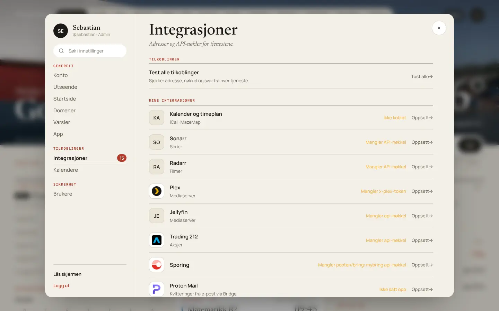

# Integrasjoner

Alle integrasjoner settes opp under **Innstillinger → Integrasjoner**, på web og i appene. Listen er gruppert (Smarthjem, Transport og pakker, Økonomi, AI, Informasjon og Annet). Hver integrasjon har en egen side med **Oppsett**, **Slik gjør du**, **Test** og **Fjern**.



**Hvem setter opp hva:**

| Type | Integrasjoner | Hvem |
|---|---|---|
| **Dine integrasjoner** | Plex, Jellyfin, Sonarr, Radarr, Kalendere (skole-iCal, Canvas), Trading 212, Bank og import, IMAP, Finn, Mybring, PostNord, ParcelsApp | Hver bruker for seg. Ingen ser andres verdier. |
| **Server (administrator)** | Home Assistant, Google Kalender-klienten, AI, qBittorrent, Prowlarr, Entur, Cloudflare, MET/Yr, Kart, Ikoner, Bilder | Bare admin endrer. Alle kan bruke dem. |

**Media-siden** bruker serverens oppsett for Sonarr, Radarr, Plex og Jellyfin, se [Media](#media-sonarr-radarr-prowlarr-og-qbittorrent). AI-tjenestene settes opp under **Innstillinger → AI → Tjenester**, og kalenderne under **Innstillinger → Kalender og gjøremål**. Integrasjoner viser status og lenke dit.

- Hemmelige verdier lagres kryptert på serveren og vises bare som «lagret». De sendes aldri tilbake til nettleseren eller appen.
- Verdier fra `.env` brukes som standard. Det du skriver i Integrasjoner, overstyrer dem. **Fjern** tar deg tilbake til `.env`-verdien.
- Adresser som `http://192.168.1.20:8123` må kunne nås **fra serveren** (containeren), ikke fra telefonen din.

**Innhold:**
[Home Assistant](#home-assistant) · [Google Kalender](#google-kalender) · [Skole-iCal og Canvas](#skole-ical-og-canvas) · [Plex og Jellyfin](#plex-og-jellyfin) · [Sonarr og Radarr](#sonarr-og-radarr) · [Media](#media-sonarr-radarr-prowlarr-og-qbittorrent) · [WLED til Skjold Lab](#wled-til-skjold-lab) · [Trading 212](#trading-212) · [IMAP og Proton Mail Bridge](#imap-og-proton-mail-bridge) · [Mybring](#mybring-posten-og-bring) · [PostNord](#postnord) · [ParcelsApp](#parcelsapp) · [Andre transportører](#dhl-ups-og-17track) · [Cloudflare](#cloudflare) · [Entur](#entur-ruter) · [MET/Yr](#metyr) · [AI](#ai-ollama-gemini-groq-og-roboflow) · [Unsplash og Pexels](#unsplash-og-pexels) · [MapTiler og Stadia](#maptiler-og-stadia)

---

## Home Assistant

Brukes til strøm på dashboardet, Huskeliste-synk med To-do-lister, og import og synk av bursdager fra en kalender.

1. I Home Assistant: klikk på **profilen din** nederst til venstre → fanen **Sikkerhet** → **Long-lived access tokens** → **Opprett token**. Kall det «Homelab» og kopier tokenet. Det vises bare én gang.
2. I Homelab: **Integrasjoner → Home Assistant**.
   - **Adresse:** `http://192.168.1.20:8123`
   - **Long-lived token:** tokenet fra steg 1
3. Trykk **Test**.

**Strømsensorer** (valgfritt, i `.env` eller under Innstillinger → Integrasjoner):

```bash
HA_SENSOR_POWER=sensor.power_now                  # effekt nå (W)
HA_SENSOR_ENERGY_DAILY=sensor.energy_daily        # forbruk i dag (kWh)
HA_SENSOR_PRICE=sensor.nordpool_kwh_oslo_nok      # strømpris
```

Finn entitets-ID-ene under **Innstillinger → Enheter og tjenester → Entiteter** i Home Assistant.

**Huskeliste og To-do:** når Home Assistant er koblet til, kan admin koble huskelistene til To-do-lister i Home Assistant. Synken går begge veier, for både lister og oppgaver.

**Bursdager:** under **Innstillinger → Kalendere → Home Assistant** velger du en kalender-entitet, trykker **Importer**, og kan lagre nye bursdager dit.

---

## Google Kalender

Brukes av **Bursdager** (egen kalender og bursdager fra kontakter) og av **Kalender**. Admin lager én OAuth-klient for hele serveren. Etterpå logger hver bruker inn med sin egen Google-konto.

> [!IMPORTANT]
> Google godtar bare **https med et offentlig domenenavn** som omdirigeringsadresse (eller `http://localhost`). En privat IP som `http://192.168.1.60:3000` gir feilen
> **«device_id and device_name are required for private IP»**. Bruk Cloudflare Tunnel eller en reverse proxy med domene, se [Installasjon](Installasjon#cloudflare-tunnel-anbefalt), og start Google-innloggingen fra den adressen.

### 1. Lag prosjektet og slå på API-et

1. Gå til [console.cloud.google.com](https://console.cloud.google.com) og lag et nytt prosjekt, for eksempel «Homelab».
2. **APIs & Services → Library**, søk etter **Google Calendar API** og trykk **Enable**.

### 2. Samtykkeskjermen (OAuth consent screen)

1. **APIs & Services → OAuth consent screen** (heter nå også *Google Auth Platform → Branding / Audience*).
2. **User type:** External. Fyll inn appnavn («Homelab») og e-post for støtte og utvikler.
3. **Scopes / Data access:** legg til
   - `.../auth/calendar.events`
   - `.../auth/calendar.readonly`
4. **Test users / Audience:** legg til **Google-kontoen til hver person** som skal logge inn. Mens appen er i modusen *Testing*, kan bare testbrukerne logge inn.

### 3. OAuth-klienten

1. **APIs & Services → Credentials → Create credentials → OAuth client ID**.
2. **Application type:** Web application.
3. **Authorized redirect URIs:**
   ```
   https://os.example.no/api/birthdays/google/callback
   ```
4. Trykk **Create** og kopier **Client ID** og **Client secret**.

### 4. Legg inn i Homelab (admin)

**Integrasjoner → Google Kalender:**

| Felt | Verdi |
|---|---|
| Klient-ID | `1234567890-abc….apps.googleusercontent.com` |
| Klienthemmelighet | `GOCSPX-…` |
| Omdirigerings-URI (valgfri) | `https://os.example.no/api/birthdays/google/callback`. Tomt felt betyr adressen serveren nås på. |

Trykk **Test tilkobling**. Testen sjekker at klient-ID og hemmelighet er gyldige.

Det samme kan settes i `.env` med `GOOGLE_CLIENT_ID`, `GOOGLE_CLIENT_SECRET` og `GOOGLE_REDIRECT_URI`.

### 5. Hver bruker logger inn

1. **Innstillinger → Kalendere → Google Kalender → Logg inn med Google**.
2. Velg Google-kontoen. Ser du «Google hasn't verified this app», trykk **Continue**. Det er din egen app.
3. Velg kalenderen bursdagene skal lagres i.

> [!TIP]
> Bruk alltid den offentlige adressen (`https://os.example.no`) når du logger inn med Google. Etter innloggingen sendes du tilbake til adressen du startet fra. I testmodus kan Google be deg logge inn på nytt etter 7 dager. Det unngår du ved å sette appen til *In production* under Audience.

---

## Skole-iCal og Canvas

Gir timeplanen, prøver og frister i **Kalender**. Settes opp per bruker under **Innstillinger → Kalendere** (eller Integrasjoner → Kalendere).

1. **Skole-iCal:** i skolens system (Visma InSchool, Outlook eller Teams), se etter «Abonner på kalender», «Publiser kalender» eller «Eksporter til kalender». Kopier adressen som slutter på `.ics`:
   ```
   https://skole.example.no/kalender/elev/abc123.ics
   ```
2. **Canvas-iCal (valgfritt):** i Canvas, gå til **Kalender → Kalenderfeed** nederst til høyre og kopier adressen. Den gir innleveringer og frister fra alle fagene:
   ```
   https://skole.instructure.com/feeds/calendars/user_abc123.ics
   ```
3. Lim inn adressene. `webcal://` gjøres om til `https://` automatisk.
4. **MazeMap campus-ID (valgfritt):** åpne skolen på use.mazemap.com og finn `campusid=…` i adressen. Da får hvert rom lenken «Finn rommet i MazeMap».
5. Trykk **Test tilkobling**. Testen henter kalenderne og teller hendelsene.

Kalenderen hentes på nytt hver time. Se [Kalender og Bursdager](Kalender-og-Bursdager) for hvordan hendelsene tolkes.

---

## Plex og Jellyfin

Gir kortet **Media** med «Spilles nå» og «Nylig lagt til», og styring av avspillinger (spill av, pause, stopp, neste, forrige, spoling og volum) fra web, apper, klokke og Android Auto. Per bruker.

**Plex:**
1. **Adresse:** IP-en til Plex-serveren med port 32400, for eksempel `http://192.168.1.20:32400`.
2. **X-Plex-Token:** åpne Plex i nettleseren, velg en film → **⋯ → Hent info → Vis XML**. Adressen som åpnes slutter med `X-Plex-Token=…`:
   ```
   http://192.168.1.20:32400/library/metadata/123?X-Plex-Token=AbCdEf123456
   ```
   Tokenet står også i `Preferences.xml` på serveren:
   ```bash
   grep -o 'PlexOnlineToken="[^"]*"' Preferences.xml
   ```
3. Trykk **Test**. Du ser servernavn, versjon og hvor mange som spiller nå.

**Jellyfin:**
1. **Adresse:** `http://192.168.1.20:8096`
2. **API-nøkkel:** **Kontrollpanel → Avansert → API-nøkler → +**. Kall den «Homelab».
3. **Brukernavn:** brukeren «Nylig lagt til» hentes for. Tomt felt bruker den første brukeren.
4. Trykk **Test**.

**Hvem kan styre avspillinger:** du styrer bare dine egne. Admin kobler hver Homelab-bruker til brukernavnet i Plex og Jellyfin under **Media → Avspilling → «Hvem kan styre avspillinger»**, og kan selv styre alle. Uten kobling kan en vanlig bruker bare se. Kommandoene går fra serveren, så tokenet og nøkkelen blir der. Plex-avspilleren må tillate fjernkontroll. **Stopp** virker likevel, fordi serveren avslutter strømmen.

---

## Sonarr og Radarr

Gir «Kommer ut» med serier og filmer de neste 14 dagene. Per bruker.

1. I Sonarr eller Radarr: **Settings → General → Security → API Key**. Kopier nøkkelen.
2. **Integrasjoner → Sonarr:** adresse `http://192.168.1.20:8989` og API-nøkkelen.
3. **Integrasjoner → Radarr:** adresse `http://192.168.1.20:7878` og API-nøkkelen.
4. Trykk **Test** på hver.

Antall dager kan endres med `SONARR_DAYS` og `RADARR_DAYS` i `.env`.

---

## Media: Sonarr, Radarr, Prowlarr og qBittorrent

**Media** samler Sonarr, Radarr, Prowlarr og qBittorrent på én side, på web og i appene: Oversikt, Kalender, Bibliotek og Nedlastinger.

- **Legg til** serier og filmer med kvalitet og overvåking.
- **Interaktivt søk** viser treffene fra indekserne, med seedere, størrelse og kvalitet, så du velger utgivelsen selv. Svarer ikke Sonarr eller Radarr, lastes det ned via Prowlarr.
- **Nedlastinger** fra qBittorrent med pause, kø, filer og slett.
- **Glimt** forstår for eksempel «legg til Severance i 4K».
- **Varsler** når noe er ferdig eller står fast.

**Oppsett, under Innstillinger → Integrasjoner → Media:**

| Tjeneste | Adresse (eksempel) | Du trenger |
|---|---|---|
| Sonarr | `http://192.168.1.20:8989` | API-nøkkel (Settings → General → Security) |
| Radarr | `http://192.168.1.20:7878` | API-nøkkel |
| Prowlarr | `http://192.168.1.20:9696` | API-nøkkel |
| qBittorrent | `http://192.168.1.20:8080` | Brukernavn og passord til Web UI |

Trykk **Test** på hver. qBittorrent og Prowlarr er serveroppsett som bare admin endrer.

- **Nøklene blir på serveren.** Serveren er mellomledd for alle kall, og nøkler og passord sendes aldri til nettleseren eller appene.
- **Hvilket oppsett brukes:** Media bruker eierens verdier for Sonarr, Radarr, Plex og Jellyfin. Mangler de, brukes verdiene til den første administratoren som har lagt inn både adresse og nøkkel.
- **Tilgang:** admin har alltid tilgang. Andre brukere ser Media når admin har gitt dem tilgang. Bare admin kan slette, endre profiler og overvåking og legge til indeksere.
- **Starter ikke nedlastingen?** Innstillinger → Media → Diagnostikk viser hvilket ledd som feiler: kommandoen, indekserne, nedlastingsklienten eller qBittorrent. Se [docs/media-nedlasting-50.md](https://github.com/SebastianKristo/torskenes-verden/blob/main/docs/media-nedlasting-50.md).

---

## WLED til Skjold Lab

**Skjold Lab** er sorteringsdatabasen for deler: skap med rader og skuffer, deler med bilder, antall og tags, søk som svarer «Hovedskap · Rad 4 · Skuff 2», plukkliste og produkter med stykkliste. Selve Skjold Lab trenger ingen integrasjon. Den er per bruker, og du finner den under Mer og på Hjem.

Med en adresserbar LED-stripe over hver skuffrad kan Skjold Lab tenne LED-en over skuffen der delen ligger (**💡 Vis i skapet**). Det styres av en ESP32 med [WLED](https://kno.wled.ge/). Du trenger ikke skrive egen kode.

1. **Bygg og koble:** innkjøpsliste, koblingsskjema og strømberegning står i [tools/skjoldlab-led/README.md](https://github.com/SebastianKristo/torskenes-verden/blob/main/tools/skjoldlab-led/README.md).
2. **Installer WLED** på ESP32 fra install.wled.me, koble den til hjemmenettet og gi den en fast adresse, for eksempel `192.168.1.50`.
3. **Slå på strømgrensen i WLED** (2000 mA). Den skal alltid være på.
4. I Skjold Lab: **Skap → velg skapet → 💡 Sett opp lys over skuffene**. Skriv inn WLED-verten og trykk **Sjekk**.
5. Fyll ut radene, trykk **Test alle**, og bruk **Kalibrer …** hvis en LED står over feil skuff. **Feilsøk LED** tenner hele stripa rødt og så én LED blått, og sier hvor feilen ligger.

- Standard er 30 sekunder lys, og så går stripa tilbake til det den viste før. I plukklista kan opptil 20 skuffer lyse samtidig, hver del i sin farge.
- **Serveren snakker bare med enheter i hjemmenettet:** en privat IP-adresse, et `.local`- eller `.lan`-navn, eller et lokalt navn uten punktum. Offentlige adresser blir avvist med vilje.
- **Ikke åpne WLED mot internett.** WLED har ingen innlogging som standard.
- **3D-print:** skapet, LED-kanalene og elektronikkboksen ligger som ferdige STL- og 3MF-filer på releasen [«skjoldlab3d»](https://github.com/SebastianKristo/torskenes-verden/releases/tag/skjoldlab3d). Modellen og målene er forklart i [tools/skjoldlab3d/README.md](https://github.com/SebastianKristo/torskenes-verden/blob/main/tools/skjoldlab3d/README.md). Mål hylla di før du printer noe stort.
- **✦ Foreslå** og **Finn bilde** slås av og på under Innstillinger → Moduler → Skjold Lab. Gjenkjenningen kjører på den lokale modellen. Bildesøket sender bare navnet på delen.

---

## Trading 212

Gir **Aksjer** i FinansHub (portefølje, ordrer og utbytte) og et sammendrag på dashboardet. Per bruker.

1. Logg inn på [app.trading212.com](https://app.trading212.com) i **samme konto og miljø** (Live eller Demo) som du vil hente fra.
2. **Innstillinger → API (Beta) → Generate API key**. Gi **bare lesetilgang**: account, portfolio, history:orders og history:dividends. Lås den gjerne til serverens offentlige IP.
3. Kopier **Key ID** og **Secret**.
4. **Integrasjoner → Trading 212:** lim inn nøkkelen og secret, og skriv `live` eller `demo` under Miljø.
5. Trykk **Test**.

---

## IMAP og Proton Mail Bridge

Henter kvitteringer fra e-post inn i FinansHub, og Finn-e-poster inn i Finn-handler og Sporing. Per bruker.

### Proton Mail (krever betalt plan)

Proton har ingen vanlig IMAP-server. Tilgangen går gjennom **Proton Mail Bridge**, som følger med i `docker-compose.yml` (profilen `mail`).

```bash
cd /opt/homelab-os
docker compose --profile mail run --rm protonmail-bridge init
# I Bridge-konsollen:
>>> login        # Proton-adresse, passord og 2FA
>>> info         # viser brukernavn og Bridge-passord – kopier dem
>>> exit
docker compose --profile mail up -d
```

Fyll ut **Integrasjoner → Kvitteringer på e-post (IMAP)**:

| Felt | Verdi |
|---|---|
| Vert | `protonmail-bridge` |
| Port | `143` |
| Sikkerhet | `starttls` |
| Brukernavn | Proton-adressen din, slik `info` viser den |
| Passord | **Bridge-passordet** fra `info`, ikke Proton-passordet |
| Mappe | `Folders/Kvitteringer` |

Trykk **Test tilkobling**. Lag gjerne et filter i Proton som flytter kvitteringer til mappen «Kvitteringer». Leste e-poster flyttes til `Folders/Kvitteringer/Lest` når den mappen finnes.

Bridge-portene publiseres ikke. Bare containere i samme compose når den. Ta med `./proton` i backupen.

### Gmail og andre

| Felt | Gmail | Outlook |
|---|---|---|
| Vert | `imap.gmail.com` | `outlook.office365.com` |
| Port | `993` | `993` |
| Sikkerhet | `tls` | `tls` |
| Passord | Et **app-passord** (Google-konto → Sikkerhet → App-passord, krever 2-trinns) | App-passord |
| Mappe | `Kvitteringer` (Gmail-etikett) | `Kvitteringer` |

### Finn

Under **Integrasjoner → Finn** skriver du navnet på mappen der Finn-e-poster havner, for eksempel `Folders/Finn`. Den bruker samme e-postkonto som kvitteringene.

---

## Mybring (Posten og Bring)

Gir automatisk status for pakker med Posten og Bring. Per bruker.

1. Lag en gratis bruker på [mybring.com](https://www.mybring.com).
2. Gå til **Mybring → Innstillinger → API** og lag en API-nøkkel.
3. **Integrasjoner → Mybring:**
   - **Mybring-bruker:** e-postadressen du logger inn med
   - **API-nøkkel:** nøkkelen fra steg 2
4. Trykk **Test**.

---

## PostNord

**Virker uten nøkkel.** Uten nøkkel får pakken en sporingslenke til postnord.no/pakkesporing, og status hentes fra PostNords offentlige sporingsside. Det er ikke et offisielt API, så ParcelsApp er reserven.

Vil du bruke det offisielle API-et, trenger du et **organisasjonsnummer**:

1. Lag en konto på [developer.postnord.com](https://developer.postnord.com) med organisasjonsnummeret.
2. Lag en API-nøkkel for **Track and Trace**.
3. Lim den inn under **Integrasjoner → PostNord → API-nøkkel (valgfri)**.

Har du ikke organisasjonsnummer, la feltet stå tomt.

---

## ParcelsApp

Siste reserve når ingen annen kilde kjenner sendingen. Per bruker.

1. Lag en API-nøkkel på [parcelsapp.com/developers](https://parcelsapp.com/developers/console/api-keys).
2. Lim den inn under **Integrasjoner → ParcelsApp**.

Gratisplanen har **3 oppslag i måneden**. Derfor brukes ParcelsApp bare når **du** legger til en pakke eller trykker Oppdater, aldri i bakgrunnen. Serveren teller oppslagene.

---

## DHL, UPS og 17TRACK

Disse nøklene ligger i sporingsoppsettet (Innstillinger → Integrasjoner → Sporing på web) og i `.env`:

| Tjeneste | Hvor | `.env` |
|---|---|---|
| DHL | developer.dhl.com → app med «Shipment Tracking – Unified». Bruk API Key. | `DHL_API_KEY` |
| UPS | developer.ups.com → app med produktet «Tracking». Client ID og Client Secret. | `UPS_CLIENT_ID`, `UPS_CLIENT_SECRET` |
| 17TRACK | api.17track.net. Dekker FedEx, GLS, DB Schenker, Helthjem, Budbee, Instabox og flere. | `TRACK17_API_KEY` |

---

## Cloudflare

Gir **Domener**: trafikk, besøk per land, ytelse, sikkerhet, DNS og oppetid. Serveroppsett.

1. Cloudflare → **My Profile → API Tokens → Create Token → Custom token**.
2. Gi tilgangene (alle **Read**): Zone, DNS, Analytics, Registrar og Firewall Services.
3. Velg **Zone Resources → Include → All zones** (eller bestemte domener).
4. **Integrasjoner → Cloudflare:** lim inn tokenet, og eventuelt det første domenet, for eksempel `example.no`.
5. Trykk **Test**. Flere domener legges til under Domener → Administrer domener.

Tunnel-tokenet (`CLOUDFLARE_TUNNEL_TOKEN`) er noe annet, se [Installasjon](Installasjon#cloudflare-tunnel-anbefalt).

---

## Entur (Ruter)

Avganger i sanntid. **Ingen nøkkel trengs.** Serveroppsett.

1. Finn stopp-ID-en (NSR) på [stoppested.entur.org](https://stoppested.entur.org). Søk opp holdeplassen, og bruk tallet i `NSR:StopPlace:58381`.
2. **Integrasjoner → Entur:** skriv én strekning per linje:
   ```
   Majorstuen (58381) > Holbergs plass (63280)
   Frydenlund (6258) > Majorstuen (58381)
   ```
3. **Antall avganger:** for eksempel `3`.

I appene kan hver bruker også søke opp egne stopp under Avganger, uten oppsett. `ENTUR_CLIENT_NAME` i `.env` sendes som identifikasjon til Entur. Bruk noe som `fornavn-homelab`.

---

## MET/Yr

Værmeldingen. **Ingen nøkkel trengs.** Serveroppsett.

- **Integrasjoner → MET / Yr:** sted, breddegrad og lengdegrad, for eksempel `Oslo`, `59.9139` og `10.7522`. Høyreklikk på et sted i Google Maps for å få koordinatene.
- MET krever en User-Agent med kontaktinfo. Sett `MET_USER_AGENT=homelab-dashboard/1.0 din@epost.example` i `.env`.

Værsiden i appene bruker i tillegg Open-Meteo via serveren. Hver bruker kan legge til egne steder.

---

## AI: Ollama, Gemini, Groq og Roboflow

AI driver Glimt, leser kvitteringer, svarer på AI-søk, lager sammendrag og velger kategorier. Serveroppsett. Tjenestene settes opp under **Innstillinger → AI → Tjenester**, med adresse, nøkkel og test i én rad. FinansHub har sin egen AI-side under Innstillinger. Se også [AI og tidsgrenser](AI-og-tidsgrenser).

> [!IMPORTANT]
> **Kvitteringer leses bare lokalt.** Gemini, Groq og Roboflow får aldri kvitteringsbilder. Start derfor med [Ollama](#ollama-lokalt-ingenting-forlater-huset). Gemini og Groq er valgfrie tillegg til annet enn kvitteringer, og med «Finansdata forlater aldri huset» på sendes ingen finansdata til dem.

### Gemini (valgfritt)

1. Gå til [aistudio.google.com](https://aistudio.google.com) → **Get API key → Create API key**. Gratisnivået holder for vanlig bruk.
2. Lim nøkkelen inn under **Gemini API-nøkkel** og trykk **Test**.

**Flere nøkler som reserve:** under **FinansHub → Innstillinger → AI og tolkning** legger du inn flere nøkler i rekkefølge. Lag dem gjerne i ulike Google-prosjekter, siden kvoten gjelder per prosjekt.
- Når en nøkkel svarer at kvoten er brukt opp (429) eller er ugyldig, brukes neste nøkkel med en gang.
- En nøkkel som er brukt opp, hviler til kvoten nullstilles: ett minutt for minuttkvote, neste døgnskifte hos Google for dagskvote.
- Hver nøkkel viser status, og har knappene Test, Prøv igjen, ▲ og Fjern. Bare de fire siste tegnene vises.

### Groq (raskt, gratis nivå)

1. [console.groq.com](https://console.groq.com) → **API Keys → Create API Key**.
2. Lim inn under **Groq API-nøkkel** og trykk **Test**.

Groq er en valgfri sky-motor for tekstsvar. Den brukes ikke til kvitteringer.

### Ollama (lokalt, ingenting forlater huset)

**På en Mac mini M4 med 16 GB:**

> [!WARNING]
> **Ollama skal aldri eksponeres mot internett.** Ollama har ingen innlogging. La den bare lytte på hjemmenettet, og lag aldri portviderekobling, tunnel eller Cloudflare-rute til port 11434. Bare Homelab-serveren skal snakke med den.

1. Installer Ollama fra [ollama.com](https://ollama.com/download).
2. La Ollama lytte på hjemmenettet, og start den på nytt:
   ```bash
   launchctl setenv OLLAMA_HOST 0.0.0.0
   # Avslutt Ollama fra menylinjen og åpne den igjen
   ```
3. Sjekk fra serveren: `curl http://192.168.1.30:11434/api/tags`
4. **Innstillinger → AI → Tjenester → Ollama:** adressen `http://192.168.1.30:11434`, og trykk **Test**.
5. **Innstillinger → AI → Modeller:** trykk **Installer** på modellene du vil ha. Fremdriften vises.

**Anbefalte modeller for 16 GB** (modellen må få plass sammen med macOS, og rundt 10–11 GB er trygt):

| Oppgave | Modell | Størrelse | Merknad |
|---|---|---|---|
| Tekst, Glimt og tolkning av kvitteringer | `qwen3:8b` | 5,2 GB | Standard for all tekst |
| Bilder | `qwen2.5vl:7b` | 6,0 GB | Standard for bilder. Leser kvitteringer når ingen OCR er tilgjengelig. |
| Kvitteringer og tekst | `gemma3:12b` | 8,1 GB | Leser bilder og skriver godt norsk. Litt tregere. |
| Vektorsøk (embeddings) | `nomic-embed-text` | 0,3 GB | Til AI-søk med vektorer |
| Lite og raskt | `gemma3:4b` | 3,3 GB | Mindre nøyaktig på kvitteringer |

`qwen2.5vl:32b` og `gemma3:27b` er merket «for stor for 16 GB». Andre modeller fra ollama.com/library kan installeres ved navn.

Du kan velge egen modell per oppgave under AI → Oppgaver.

**Flere lokale tjenester (valgfritt, på en Mac i huset):** Mac-OCR med Apple Vision for kvitteringer, NB-Whisper for tale til tekst på norsk, VoxCPM for egne stemmer og oMLX som alternativ motor til Ollama. Hver av dem har et installasjonsskript under `tools/` i repoet, og adresse og nøkkel legges inn under AI → Tjenester. Se [AI og tidsgrenser](AI-og-tidsgrenser#lokale-tjenester-på-en-mac).

### Roboflow (valgfritt)

Roboflow kan lese strekkoder. Beskjæring av kvitteringer med Roboflow er fjernet, fordi kvitteringsbilder aldri sendes til en sky-tjeneste.

1. Lag en konto på [roboflow.com](https://roboflow.com) og kopier API-nøkkelen under **Settings → API Keys**.
2. Lim inn nøkkelen under AI-oppsettet og trykk **Test**.

---

## Unsplash og Pexels

Gir Oslo-foto til bakgrunnen «Oslo». Serveroppsett. Uten nøkler brukes de medfølgende bildene og egne opplastinger.

- **Unsplash:** lag en gratis app på [unsplash.com/developers](https://unsplash.com/developers) og kopier **Access Key**. Fotografen krediteres automatisk.
- **Pexels:** lag en gratis nøkkel på [pexels.com/api](https://www.pexels.com/api/). Den brukes når Unsplash mangler eller ikke gir treff.

Lim dem inn under **Integrasjoner → Bilder (Unsplash og Pexels)** og trykk **Test**.

---

## MapTiler og Stadia

Kartet bruker **Kartverket topo** som standard, uten nøkkel. Kartflisene går gjennom serveren (`/tiles/...`) og caches i 30 dager.

- **MapTiler:** gratis konto på [cloud.maptiler.com](https://cloud.maptiler.com) → **Account → API keys**. Lim inn under **Integrasjoner → Kart**.
- **Stadia Maps:** gratis konto på [client.stadiamaps.com](https://client.stadiamaps.com), og lag en API-nøkkel.

Trykk **Test**. Når nøkkelen er satt, blir MapTiler og Stadia Maps valgbare kartstiler ved siden av Kartverket topo og CARTO.
